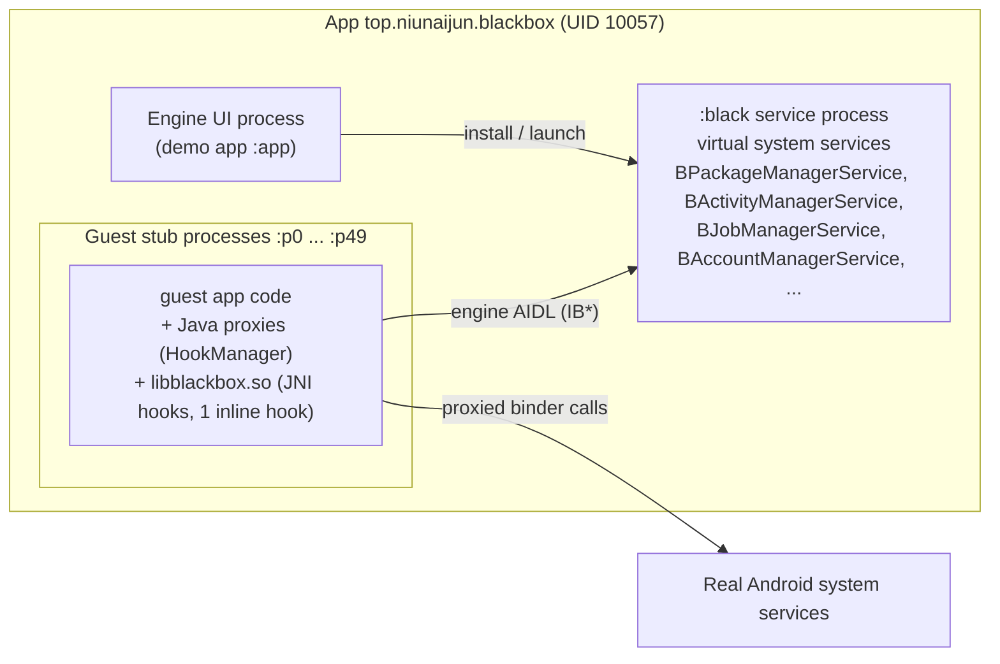
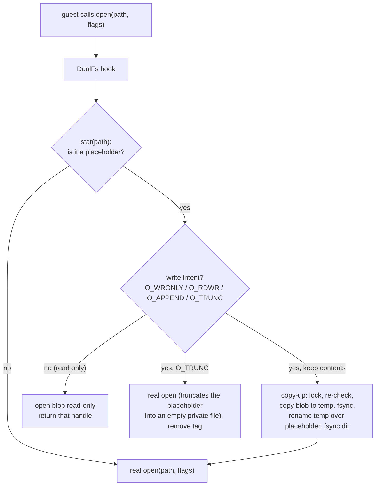
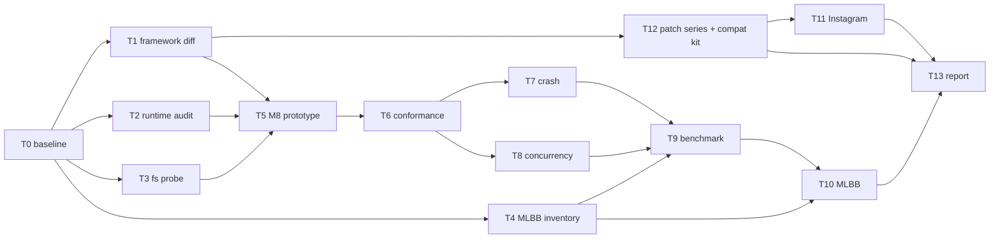

# DualApp Phase 0b engineering plan

Date: 2026-11-13. Device: Samsung Galaxy S25+ (SM-S936B), Android 17 (API 37), One UI 9.

**Status: plan only.** Nothing in this document has been built or run yet. Updated 2026-11-14 with six leads from another team's MLBB container notes (Section 2.1). It follows the Phase 0 NO-GO in [`phase0/REPORT.md`](phase0/REPORT.md) and builds on the storage design in [`plan.md`](plan.md) Section 9.

**Evidence labels**

| Label | Meaning |
|---|---|
| **[Measured]** | Measured on the phone in Phase 0 |
| **[Audit]** | Read in the NewBlackbox source (commit `89b5983` plus patch 0001) for this plan |
| **[Design]** | Proposed in this plan |
| **[Hypothesis]** | Believed but not checked; a task below checks it |
| **[Lead]** | Reported in another team's notes (a rooted VirtualApp fork running MLBB on Android 14). A strong lead, not verified on our phone or engine (Section 2.1). |

**Words used**

| Term | Meaning |
|---|---|
| **Instance** | One cloned copy of an app inside the engine (a NewBlackbox virtual "user"). |
| **Pool** | The single shared copy of an app's big resource files. |
| **Blob** | One file in the pool, named by the SHA-256 hash of its content. |
| **Copy-on-write (CoW), copy-up** | When an instance is about to change a shared file, it first gets its own private copy. The shared copy never changes. |
| **Hook** | Engine code placed in front of a system function (for example `open`) that can change what the function does. |
| **Placeholder** | (New in this plan.) A private, empty-but-correctly-sized file that stands in for a shared file inside one instance (Section 4.3). |

---

## 1. Executive summary

Phase 0 ended **NO-GO** for two reasons:

1. **Shared files can be destroyed.** Every instance runs under one Linux user ID, so a guest app can `chmod` a "read-only" shared file and overwrite it for every instance [Measured].
2. **The engine is fragile on Android 17.** It crashed every app that binds a background service until we wrote patch 0001 [Measured].

Phase 0b is a short, measured follow-up that decides whether Phase 1 can start. Every question it asks has a numeric pass/fail line (Section 7).

**What the source audit found** (Section 3):

- **The engine has almost no native file layer.** File redirection works because:
  - apps receive already-redirected folder paths from Java;
  - Java file calls pass through a Java proxy (`OsStub`).

  The two native file hooks in the source (`FileSystemHook`, `AntiDetection`) look up libc functions but never install a hook. So the copy-on-write layer must be **built new**, not bolted onto an existing hook.
- **Much of the spoofing and anti-detection code is inactive.**
  - Natively, exactly one hook runs: `__system_property_get` returns Pixel 6 / Android 12 values.
  - Several Java proxies wrap nothing.
  - This plan keeps all of it unchanged and records what each piece really does.
- **Three more framework callbacks are implemented the way Android 17 just broke** (`IIntentReceiver`, `IAccountAuthenticatorResponse`, `IAccountManagerResponse`).
  - The public Android source (AOSP `main`, checked 2026-11-13) does not yet show Android 17's `IBinderSession` change.
  - So only the phone's own `framework.jar` can tell us what else changed.
- **No Keystore or push-notification handling.**
  - All clones share one Android Keystore, so two clones of the same app can overwrite each other's keys.
  - Push registrations go out under the engine's identity.
  - Both matter for Instagram.

**Leads from another team** (added 2026-11-14, Section 2.1). Notes from a rooted VirtualApp fork running MLBB on Android 14 point to six MLBB-specific traps:

- MLBB caches **absolute paths** in its private preferences, so copying one instance's metadata into another would plant the wrong paths. Index mode M-c now needs path rewriting or is dropped.
- **Login data** sits inside `files/dragon2017/`, the folder we plan to share. It gets a hard exclude.
- MLBB **unpacks** payloads from its APK separately from downloading. T10 measures "skips unpack" and "skips download" separately.
- A **Samsung-added** framework method crashed their engine the way Android 17 crashed ours. T1 now scans OEM additions too, and our audit found a matching silent `handleNewIntent` bug in NewBlackbox.
- **Swipe from Recents, then relaunch**, started two game engines and then crashed. T10 adds that lifecycle test.
- **Device-identity files** must stay private per instance. This links to ban risk and to the engine's shared `ANDROID_ID`.

**The proposed storage design** (Section 4) changes the Phase 0 design in one key way: **instances never get a filesystem path to a shared blob.**

- Each instance keeps a private **placeholder** for every shared resource. It has the right size and date but stores no data (a "sparse" file).
- When the app opens a placeholder **to read**, the hook hands it a read-only handle to the pool blob.
- When the app opens it **to write**, the hook first replaces the placeholder with a full private copy.

If a hook is ever missed, the damage lands on that instance's own placeholder, never on the pool. Phase 0's `chmod` attack becomes harmless by design: `chmod` on a placeholder only changes the instance's own empty file. This design is called **M8 (placeholder overlay)** and replaces M1 (symlink farm) as the main candidate. A separate-UID pool (**M9**) is evaluated only as a small feasibility spike, as optional hardening.

**Phase 0b has 14 tasks** (T0–T13, Section 5), about 3–4 weeks of work:

| Tasks | What they do |
|---|---|
| T0–T4 | Read-only or near read-only checks: framework diff, runtime audit, filesystem probe, MLBB file inventory |
| T5 | Build the M8 prototype into the engine as a separate native module with one small hook-in point |
| T6–T9 | Attack, crash, concurrency and 1.5 GB synthetic benchmark tests |
| T10 | MLBB resource-sharing test. It proves or disproves skipped downloads by measuring per-file rewrites and bytes, **not** by checking that seeded files exist. |
| T11 | Instagram session, lifecycle and push test. Login only with your approval and a throwaway account. |
| T12 | Android 17 patch series and a compatibility test kit |
| T13 | Report and decisions |

**Phase 1 becomes GO** (Section 11) only if all of these hold:

- the pool survives every attack and crash test with zero corruption;
- no hook bypasses are seen;
- overhead stays within 10%;
- MLBB runs on placeholder-backed files;
- **either** MLBB skips seeded downloads (L2), **or** a rolling-harvest mode keeps the extra disk a second copy needs under 3 GB.

With 16–17 GB free on this phone, "share only after re-downloading 12 GB" (L1 only) does not fit.

---

## 2. Phase 0 findings relevant to Phase 0b

| # | Phase 0 finding | Evidence | What it means for Phase 0b |
|---|---|---|---|
| F1 | Instances are isolated: preferences, SQLite, internal and external files; survives force-stop and reboot | [Measured] `canary-isolation-newblackbox.txt` | Not retested. Canary runs only as a regression check after engine updates. |
| F2 | All guests run as one Linux user (u0_a57 / 10057) in SELinux domain `untrusted_app_27` | [Measured] `guest-probe.txt` | The kernel cannot tell instances apart. Pool safety must come from **not exposing pool paths** (M8) or from **a second UID** (M9). |
| F3 | A `0444` shared file can be `chmod`-ed and overwritten by any guest, from Java, in both users | [Measured] storage T3 + guest probe | This attack is the **first** test the new design must survive (T6 case C3). |
| F4 | Hard links, `chattr +i` and fs-verity are all denied | [Measured] storage T6 | Not retested. No kernel-enforced immutability exists for one UID. |
| F5 | Symlinks can be created in internal storage and are followed | [Measured] storage T1 | M1 still technically works but fails F3. Symlinks on the **external** path were never tested. |
| F6 | No kernel copy-on-write; engine copy-up of 64 MiB took 109 ms; readers during copy-up stayed consistent | [Measured] storage T7, T8 | Copy-up cost is acceptable. Kept as a regression in T6–T8. |
| F7 | `kill -9` during copy-up leaves the original intact plus a partial temp file | [Measured] storage T9 | Temp files must live in a dedicated directory and be cleaned at start (T7). |
| F8 | A hash scrub detects corrupted blobs | [Measured] storage T10 | Reused in the T7 integrity case. |
| F9 | MLBB assets are byte-identical across instances (300/300 sampled files) | [Measured] `mlbb-seeded/summary.txt` | De-duplication is valid. T4 extends the check to every overlapping file. |
| F10 | Each MLBB copy holds ~12 GB in `files/dragon2017` (host: 12.3 GB) | [Measured] | This is the size the pool must save. |
| F11 | **MLBB guest data lives on the engine's external path** (`/storage/emulated/0/Android/data/top.niunaijun.blackbox/files/blackbox/storage/emulated/<N>/Android/data/com.mobile.legends`) | [Measured] `mlbb-monitor.sh` paths | Phase 0's storage tests ran only in **internal** storage. T3 must test the CoW mechanism on the external filesystem. |
| F12 | L2 partial: 47,069 seeded `img/` files were left untouched for 4 min, but MLBB never reached `img/` in that time | [Measured] | T10 uses **order-aware seeding** (seed what MLBB downloads first) and per-file evidence. |
| F13 | MLBB downloads at 1.2–1.9 MB/s; a full download takes 2–3 h | [Measured] | T10 is designed so it does not need a full download. |
| F14 | Android 17 added `IServiceConnection.connected(ComponentName, IBinder, IBinderSession, boolean)`; patch 0001 fixed the crash loop | [Measured] | T1 checks the rest of the framework against the engine. T12 turns 0001 into a maintained patch series. |
| F15 | Guests see the real `Build.MODEL` (SM-S936B), not the engine's Pixel 6 values | [Measured] `canary-isolation-newblackbox.txt` | The spoofing is narrower than assumed (Section 3.7). T2 measures exactly who sees what. |
| F16 | 16–17 GB free; the MLBB clone holds ~2.3 GB | [Measured] | Caps: pool ≤ 2.5 GB, MLBB downloads ≤ 2 GB per run, stop if free space < 4 GB. |
| F17 | Canary cold start shows no penalty; guest memory +35% PSS | [Measured] | Not retested. MLBB load time is still unmeasured (T10 step 13). |
| F18 | Play Protect rejects the engine as harmful | [Measured] | Every engine update install needs you to handle Play Protect. |
| F19 | Instagram metadata only (455.0, targetSdk 37, 9 splits); runtime untested | [Measured] | T11. |
| F20 | MLBB network was measured device-wide (`/proc/net/dev`) | [Measured] method | T0/T10 add per-UID counters so other apps don't pollute the numbers. |

**Not repeated in Phase 0b:** the isolation suite (F1), the hard-link, chattr and fs-verity checks (F4), Canary performance (F17), the 300-file identity sample (F9), and reproducing the Android 17 `IServiceConnection` crash (F14).

### 2.1 Leads from another team's MLBB container notes [Lead]

Another team ran MLBB in a **rooted** VirtualApp fork on **Android 14**. Their setup differs from ours (root, a different engine, older Android), so each point below is a strong lead to check, not a fact about our phone. You approved adding them on 2026-11-14.

| # | Lead | Why it matters to us | Where this plan uses it |
|---|---|---|---|
| N1 | MLBB stores **absolute paths** in its private preferences: `__SharedPreference__.xml` keys `__Extracted_PersistentFilesPath__`, `__SDKOverrideAssetsPath__` and `moba_loading_bg`, plus encoded Unity PlayerPrefs values `IphonePath` and `RWPathRec`. After their container was renamed, the game logged the mismatch but kept using the cached old path. It surfaced as a misleading "Not enough space" error (SevenZip ErrorCode 1804 = `ENOENT`). | Each NewBlackbox instance's paths contain its user number (`.../storage/emulated/<N>/...`). Copying A's metadata or preferences into B would plant A's paths in B. That means wrong-path failures or, worse, **B writing into A's tree**. All instances share one UID, so the kernel would allow it, and isolation would break silently. Moving guest data later (the T3 internal-storage fallback) would break existing instances the same way. | T3 decision, T4 step 7 (path scan), T10 steps 8 and 10 (M-b/M-c need path rewriting or are dropped), Section 7, risks 25–26 |
| N2 | Login data lives in `files/dragon2017/login_data/` (`login_auth_cache`, the `login_auth_md5` pair, `native_login`, `check_upgrade_cache`), **inside** the folder we plan to share. | The share list only includes `assets/**`, but a broadened glob or a harvest bug could still pool login data. | T4 step 8, the Sharing Profile hard exclude `files/dragon2017/login_data/**` (also enforced inside `dualfs-tool harvest`), Section 7 |
| N3 | MLBB has a separate **unpack** step: it extracts `Resources*.dat` / `libResources0.so` payloads from its APK with 7-Zip, before or alongside the CDN download. The preferences `__Extracted_UUID__`, `__First_Start_After_Extracted__` and `__Resources_UnzipTimestamp__` decide whether it re-extracts. | "Skips download" and "skips unpack" are different results. A fresh instance may skip downloads but still unpack, which costs time and disk but no network. | T4 step 9, T10 step 8 (two separate outcomes), Section 7 |
| N4 | A **Samsung-specific** `AbstractMethodError` on `ClientTransactionHandler.handleCoreStatesChanged(Bundle)` (the same bug class as our patch 0001), and an Android 12+ `handleNewIntent` failure to find the `ActivityClientRecord`. | Our audit found a twin of the second: NewBlackbox's `BActivityThread.handleNewIntent` (line 1122) only knows the pre-Android-12 reflection forms, so on Android 17 it probably drops new intents silently [Audit + Hypothesis]. OEM-added methods never show up in an AOSP diff. | Section 3.8, T1 steps 3–4, T12 kit case K9, Section 7, risk 27 |
| N5 | After **swipe from Recents → relaunch**, their container started two Unity players: two `MobaGameUnityActivity` requests about 1 s apart, each creating a new task. Then came a native deadlock or a Scudo crash in `libnativelogin.so`. Their fix is unverified. | This is an ordinary user action that could crash MLBB in our engine too. It may be linked to the dropped new intent above. | T10 step 14 (Recents test), Section 7, G3b, risk 28 |
| N6 | Per-device **identity files** must stay private per instance: `files/.DNA_`, `.DNA_FLAG`, `.gp_uuid`, `INSTALLATION`, `AdjustAttribution`, `__app_uuid__`, and the preferences `snssdk_openudid.xml`, `DeviceSettings.xml` and `Cdid.xml`. | Shared or copied identity files would make two accounts look like one device install, which is a ban-risk signal. It also links to two engine findings: all clones probably read the engine's single `ANDROID_ID` (Section 3.4), and VirtualSpoof shows an inconsistent device (Section 3.7). | T2 step 2 (`ANDROID_ID` per instance), T4 step 8, T10 step 8, Section 7, risk 29 |

---

## 3. NewBlackbox architecture audit

Scope: a read-only audit of commit `89b5983` (the version Phase 0 built and installed) plus patch 0001. No engine source was modified for this plan. For each feature, this section records its **real technical role** and **status**:

- **Active:** runs today.
- **Conditional:** runs only when a setting is on.
- **Inactive:** the code exists but does nothing at runtime.

**Owner directive:** nothing is removed or disabled. Section 3.10 lists every change this plan proposes and its consequences.

### 3.1 Big picture [Audit]



| Module | Role |
|---|---|
| `:Bcore` | The engine library: virtual system services, Java proxies, native library `libblackbox.so` |
| `:black-reflection` + `:compiler` | Annotation-driven mirrors of hidden Android classes. There are **220** mirror classes in `black.*` (`@BClassName`), and the annotation processor generates `BR*` accessors from them. |
| `:app` | Demo UI (users as pages, the **+** button, the hide-root setting) |

### 3.2 Cloning and install flow [Audit]

Entry point: `BPackageManagerService.installPackageAsUser(file, option, userId)` → `installPackageAsUserLocked` (`BPackageManagerService.java:648`).

1. Create the virtual user if it doesn't exist (`BUserManagerService`).
2. For a content-URI install, copy the APK into `blackbox/cache/`.
3. Parse it (`getPackageArchiveInfo`, then the engine's `PackageParser`).
4. Refuse to clone the engine itself, and check the ABI. Only 64-bit apps are possible on this phone.
5. **Installed-app mode (`FLAG_SYSTEM`)**, which Phase 0 used for MLBB: take the host's `ApplicationInfo` (APK path, splits, native library dir). **Nothing is copied.**
6. Kill any running guest processes of that package.
7. Run the installer executors:
   - `CreateUserExecutor`
   - `CreatePackageExecutor` (data directories)
   - `CopyExecutor`. For APK-file installs it copies the APK to `blackbox/data/app/<pkg>/base.apk`, marks it read-only, and extracts native libraries. For installed-app mode it does nothing.
8. Save `BPackageSettings` and register the app's components with the engine's `ComponentResolver`.

**Consequences:**

- **Code needs no pool.** It is already shared by reference with the host app (Phase 0: a clone costs ~0 bytes of code).
- **Play updates reach clones automatically.** A clone runs the new code at its next launch on old data. There is no migration step (plan.md 9.8, "Application updates").
- **Uninstalling the host app breaks its clones.**
- **Split APKs come from the host** (MLBB has 13 including a Play Asset Pack). Phase 0 shows this works at least up to MLBB's Create Character screen.

### 3.3 Guest process creation [Audit]

- **Stub processes:** the Bcore manifest declares **50** stub processes (`:p0`–`:p49`) with about **250** proxy components (activities, services, content providers, a job service), plus the `:black` service process (`@string/black_box_service_name`).
- **Virtual system services** live in `:black`: package manager, activity manager (with `ActiveServices`), job scheduler, accounts, notifications, location, storage, users and package installer. Guests reach them through the engine's **own** AIDL interfaces (`IB*`), so Android changes don't break that link.
- **Guest start** (`BActivityThread.handleBindApplication`):
  1. `NativeCore.init` (line 402)
  2. `IOCore.enableRedirect` (line 404)
  3. `makeApplication` (line 432)
  4. `installProviders` (line 475)
  5. `Application.onCreate` (line 478)

  The process is renamed to the guest package name.
- **Limit:** 50 guest processes at once across all instances. MLBB uses at least 2 (main + `:UnityKillsMe`) [Measured], so this is fine under the one-instance-at-a-time policy.
- **SELinux domain:** `untrusted_app_27`, because the engine targets SDK 28 [Measured].
  - This legacy domain lets an app run code from its own data folder. APK-file installs need that, because their native libraries are copied there.
  - Raising the engine's targetSdk to ≥ 29 would remove this ability, so **targetSdk 28 must stay**.
  - Risk: a future Android could refuse to install apps below some targetSdk above 28. Android 17 accepted 28 [Measured].

### 3.4 Package identity and environment [Audit]

| Mechanism | What it does | Status |
|---|---|---|
| `Binder.getCallingUid` JNI hook (`BinderHook.cpp`) | Maps the real calling UID to the guest's virtual UID | Active |
| `OsStub.getuid` / `OsStub.stat` | Return the guest's virtual app ID; rewrite `st_uid` in `stat` results | Active |
| `/proc/self/cmdline`, `/proc/<pid>/cmdline` redirect (`IOCore.proc`) | Java callers read a fake command line naming the guest | Active (Java callers only) |
| `HCallbackProxy` | Intercepts `ActivityThread.H` `EXECUTE_TRANSACTION` and reads `LaunchActivityItem` / `ClientTransaction` through reflection to swap in the guest activity | Active. **High churn risk:** these classes change in most Android releases. |
| Java service proxies | 94 proxy classes; about 75 registered in `HookManager` (activity, package, telephony, app-ops, notification, alarm, content, window, user, location, storage, settings, connectivity, DNS, Wi-Fi, ...) as dynamic proxies | Active |
| Hidden-API exemption (`hidden_api.cpp`) | Calls ART's `setHiddenApiExemptions("L")` so engine reflection works | Active |
| `DexFileHook` (API ≥ 34) | Makes dex files under `/blackbox/` read-only (0400) before ART opens them. Android 14 requires dynamically loaded code to be read-only. | Active |
| Real `Build.*` (Java) | Not changed. Guests see SM-S936B / Android 17. | [Measured] |
| **Android Keystore** | **No virtualization at all** (no reference in the source). Every instance uses the engine UID's Keystore, so key aliases from two clones of the same app collide. | Missing (T11 step 9) |
| **Push (FCM / C2DM)** | **No handling.** [Hypothesis] Registrations carry the engine's package identity, so push to a clone probably fails or lands elsewhere. | Missing (T11 step 7) |
| **`ANDROID_ID`** | `AndroidIdProxy` is inactive and nothing else handles `android_id` [Audit]. Since Android 8, `ANDROID_ID` depends on the app's signing key and user. So [Hypothesis] every clone reads the **engine's** value: the same for all instances, and different from your real MLBB's. Two accounts on one ID is a ban-risk link (Section 2.1, N6). | Missing (T2 step 2 checks) |

### 3.5 Filesystem virtualization [Audit]

**Layout** (instance N, package P):

| Kind | Real location |
|---|---|
| Internal (CE) data | `/data/user/0/top.niunaijun.blackbox/blackbox/data/user/N/P` |
| Device-protected data | `.../blackbox/data/user_de/N/P` |
| External ("/sdcard") root | `/storage/emulated/0/Android/data/top.niunaijun.blackbox/files/blackbox/storage/emulated/N/` |
| External app data | that root + `Android/data/P` (MLBB's 12 GB goes here [Measured]) |
| Native libraries | the host's library dir (installed-app mode) or `blackbox/data/app/P/lib` |
| Fake `/proc` entries | `.../blackbox/proc/<pid>/` |

**Redirect rules** (`IOCore.enableRedirect`): `/data/data/P` and `/data/user/0/P` (plus their `lib`), `/data/misc/profiles` (and per-user `cur`/`ref`), `/sdcard` and `/storage/emulated/0` → the instance's virtual locations. Exemptions:

- Any path containing `/blackbox/` is never redirected.
- `/sdcard/Pictures` is excluded from redirection (black rule). Hide-root adds 10 `su` path rules (Section 3.7).

**How the rules are applied.** There are exactly three channels:

1. **Directory APIs.** The guest's `ApplicationInfo` (`dataDir`, and so on) points at the virtual folders, so `getFilesDir()` and `getExternalFilesDir()` return redirected paths. **Native engines such as Unity build their paths from these**, which is why MLBB's files landed in the right place [Measured].
2. **Java I/O.** `OsStub` replaces `libcore.io.Libcore.os` with a dynamic proxy that rewrites every `String` argument starting with `/`. This covers `FileInputStream`, `FileOutputStream`, `RandomAccessFile` and `android.system.Os` (open, chmod, rename, remove, stat, ...).
3. **`java.io.File` metadata natives.** `UnixFileSystemHook` JNI-hooks 9 natives (`canonicalize0`, `getLastModifiedTime0`, `setPermission0`, `createFileExclusively0`, `list0`, `createDirectory0`, `setLastModifiedTime0`, `setReadOnly0`, `getSpace0`). The `getBooleanAttributes0` hook is commented out. Each call crosses JNI back into Java `IOCore`.

**No native (libc) redirection exists:**

| Code | What it looks like | What it actually does |
|---|---|---|
| `FileSystemHook.cpp` | Hooks `open` / `open64` with a block list (`systemui`, `.frro`, `resource-cache`, `@idmap`) | Finds the functions with `xdl_sym` but **never calls `DobbyHook`**. Inactive. |
| `IO::redirectPath(const char*)` (`IO.cpp`) | A native rule list (filled by `addIORule`) plus a `/dev/null` block list | **Nothing calls it.** Inactive. It also has defects that would matter if switched on: substring matching, a `memset` over an uninitialized length in `replace()`, and leaked buffers. |
| `AntiDetection.cpp` | libc replacements for `access`, `stat`, `lstat`, `fopen`, `open`, `readlink`, `opendir` hiding root, emulator and virtual-app files | `install_file_hooks()` opens libc and closes it without hooking anything. Inactive. Its block list matches the substrings `/blackbox` and `/virtual`, so **switching it on unchanged would hide every guest's own data directory and break all guests.** |
| `RuntimeHook.cpp` | Logs `System.loadLibrary` | Not compiled (missing from `Android.mk`). |

**Consequences:**

- Native code that builds paths from the folders Java gives it is isolated correctly [Measured].
- Native code with **hard-coded** paths is **not redirected**:
  - `/data/data/<pkg>` reaches the host app's real folder and is denied (different UID). That is safe.
  - `/sdcard/...` reaches the **real shared storage**, because the engine has All Files Access. This is a possible isolation leak between clones and the host [Hypothesis; T2 step 3 checks it].
- **The copy-on-write layer has no native hook to extend.** It must install its own libc hooks (Section 4.5).

### 3.6 Native hooks [Audit]

| Technology | Used for | Notes |
|---|---|---|
| **JniHook** (`JniHook/JniHook.cpp`) | Replacing the native entry point of a Java `native` method inside ART's `ArtMethod` | Depends on ART's internal memory layout. ART is a Play-updated module (`com.google.android.art` 372042720 [Measured]), so it **can change without an Android version change**. |
| **Dobby** (`Dobby/<abi>/libdobby.a`) | Inline hooks (patching the first instructions of a function) | **Closed prebuilt binary** with an obfuscated header (`#define DobbyHook c8dc3f...`). Used in exactly one place. |
| **xDL** (`xdl/`, open source, MIT) | Finding symbols, including non-exported ones from `.symtab` / `.gnu_debugdata` (`xdl_dsym`) | Needed to find hidden libc functions. |
| SandHook `ElfImg` (`Utils/elf_util.cpp`) | Finding libart symbols for the hidden-API exemption | |

**Hook inventory:**

| # | Target | Technique | Status |
|---|---|---|---|
| 1 | `Binder.getCallingUid` | JNI | Active |
| 2 | `UnixFileSystem` × 9 natives | JNI | Active |
| 3 | `VMClassLoader.findLoadedClass` (hide Xposed/epic classes) | JNI | Active; the filter itself is Conditional (`hideXposed`) |
| 4 | `DexFile.openDexFileNative` (API ≥ 34) | JNI | Active |
| 5 | libc `__system_property_get` (`VirtualSpoof.cpp`) | Dobby inline | **Active in every process that loads `libblackbox.so`.** It is installed by a library constructor, so it runs in the engine UI, `:black` and every guest. |
| 6 | libc `open` / `open64` (`FileSystemHook`) | none | Inactive |
| 7 | libc `access`, `stat`, `lstat`, `fopen`, `open`, `readlink`, `opendir` (`AntiDetection`) | none | Inactive |
| 8 | `Runtime.nativeLoad` (`RuntimeHook`) | not compiled | Inactive |
| 9 | `disable_resource_loading` | lookups and logging only | Inactive |

**Open question for T2:** does hook 5 actually install on Android 17's libc? Its log line is `Spoof installed successfully`. arm64 libraries may be built with branch protection (BTI/PAC), which can make inline hooks crash. The answer also decides which hook technique the CoW layer uses (Section 4.5).

### 3.7 Spoofing and anti-detection [Audit]

| Feature | Real technical role | Status | Decision |
|---|---|---|---|
| **VirtualSpoof** | Returns Pixel 6 / Android 12 values for 18 `ro.*` properties (model, brand, manufacturer, device, fingerprint, release, security patch, serial, hardware, board, ABI, build type/tags, QEMU flags, EGL). Only callers of the **old** `__system_property_get` see them. Java `Build.*` (filled before the library loads) and modern native readers (`__system_property_find` / `read_callback`) see the real phone [Measured for Java]. | Active (native) | **Keep.** Note: this creates an inconsistent picture (Java says Samsung Android 17, old-style native readers say Pixel 6 Android 12), which a detector could itself notice. T2 maps exactly which readers see which values. |
| Hide root | Redirects 10 `su` paths to `*-fake`; hides `su` packages (`AppSystemEnv`) | Conditional (demo-app setting) | Keep |
| Hide Xposed | Hides Xposed/epic classes from `VMClassLoader.findLoadedClass` | Conditional | Keep |
| `AntiVirtualDetectProxy` | Its comments describe blocking `System.exit`, but the code only logs. Its one real behavior: `isAntiDetectProvider()` lets `BActivityThread` skip "Hades" detection content providers (Meituan). | Active, narrow | Keep |
| `AntiDetection.cpp` file hiding | See Section 3.5 | Inactive | Keep as is. **Do not switch on** (it would break every guest). |
| `DeviceIdProxy`, `AndroidIdProxy` | `getWho()` returns `null` and `inject()` is empty, so they wrap nothing | Inactive scaffolding | Keep |
| `GmsProxy` | Asks `ServiceManager` for a service named `gms`, which Play services does not register. Returns `mock_gms_token_<time>` only on error paths. | Probably inactive [Hypothesis; T2 step 4 checks for log line `Failed to get gms service binder`] | Keep |
| UID consistency (`getuid`, `stat`, `getCallingUid`) | Makes the guest see a consistent own UID. Compatibility, not deception. | Active | Keep |
| Hidden-API exemption | Lets the engine's reflection reach hidden framework APIs | Active | Keep |

**Rule for Phase 0b:** the default build changes none of the above. Phase 0b only **adds**:

- the DualFs module;
- Android compatibility fixes;
- optional test instrumentation.

One optional experiment (T2 step 6, **only with your approval**) builds a separate test variant in which the VirtualSpoof hook is not installed, to see whether MLBB behaves differently in an honest container. Its consequences are documented in that step.

### 3.8 Android 17 issues [Audit + Measured]

**Patch 0001 explained.**

- **What changed in Android:** Android 17 added a fourth form of a hidden callback, `android.app.IServiceConnection.connected(ComponentName, IBinder, IBinderSession, boolean)`.
- **Why it crashed:** at runtime the framework's own `IServiceConnection.Stub` (on the boot class path) replaces the engine's compile-time copy of that interface. The engine's `ServiceConnectionDelegate` was compiled against the old interface, so it had no body for the new method. The first time the system delivered a service connection, ART threw `AbstractMethodError`. That was MLBB's `:UnityKillsMe` crash loop [Measured].
- **The fix:** add the 4-argument method and forward the call to the real connection by reflection, falling back to the 3-argument form. Plus a compile-time `IBinderSession` AIDL placeholder, since the engine compiles against SDK 35, which doesn't have it.

**Same risk elsewhere.** These engine classes extend a framework `.Stub`, so a new method in Android breaks them the same way:

| Engine class | Framework interface | Methods in AOSP `main` (checked 2026-11-13) | Impact if Android adds a method |
|---|---|---|---|
| `fake/delegate/ServiceConnectionDelegate` | `android.app.IServiceConnection` | `connected(ComponentName, IBinder, boolean)`. AOSP `main` **does not yet show** Android 17's 4-argument method. | Fixed by 0001 |
| `fake/delegate/InnerReceiverDelegate` | `android.content.IIntentReceiver` | `performReceive(Intent, int, String, Bundle, boolean, boolean, int)` | Every dynamically registered broadcast receiver |
| `BAccountManagerService.Session` | `android.accounts.IAccountAuthenticatorResponse` | `onResult`, `onRequestContinued`, `onError` | AccountManager logins |
| anonymous class, `BAccountManagerService.java:282` | `android.accounts.IAccountManagerResponse` | `onResult`, `onError` | AccountManager |

**Key point: the public Android source lags the phone.** AOSP `main` still shows the old `IServiceConnection`, so reading public source cannot predict the next break. T1 compares the engine against the phone's own `framework.jar`.

**Other Android-version risks** (these usually fail silently instead of crashing):

- **24 local AIDL copies** of `android.*` interfaces (`Bcore/src/main/aidl/android/...`) are compiled against old signatures. Anything that implements them can break like 0001.
- **About 75 dynamic proxies** rewrite arguments by position. If Android changes a method's parameter list, the proxy edits the wrong argument (for example `IActivityManager.bindService*`, `IPackageManager.getPackageInfo` flags).
- **220 reflection mirrors.** A renamed hidden field or method returns `null` or does nothing.
- **`HCallbackProxy`** reads `LaunchActivityItem` / `ClientTransaction` internals, which change in most releases.
- **JniHook** depends on ART's `ArtMethod` layout, which changes with ART module updates.
- **The `setHiddenApiExemptions` symbol name** in libart.
- **The targetSdk-28 install floor** (Section 3.3).
- **Branch protection (BTI/PAC)** in system libraries can break inline hooks (Section 3.6).
- **New intents on Android 12+** [Audit]: `BActivityThread.handleNewIntent` (line 1122) tries three reflection forms: `performNewIntents(IBinder, List)`, `performNewIntents(IBinder, List, boolean)` and Android 10's `handleNewIntent(IBinder, List)`. Since Android 12 the framework method takes an `ActivityClientRecord` instead of an `IBinder`. So none of the three match, and the call **silently does nothing** [Hypothesis until T1 and kit case K9]. A guest activity brought back while still running would then never receive `onNewIntent`. The other team hit the same failure (Section 2.1, N4).
- **Framework classes the engine extends:** `BaseInstrumentationDelegate` / `AppInstrumentation` extend `android.app.Instrumentation`. A method that Android or Samsung adds to `Instrumentation` is not forwarded to the wrapped original, so it silently falls back to default behavior.
- **OEM (Samsung) additions** to hidden framework classes and interfaces. These never appear in AOSP. The other team's `ClientTransactionHandler.handleCoreStatesChanged(Bundle)` crash is one example (N4). NewBlackbox doesn't subclass `ClientTransactionHandler` (it only mirrors it for reflection), but every engine class that extends or implements a framework type is exposed to the same kind of change.

### 3.9 Maintainability and upstream dependencies [Audit]

| Item | Finding | Risk |
|---|---|---|
| Upstream | 58 commits, 2025-08-16 to 2026-07-19. 51 commits by one author (`alex5402` / `Alex`). Last change: merge of PR #54. | Bus factor of one. Android 17 support is not upstream. |
| Tests | No test suite found (no `test` / `androidTest` folders; one `JarManagerTest.java` inside the main sources) | Every fix is verified by hand |
| Closed binaries | `libdobby.a` (prebuilt, obfuscated); three prebuilt AARs in the demo app; JitPack as a dependency repository | Inline hooking can't be fixed or audited by us |
| Code health | Inactive scaffolding (Sections 3.5–3.7), comments that contradict the code (`AntiVirtualDetectProxy`), defects in unused native paths | Features listed in the README may not work as described |
| Build | NDK 29.0.13846066 (**beta**) pinned; `ndk-build`; compileSdk 35 (not 37), so API 37 symbols need placeholders like patch 0001's AIDL | Toolchain drift |
| Size | ~1,760 lines of native C++ (without xDL); large Java core (94 proxies, 220 mirrors, about 10 virtual services) | Large surface for one maintainer |

**Assessment:** NewBlackbox is good enough for Phase 0b because it already runs MLBB. It is risky as a long-term base. This plan reduces lock-in three ways:

1. The CoW layer (**DualFs**) is a separate module that touches the engine in **one** Java place and **one** JNI registration, so it can move to another engine.
2. We keep our own numbered patch series and an Android-update test kit (T12).
3. The keep-or-replace decision (T13) is made with T1, T2 and T12 data, not opinion.

### 3.10 Engine changes proposed by this plan

| Patch | Change | Why | Consequence |
|---|---|---|---|
| 0001 (exists) | `IServiceConnection` 4-argument `connected` + `IBinderSession` AIDL placeholder | Android 17 crash | Already applied in Phase 0. Uses reflection, so it is also safe on older Android. |
| 0002-dualfs-init | New native method `NativeCore.enableDualFs(String configPath)`. Called in `BActivityThread.handleBindApplication` right after `IOCore.get().enableRedirect(...)` (line 404), **only** if the instance has a DualFs config file. Registered in `BoxCore.cpp`; new sources added to `Android.mk`. | The one hook-in point for the CoW layer (Section 4.5) | Touches 4 engine files, about 40 lines. **Without a config file the engine behaves exactly as today.** Nothing is removed. |
| 0003-dualfs-native | New folder `Bcore/src/main/cpp/dualfs/` (new files only) | The CoW layer itself | Adds code to `libblackbox.so`. Inactive unless 0002 enables it. |
| 00NN-compat-* | Fixes found by T1, if any | Android 17 framework changes | One patch per change, tested by the T12 compatibility kit |
| Test-only flag `DUALAPP_NO_PROP_SPOOF` | Skips installing the VirtualSpoof hook | Optional honest-container experiment (T2 step 6), only with your approval | **Never in the default build.** In that variant, old-style native property readers see the real Samsung values; nothing else changes. |

Nothing in spoofing, anti-detection, hooks or virtualization is removed or disabled in the default build.

---

## 4. Proposed Copy-on-Write architecture

### 4.1 Requirements and threat model [Design]

| ID | Requirement |
|---|---|
| R1 | Pool content never changes after a blob is published, whatever file operations a guest performs (hooked or not, within the threat model below). |
| R2 | An instance sees the same bytes it would see with its own private copy: the blob's bytes until it writes, its own bytes afterwards. |
| R3 | A write by instance B is never visible to instance A. |
| R4 | A crash at any moment leaves each file either fully shared or fully private, never half-copied. |
| R5 | Overhead ≤ 10% on load-type workloads. |
| R6 | **Fail-private:** if a hook is missed, the worst outcome is damage to the calling instance's own private data, never the pool. |
| R7 | Apps without a DualFs config behave exactly as today. |

**Threat model.** Guests are ordinary apps, not attackers of DualApp. They read, write, truncate, delete, rename and `chmod` their **own** files. They use Java and native code, may make raw system calls (anti-cheat code often does), and load libraries through the dynamic linker.

**Out of scope:** code that deliberately hunts for the pool's real path. It shares our UID, so only a second UID (M9, Section 4.9) can stop it.

### 4.2 Mechanisms compared

| | **M1** symlink farm (plan.md 9.4) | **M2** pure in-hook overlay | **M8 placeholder overlay** (this plan) | **M9** separate-UID pool (add-on to M8) |
|---|---|---|---|---|
| Filesystem path from an instance to a blob | Yes (the symlink) | Only inside the hook | **None** | None, and a different owner |
| Phase 0 attack (`chmod` + write) when the hook is missed | **Corrupts the pool** [Measured] | Depends on the path; can reach the pool | Changes the instance's own placeholder only | Kernel refuses (not owner) |
| Unhooked **read** | Correct data | Inconsistent view | Zeros (fail-private, R6) | Zeros (fail-private) |
| Hooks needed for safety | open-for-write, chmod, truncate, timestamps, xattr | Very many: `getdents`, the `stat` family, `access`, `readlink`, `rename`, `unlink`, whiteouts | open family + truncate + 4 guards on blob handles (about 20 functions, Section 4.4) | M8 + an IPC call per blob |
| Directory listings | Native | Faked by hooks | Native (placeholders are real files) | Native |
| What `stat` shows | `lstat` reveals a symlink | Faked | A real file with the right size; `st_blocks` = 0 | Same as M8 |
| Dynamic linker (`dlopen`) | Works | Breaks | Reads zeros, so ELF files are never shared | Same as M8 |
| Disk cost per shared file | One inode | None | One inode (~4 KiB on f2fs [Hypothesis], measured in T3) | One inode |
| Works on the external path? | Unknown (symlinks there were never tested) | n/a | Needs sparse files + xattrs or an index (T3) | Needs fd passing between apps (T5 step 9) |
| **Verdict** | Rejected as primary: fails R1 under a shared UID | Rejected: hook surface too large, unsafe when a hook is missed | **Primary candidate** | Feasibility spike only |

### 4.3 How M8 works [Design]



**Placeholder:** a regular file in the instance's own tree with:

- **size** = the blob's size, but **`st_blocks` = 0** (sparse: it stores no data);
- **modified time** = the original file's time at harvest, and **mode** = the mode the app gave the file;
- a **tag** naming its blob. Preferred tag storage is an extended attribute (`xattr`) `user.dualapp.blob` = `<sha256>:<size>:<generation>`. It travels with the file on rename, survives reboot and needs no database. **Fallback** if T3 shows xattrs are unavailable: a per-instance index file mapping `(st_dev, st_ino)` → blob, edited only by the hook (under lock) and by maintenance.

**Placeholder test** (all four must hold): regular file **and** `st_blocks == 0` **and** `st_size ==` tag size **and** tag present.

If anything ever writes real data into a placeholder without the hook, `st_blocks` becomes > 0 and the file simply counts as private from then on (fail-private, R6). Shared files must be **≥ 64 KiB** (the Sharing Profile `minFileBytes` from plan.md 9.6). This keeps out tiny files that f2fs stores inside the inode, where `st_blocks` can be 0 even with real data.

**Pool location:** `<engine external files>/blackbox/dualfs/pool/<pkg>/blobs/<first 2 hex>/<sha256>`.

- Blobs are `0444` and folders `0555`.
- It sits on the **same mount** as the instances' external trees, so harvest can move files without copying (T3 confirms; otherwise internal storage).
- It is **outside** `storage/emulated/<N>/`, which guests see as `/sdcard`, so no path a guest is ever given leads to it.

**Per-instance support folder:** `<engine external files>/blackbox/dualfs/inst/<N>/<pkg>/`. Same mount as the tree, outside the guest's view. It contains:

| Item | Purpose |
|---|---|
| `config` | Pool path, tree roots, flags (its existence is what turns DualFs on) |
| `tmp/` | Copy-up temporary files |
| `locks/` | 64 striped lock files |
| `instance.lock` | Lifetime lock (Section 4.6) |
| `log/` | Counters and events |

### 4.4 Interception points: exact operations [Design]

"Blob handle" means a file descriptor the hook opened on a pool blob (always read-only).

| Guest operation | libc entry points (bionic, arm64) | M8 action | Needed for |
|---|---|---|---|
| **Open for reading** | `open`, `open64`, `openat`, `openat64`, `__open_2`, `__openat_2`; plus `fopen`, `fopen64`, `freopen`, `freopen64` with the PLT backend | `stat` the path (following symlinks unless `O_NOFOLLOW`). If it is a placeholder, open the blob read-only with the caller's `O_CLOEXEC` / `O_NONBLOCK` and return that handle; remember handle → placeholder in a small table. | R2 |
| **Open for writing** (`O_WRONLY`, `O_RDWR`, `O_APPEND`; no `O_TRUNC`) | same | Copy-up (Section 4.6), then real open | R2, R3 |
| **Open with `O_TRUNC`**, `creat` | same + `creat`, `creat64` | Real open (this empties the placeholder into a normal private file), then remove the tag. No copy needed. | R2 |
| `truncate(path, len)` | `truncate`, `truncate64` | `len == 0`: truncate + remove tag. Otherwise copy-up, then truncate. | R2 |
| `ftruncate(fd)` | `ftruncate`, `ftruncate64` | Pass through. A blob handle is read-only, so the kernel refuses (`EINVAL`), exactly as for any read-only file. Counted. | audit |
| **`chmod` by path** | `chmod`, `fchmodat` | If the path is `/proc/self/fd/N` or `/proc/<own pid>/fd/N` and N is a blob handle, apply to the placeholder instead. Otherwise pass through: a placeholder is private, so this is harmless. | **R1** (closes Phase 0's attack) |
| `fchmod(fd)` | `fchmod` | Blob handle → apply to the placeholder (if unknown: succeed without change). `fchmod` works even on read-only handles [Hypothesis from Linux rules; T3 step 7 confirms], so this guard is required. | **R1** |
| Timestamps | `utimensat`, `futimens`, `utimes`, `lutimes`, `futimes` | Blob handle or `/proc/.../fd/N` path → placeholder | R1 |
| Extended attributes | `setxattr`, `lsetxattr`, `fsetxattr`, `removexattr`, `lremovexattr`, `fremovexattr` | Blob handle or `/proc` path → placeholder. Guest changes to `user.dualapp.*` are refused (`ENOTSUP`). | R1, tag integrity |
| Delete | `unlink`, `unlinkat`, `remove` | Pass through (deletes the placeholder only). Counted. | — |
| Rename / move | `rename`, `renameat`, `renameat2` | Pass through. The tag moves with the file, so the placeholder stays valid at its new path. | — |
| Hard link | `link`, `linkat` | Pass through (SELinux already refuses [Measured]) | — |
| Create a new file | `open` with `O_CREAT` on a missing path | Pass through: a normal private file | — |
| Reopen through `/proc/self/fd/N` | open family | If N is a blob handle with write intent: copy-up the mapped placeholder, open the private file. If N is not in the table: `EACCES` (the blob is `0444` anyway). | R1, R2 |
| `mmap` | `mmap`, `mmap64` | Pass through. Blob handles are read-only, so the kernel refuses writable shared maps (`EACCES`); private writable maps only change memory. Counted. | audit |
| `readlink` of `/proc/self/fd/N` | `readlink`, `readlinkat` | Blob handle → return the placeholder path (consistency; doesn't reveal the pool path) | consistency |
| `fstat` of a blob handle | `fstat`, `fstatat(AT_EMPTY_PATH)`, `statx` | Pass through in the prototype. Inode number and mode differ from `stat(path)`. Optional fix later (risk 6). | known difference |
| `close`, `dup` | — | Not hooked. Table entries are checked lazily: an entry is trusted only if `/proc/self/fd/N` still points into the pool. | keeps the common path cheap |

**Bypasses and how they are contained:**

- **Dynamic linker** (`dlopen`, `System.load`): `linker64` has its own private copy of libc and never sees our hooks. So **ELF files are never turned into placeholders**, and neither are dex, jar, apk, odex, vdex or oat files. Harvest checks the file's **first bytes**, not just its name (ELF `7F 45 4C 46`, dex `dex\n`, zip `PK\3\4`). MLBB's `comlibs` (139 MB of arm64 libraries) stays private.
- **Raw system calls** (`svc` instructions, as anti-cheat code often uses): reads return zeros from the placeholder; writes land in the placeholder. Only that instance is affected (R6), and the audit (Section 4.7) reports it.
- **Child processes started with `exec`** run without hooks; same containment.
- **`io_uring`**: [Hypothesis] Android blocks it for apps; T3 step 10 confirms.
- **The one remaining hole: two raw system calls on a blob handle.** A guest could make a raw `fchmod` on a blob handle the hook gave it, then a raw reopen of `/proc/self/fd/N` for writing. Both calls bypass libc, so this could still change the blob. Ordinary apps don't `chmod` and rewrite their own asset files through raw system calls, so this is outside the threat model. The T7 scrub and the T6 C18/C19 audit would show it. Only M9 (Section 4.9) closes it fully.

### 4.5 Where to hook in NewBlackbox, and why [Design]

| Layer | Exact location | What we add | Why here |
|---|---|---|---|
| Java start-up | `BActivityThread.handleBindApplication`, immediately after `IOCore.get().enableRedirect(packageContext)` (`BActivityThread.java:404`) | `NativeCore.enableDualFs(configPath)` when `dualfs/inst/<N>/<pkg>/config` exists | The earliest point where the instance number and package are known and the redirect rules exist. It runs **before** `makeApplication` (line 432), the app's content providers (line 475) and `Application.onCreate` (line 478), so hooks are in place before any guest code or guest native library loads. |
| JNI registration | `BoxCore.cpp`, `gMethods` table | One entry: `enableDualFs (Ljava/lang/String;)Z` | Same pattern as the existing `enableIO` |
| Native hooks | New `Bcore/src/main/cpp/dualfs/` (`DualFs.cpp`, `Placeholder.cpp`, `CopyUp.cpp`, `HookBackend.cpp`, `Audit.cpp`), built into `libblackbox.so` | The libc hooks in Section 4.4 | Both MLBB's native code (Unity / IL2CPP) and Java I/O end in libc (`OsStub` forwards to libcore, which calls libc). One libc layer covers both. A Java-only hook in `OsStub` would miss MLBB's native reads. |
| **Not** here | `IO::redirectPath`, `FileSystemHook`, `AntiDetection` | Nothing; left untouched | Inactive paths with known defects. Building on them would mean switching on broken code. |
| **Not** in the engine UI or `:black` | `enableDualFs` runs only in guest processes | — | Maintenance must see the real files; the UI never touches guest files. |
| Maintenance (seed, harvest, rehydrate, scrub, cleanup) | Phase 0b: a stand-alone `dualfs-tool` (C, arm64), run under the engine's UID with `run-as`, with the guests stopped. Phase 1: a `BSharedResourceService` in `:black`. | — | No engine Java changes needed for the prototype. Maintenance runs only when no guest of that instance is alive (enforced by `instance.lock`, Section 4.6). |

**Hook technique.** Two candidates. T5 step 1 decides by test, not opinion:

| | A. Inline hooks with Dobby (already in the engine) | B. PLT/GOT hooks with ByteHook (open source, MIT) |
|---|---|---|
| How | Patch the start of bionic's internal syscall wrappers (`__openat`, found with `xdl_dsym`) and the public chmod / time / xattr functions | Swap function pointers in each loaded library's call table, including libraries loaded later |
| Coverage | Every caller, inside and outside libc | Misses calls inside libc itself (`fopen` → `open`), so `fopen` / `freopen` are hooked separately; misses calls through `dlsym` pointers |
| Risks | Closed binary; must be safe on BTI/PAC-protected libc; changes libc code (an integrity check could see it, though the engine already does this for `__system_property_get`) | New dependency (download needed) |

**Selection rule:** choose the technique with **zero** bypasses in the T6 and T9 audits and **zero** crashes. If both pass, choose B (open source, no code patching).

**Hook coding rules:**

- Call the original functions for all internal I/O, so the hooks never recurse.
- No `malloc`, no JNI and no locks on the read path.
- A per-thread re-entry guard.
- Leave `errno` exactly as the original call would have set it.
- Never block inside a signal handler.

### 4.6 Copy-up, crash consistency, recovery and concurrency [Design]

**Copy-up** (write intent on a placeholder):

1. Take the striped lock `locks/<inode mod 64>` (`flock`, exclusive). Lock files are used instead of the placeholder itself so the audit doesn't see extra opens.
2. Re-check the placeholder test. Another process may have finished the copy-up already.
3. Create `tmp/cu-<inode>-<pid>-<seq>` (`O_EXCL`, same mode as the placeholder).
4. Copy blob → temp with `copy_file_range` (in-kernel copy), falling back to 1 MiB `read` / `write`.
5. `fsync` the temp file; set its modified time to the placeholder's.
6. `rename` the temp file over the placeholder. This is **atomic**: anyone opening the path sees either the placeholder or the complete copy, never a partial file.
7. `fsync` the parent folder; release the lock; count and log.

**Why copy-up needs no journal:** the only in-between state is the temp file, and it lives in a dedicated `tmp/` folder. **Any file found in `tmp/` at start-up is an orphan by definition** and is deleted. Phase 0's `kill -9` test left exactly such a file [Measured].

**Start-up recovery** (inside `enableDualFs`):

- Each guest process holds `instance.lock` in **shared** mode for its whole life.
- At start it first tries an **exclusive** non-blocking lock. That succeeds only if no other process of this instance is alive, which means this is the first process.
- The first process empties `tmp/`, then switches to shared mode.
- The kernel drops a dead process's locks, so a crash never leaves a stale lock.

**Maintenance journal** (harvest, seed, rehydrate: many files, several steps each):

- An append-only intent log `dualfs/journal/<op>-<time>.log`; each record is `fsync`-ed before its step runs.
- Every step is idempotent (safe to repeat). For **harvest**:
  1. Hash the file.
  2. If the blob is missing: rename the file into `pool/<pkg>/staging/`, `fsync`, `chmod 0444`, then rename it into `blobs/`.
  3. Build the placeholder in `tmp/` (truncate to size, set time and mode, set tag), then rename it over the original path.
- The next maintenance start replays the log, finishing or rolling back each record. Nothing becomes guest-visible until a final atomic rename.

**Concurrency:**

| Situation | Handling |
|---|---|
| Two processes of one instance copy up the same file | Striped lock + re-check: one copies, the other then opens the private result |
| A reader holds a blob handle while its instance copies up the same file | It keeps reading the unchanged blob; new opens get the private copy |
| Two instances read one blob at once | Safe: blobs are read-only (keeps future simultaneous running possible) |
| Maintenance while a guest of that instance runs | Impossible: maintenance needs `instance.lock` exclusively and guests hold it shared |
| Publishing to the pool vs scrubbing | A per-package pool lock |

### 4.7 Hook-coverage audit [Design]

Goal: prove that every access to a shared file went through a hook.

1. **inotify watcher `dfaudit`** (a C tool run under the engine UID). It watches every folder of an instance tree for `IN_OPEN`, `IN_ACCESS`, `IN_MODIFY`, `IN_CLOSE_WRITE`, `IN_MOVED_FROM/TO` and `IN_DELETE`. Under M8 the hook never reads a placeholder (it reads the blob instead), so:

   | Event on a placeholder | Meaning |
   |---|---|
   | `IN_ACCESS` | Something read zeros: **a bypass (fail)** |
   | `IN_MODIFY` | An unhooked write: **a bypass (fail)** |
   | `IN_OPEN` with no matching hook log record (path, PID, time window) | A bypass candidate, investigated |

   inotify needs one watch per **folder**. T3 reads the watch limit and T4 counts MLBB's folders.
2. **Hook counters** per process: opens seen, redirects, copy-ups, `O_TRUNC` drops, guarded chmod / timestamp / xattr calls, refused tag edits, errors. They are written to logcat tag `DUALFS` on request and at process exit.
3. **Optional seccomp detector** (T5 step 8; synthetic app first, MLBB only with your approval).
   - A seccomp filter traps file system calls whose **instruction address** lies outside libc and our own code, logs them, then re-issues them.
   - It finds raw-syscall users (anti-cheat, statically linked code, the linker).
   - Risks: anti-cheat code with its own `SIGSYS` handler, and filters that can't be removed during the process's life.
   - Detector only, never part of the default design.

### 4.8 Minimal prototype (what T5 builds)

**In scope:**

- **`libdualfs`** inside `libblackbox.so` (~1,500 lines C/C++ estimated): config loading, hook technique A or B, placeholder test, read redirect, copy-up, truncate / `O_TRUNC`, guards on blob handles (chmod, timestamps, xattr, `readlink`), tag protection, counters and log, start-up `tmp/` cleanup.
- **Engine patch 0002** (~40 lines) and **0003** (new files only).
- **`dualfs-tool`** with these commands: `seed`, `harvest`, `rehydrate` (turns placeholders back into full private files: **the undo button**), `scrub`, `verify-tree`, `recover`, `cleanup`, `stats`.
- **`dfaudit`** inotify watcher.
- **Canary v0.3** probes and **PackLoader** test app (T6, T9).

**Out of scope for Phase 0b:**

- UI and a Sharing Profile engine (profiles are hand-written JSON).
- Generations and rebase.
- Garbage-collection policy and a scheduled scrubber.
- `fstat` fix-ups.
- M9 beyond the spike.
- seccomp in default builds.

### 4.9 Optional hardening: separate-UID pool (M9) [Design + Hypothesis]

**Idea:** a tiny companion app (its own package, so its own UID) owns the pool in its private storage. Guests run under the engine's UID, so the kernel stops them from opening, `chmod`-ing or deleting pool files at all. The hook gets read-only blob handles from the companion instead of opening by path.

**Constraints:**

- **No passed folder handle.** SELinux keeps app data apart by category (MLS). An app can still read a file whose open handle another app passes to it (this is how `FileProvider` sharing works). But opening files relative to a passed **folder** handle is probably denied [Hypothesis].
- **So handles come one file at a time**, over one of two channels:
  - `ContentProvider.openFile` (binder), estimated 0.1–0.5 ms per file;
  - a Unix socket passing handles with `SCM_RIGHTS`, estimated 20–50 µs, callable from native code without JNI [Hypothesis].
- **Harvest becomes a copy**, because two UIDs can't rename into each other's folders. That needs temporary double disk space.

**Phase 0b only runs a feasibility spike** (T5 step 9):

- measure handle-passing latency for both channels;
- confirm a passed read-only handle **cannot** be `fchmod`-ed (`EPERM`, not the owner);
- confirm it cannot be reopened for writing through `/proc/self/fd` (`EACCES`).

Whether to build M9 is a Phase 1 decision.

---

## 5. Detailed experiments and procedures

**Rules for every task:**

- **Phone:** no settings changes. **No install or update without your explicit approval at that moment.** Section 9 lists every approval point. Planned installs:
  - an engine update with patches 0001–0003, same debug signing key, installed with `adb install -r` (keeps all clone data);
  - Canary v0.3;
  - PackLoader;
  - PoolHost (M9 spike only).
- **Never uninstall NewBlackbox.** That deletes every clone and the pool.
- **Your real apps:** your MLBB, Instagram and Secure Folder are only ever read.
- **Engine virtual users only** (not Android users):

  | User | Use |
  |---|---|
  | 0 (existing) | Canary + MLBB "A" |
  | 1 (existing) | Canary |
  | 2 (new) | MLBB "B" |
  | 3 (new) | MLBB "C" (control) |
  | 4 (new) | Instagram |
  | 5, 6 (new) | PackLoader "P1", "P2" |

- **Stop any run immediately if:** free space < 4 GB, a pool hash mismatches, crashes reach 10, or a monitor cap is hit.
- **Method (from Phase 0):** ADB from Git Bash with `MSYS_NO_PATHCONV=1`. In-engine scripts are piped into `adb shell run-as top.niunaijun.blackbox sh`.
- **Records:** text results go under `phase0b/results/<task>/`. Screenshots are taken but not committed (`.gitignore`).

### T0 Preconditions and baseline (0.5 day)

1. `adb devices`. Record the build fingerprint, security patch and ART module version (`dumpsys package com.google.android.art`), and compare with Phase 0 (`S936BXXUDDZJB`, ART 372042720). This catches silent system updates.
2. Free space (`df /data`) and engine data size (`du` via `run-as`).
3. Confirm the installed engine is the Phase 0 patch-0001 build (`dumpsys package top.niunaijun.blackbox`: version code, last update time).
4. List engine users, their packages and sizes (read-only).
5. Read both per-UID network sources once (read-only):
   - `dumpsys connectivity trafficcontroller` (the BPF per-UID stats map, row for UID 10057);
   - `dumpsys netstats detail` (UID 10057).

   Record which one works on this firmware. Its accuracy is checked against `/proc/net/dev` during the first networked run (T10 step 6); both counters are then recorded in every run.

**Output:** `phase0b/results/t0-baseline.txt`

### T1 Android 17 framework diff (1 day)

1. `adb pull /system/framework/framework.jar` (a read-only copy) into a scratch folder. **Never commit it**: it's Google's binary.
2. Unpack `classes*.dex` and dump the method signatures with build-tools 36 `dexdump`.
3. Build the engine's expectation list from its source:
   - **(A)** the four framework interfaces the engine **implements** (Section 3.8 table);
   - **(B)** the 24 local AIDL copies;
   - **(C)** the interfaces behind the ~75 dynamic proxies (`IActivityManager`, `IActivityTaskManager`, `IPackageManager`, `IApplicationThread`, ...);
   - **(D)** every class, method and field named in the 220 `@BClassName` / `@BMethod` / `@BField` mirrors;
   - **(E)** framework **classes** the engine extends or drives by reflection: `android.app.Instrumentation` (through `BaseInstrumentationDelegate` / `AppInstrumentation`), `ActivityThread` and `ClientTransactionHandler` (Section 2.1, N4).
4. Compare with the phone:
   - **(A)** any interface method the engine doesn't implement = **crash risk** (`AbstractMethodError`) → needs a patch;
   - **(B, C)** any parameter list that differs from the engine's assumption = silent misbehavior → reviewed one by one;
   - **(D)** any missing class, method or field;
   - **(E)** any method added to an extended class that the engine doesn't override, because it is silently not forwarded;
   - **OEM scan** (N4): for every type in (A)–(E), list the phone's methods that are **not** in the AOSP copy of that type (fetched from `android.googlesource.com`, as was done for this plan). These are Samsung / One UI additions, for example `handleCoreStatesChanged(Bundle)` or `sem*` methods. Classify each as a crash risk (abstract, not implemented), a silent-misbehavior risk, or harmless;
   - **`handleNewIntent`:** record the phone's `ActivityThread.handleNewIntent` signature and which of the engine's three reflection forms (Section 3.8) matches it. Expected: none. If none matches, write a compatibility patch, tested by kit case K9.
5. Save the extracted signatures as the **API 37 baseline** (text we generate; reused by T12).
6. Write one numbered patch per real (A) gap, in the T12 format. Building and installing them waits for your approval (T5 step 10 bundles them).

**Output:** `t1-framework-diff-api37.txt`, `t1-mirror-check-api37.txt`, `t1-oem-additions-api37.txt`, `engine/api-baseline/api37-signatures.txt`, patches if needed

**T1 result (2026-11-14, [`phase0b/results/t1/t1-summary.md`](phase0b/results/t1/t1-summary.md)):**

- **No new crash source.** All 4 implemented interfaces match the phone, and Samsung added nothing abstract to them.
- **Two silent bugs need patches** (not written yet):
  1. `IJobServiceProxy` reads `args[0]`, which is now the JobScheduler namespace, so guest jobs and WorkManager probably never get scheduled. This gets **T11 step 3** and a compat patch.
  2. `handleNewIntent` matches **none** of its forms. The phone only has `handleNewIntent(ActivityClientRecord, List)`. This gets kit case **K9** and a compat patch.
- **Smaller gaps:**
  - `SigningInfo` for guests with no host install;
  - 3 `callActivityOnNewIntent` variants not forwarded by `Instrumentation`;
  - the `setActivityLocusContext` cast;
  - fake-location `onLocationChanged`.
- **Samsung additions:** 2,858 phone-only methods, all classified: 0 crash, 924 pass-through on proxied services, the rest harmless.

### T2 Engine runtime audit (1 day)

1. Clear logcat, start Canary in User 0, and collect lines from tags `VirtualSpoof`, `AntiDetection`, `NativeCore`, `HiddenAPI`, `GmsProxy`, `FileSystemHook`, `AntiVirtualDetect`. Record what installed and what failed.
2. **Canary v0.3 "env" page** (adds a small JNI library) shows, side by side:
   - old `__system_property_get("ro.product.model")` and the fingerprint;
   - modern `__system_property_find` / `__system_property_read_callback`;
   - Java `Build.MODEL` / `Build.FINGERPRINT`;
   - `getprop` run in a child process;
   - `Settings.Secure.ANDROID_ID`, compared between Users 0 and 1 and with the normally installed Canary (identity link, Section 2.1 N6). Values are compared, not published.

   This shows exactly which readers see the Pixel 6 values, and whether all instances share one `ANDROID_ID`.
3. **Hard-coded-path escape test** (Canary JNI; needs your approval):
   - `open("/data/data/dev.dualapp.canary/files/x")`: expected to be denied;
   - create, write, read back and **immediately delete** `/sdcard/Download/.dualapp-escape-test`: shows whether native hard-coded `/sdcard` paths escape the container. That 1-byte temp file is the only thing touched outside the engine.
4. **GmsProxy:** look for `Failed to get gms service binder` (inactive) or a success line.
5. **Branch protection:** `adb pull /system/lib64/libc.so` (read-only) and read its ELF notes with the NDK's `llvm-readelf -n`, looking for `AARCH64_FEATURE_1_AND: BTI, PAC`. Together with step 1 (did Dobby's hook install?), this feeds the hook-technique choice in T5.
6. **Optional, only with your approval:** build a test variant with `-DDUALAPP_NO_PROP_SPOOF` (VirtualSpoof hook not installed). Run MLBB in User 2 to Create Character twice with it and twice with the default build, then compare crashes, warnings and download behavior.
   - **Consequence:** in that variant, old-style native property readers see the real Samsung values.
   - Nothing else changes, and the default build is untouched.

**Output:** `t2-runtime-audit.txt` (installed / failed hooks, property-reader table, escape result, BTI/PAC flags)

### T3 Filesystem capability probe (1 day)

Run under the engine UID via `run-as` (domain `runas_app`), and repeat the key checks from inside a guest via Canary v0.3 (domain `untrusted_app_27`). Three locations:

| Location | Path |
|---|---|
| L-int | `/data/user/0/top.niunaijun.blackbox/blackbox/dualfs-probe/` |
| L-ext | `/storage/emulated/0/Android/data/top.niunaijun.blackbox/files/blackbox/dualfs-probe/` |
| L-guest | Canary's own redirected external folder (same filesystem as MLBB's data) |

| # | Check | Records |
|---|---|---|
| 1 | Filesystem type and mount: `stat -f` (f2fs `0xF2F52010` or FUSE `0x65735546`), the `/proc/self/mountinfo` line, `st_dev` of L-ext vs L-guest | Whether the pool and the trees share a mount (needed for rename) |
| 2 | Sparse files: `truncate -s 64M f` → `st_blocks`, read-back zeros, `df` change | Must be 0 blocks |
| 3 | Small files: write 1, 3, 4, 64 KiB → `st_blocks` | Where f2fs stores data inside the inode |
| 4 | xattrs: `setfattr -n user.dualapp.blob -v test`, `getfattr`; survives rename and the next planned reboot; set from a guest with JNI `setxattr` | Tag storage: xattr or index fallback |
| 5 | `rename` across sub-folders of one location; across L-int ↔ L-ext (expect `EXDEV`) | Pool placement |
| 6 | Per-file overhead: create 10,000 placeholders (64 KiB logical each) and 10,000 symlinks; `df` change ÷ 10,000 | Bytes per placeholder (inode cost) |
| 7 | Attack vector: open a `0444` file read-only, `fchmod(fd, 0644)`, then `open("/proc/self/fd/N", O_RDWR)` | Confirms the two guards M8 needs |
| 8 | inotify: `max_user_watches`, `max_user_instances`; are events delivered on L-ext and L-guest? | Whether the audit works on the external path |
| 9 | `copy_file_range` on L-ext (supported? MB/s for 256 MiB); `fsync` cost | Copy-up speed |
| 10 | `io_uring_setup` from a guest | Expect blocked |
| 11 | `RLIMIT_NOFILE` in a guest | Handle budget |

**Decision outputs:**

- tag storage (xattr or index);
- pool location (external or internal);
- whether MLBB's guest external data would have to move to internal storage. That would be a change to engine behavior; it is documented in T13 and needs your approval.
  - Moving it would also break every existing instance's **cached absolute paths** (Section 2.1, N1).
  - So it may only apply to newly created instances, unless a path-rewrite step is first proven safe using the T4 step 7 scan.

**Clean-up:** delete the probe folders. **Output:** `phase0b/scripts/fs-probe.sh`, `t3-fs-probe.txt` with the decision table

### T4 MLBB inventory (read-only, 1 day)

Your MLBB and clone A are only read, except step 6, which runs clone A.

1. **Host tree:** under `/storage/emulated/0/Android/data/com.mobile.legends/files/dragon2017`, collect `find -type f -exec stat -c '%s %Y %n' {} +` (toybox). Report:
   - file count and folder count;
   - total size;
   - size histogram (< 4 KiB, 4–64 KiB, 64 KiB–1 MiB, 1–16 MiB, 16–256 MiB, > 256 MiB);
   - totals per top-level folder.
2. **Content types:** read the first 8 bytes of every file ≥ 64 KiB and sort into ELF, dex, zip, `UnityFS` (Unity asset bundle) and other. Shows which folders are code and which are data.
3. **A's download order:** list clone A's tree with modified times. Excluding the 1 GB `img/` copied from the host in Phase 0 (identified by its copy time window), sort by time to get **list L**: the order in which MLBB downloaded files itself.
4. **Overlap check:** SHA-256 every path that exists in both the host and A (excluding the `img/` copy). Identical = shareable bytes. **Different = per-instance or per-version data → private.**
5. **Metadata study.** For each candidate file, record location, size, whether host and A are byte-identical, and whether it is text or binary. Look for long numeric IDs. Candidates:
   - `last_download_state`, `loadres_checking_progress`, `loadres_module_info_high`, `option_module_info`
   - `PatchFileList.xml`, `PatchFileList_SDK.xml`, `version/`, `mode_versions_build_276`
   - `prefs_int`, `prefs_string`, `prefs_long`, `prefs_float`
   - `onceflag.dat`, `module_nouse_time`, `module_remove_time`, `loadres_skin_version.dat`
   - `game_data_30028189`, `last_mode_check_state`, `_extractor_`, `_finish`
6. **Mutable files:** hash A's whole tree, run A for 4 minutes (no login), hash again. Files that changed without being newly downloaded are **mutable → private**. A may download more files during this run; that is recorded.
7. **Absolute-path scan** (Section 2.1, N1; read via `run-as`). Search clone A's private storage and every metadata file from step 5 for absolute paths. Private storage means `shared_prefs/`, including `__SharedPreference__.xml` and the Unity PlayerPrefs file. Look for:
   - plain strings starting with `/storage/`, `/sdcard/` or `/data/`;
   - decoded PlayerPrefs values (URL- or Base64-encoded), especially `IphonePath` and `RWPathRec`, and the keys `__Extracted_PersistentFilesPath__`, `__SDKOverrideAssetsPath__` and `moba_loading_bg`.

   For each one, record the file, key, value and whether it names A's own instance root (`.../emulated/0/...`, `.../data/user/0/...`). Your real MLBB's preferences can't be read (it isn't debuggable), so this compares clones only. The same scan is re-run on every new instance in T10.
8. **Login and identity files** (N2, N6). List names and sizes only; never read or print contents:
   - `files/dragon2017/login_data/` (`login_auth_cache`, `login_auth_md5`, `native_login`, `check_upgrade_cache`), on your MLBB (read-only) and on A;
   - the identity files `files/.DNA_`, `.DNA_FLAG`, `.gp_uuid`, `INSTALLATION`, `AdjustAttribution`, `__app_uuid__`;
   - the preferences `snssdk_openudid.xml`, `DeviceSettings.xml` and `Cdid.xml` in A's internal storage.

   Record which side of the internal/external split each one lives on.
9. **Unpack payloads** (N3):
   - list the APK contents to find the `Resources*.dat` and `libResources0.so` payloads, with toybox `unzip -l` on the phone if available; otherwise pull the APK splits into a PC scratch folder (read-only, never committed);
   - find where their extracted output lands in A's tree, by name and by matching sizes and times against the extraction preferences (`__Extracted_UUID__`, `__First_Start_After_Extracted__`, `__Resources_UnzipTimestamp__`);
   - check whether the extracted files are byte-identical between your MLBB and A (shareable candidates), and whether any of them is an ELF file (then private).

**First classification** (from Phase 0 sizes; T4 confirms or corrects):

| Path (under `files/dragon2017/assets/` unless shown in full) | Host size | Class | Reason |
|---|---|---|---|
| `Art` | 8.76 GB | Shareable | Asset bundles; byte-identical sample [Measured] |
| `Audio` | 1.15 GB | Shareable | Audio banks |
| `img` | 1.04 GB | Shareable | Seeded in Phase 0, untouched for 4 min [Measured] |
| `UI` | 784 MB | Shareable | |
| `Document` | 168 MB | Shareable if T4 finds it identical and stable | Could hold text that changes with patches |
| `comlibs` | 139 MB | **Private** | arm64 libraries, loaded by the dynamic linker, which bypasses hooks |
| `android` | 85 MB | Test-only | Lua scripts updated by `LuaServerUpdate`. Share only if T4 step 6 shows them stable. |
| `LuaServerUpdate` | small | **Private** | Server-pushed updates (mutable) |
| `Scenes`, `Video`, `AstcInPack`, `VeryHighInPack`, `TextAsset`, `UnityData_NEW`, `RawImg`, `AStarPath` | rest | Shareable if `UnityFS`/data and identical | |
| All metadata files (step 5 list) | small | **Private** | Download state, settings, IDs. Never copied (plan.md 3.1-A) unless T10's index modes are approved. |
| `_finish`, `_extractor_` | tiny | **Private** | Markers. [Hypothesis] `_finish` marks "download complete": the host has it, A does not. |
| `files/dragon2017/login_data/**` | small | **Private, hard exclude** | Login data inside the shared folder [Lead N2]. Excluded even though the include list is only `assets/**`. |
| Extracted APK payloads (output of `Resources*.dat`; `libResources0.so`) | T4 step 9 | Shareable only if identical **and** not ELF | Derived from the same APK in every instance [Lead N3] |
| Identity files `files/.DNA_`, `.DNA_FLAG`, `.gp_uuid`, `INSTALLATION`, `AdjustAttribution`, `__app_uuid__`; preferences `snssdk_openudid.xml`, `DeviceSettings.xml`, `Cdid.xml` | tiny | **Private, never copied in any mode** | Per-device / per-install identity [Lead N6]. Shared or copied, they would link accounts. |

**Draft MLBB Sharing Profile** (T4 fills in the real lists):

```json
{
  "package": "com.mobile.legends",
  "includeGlobs": ["files/dragon2017/assets/**"],
  "excludeGlobs": [
    "files/dragon2017/login_data/**",
    "files/dragon2017/assets/comlibs/**",
    "files/dragon2017/assets/LuaServerUpdate/**",
    "**/.DNA_*", "**/.gp_uuid", "**/INSTALLATION", "**/AdjustAttribution", "**/__app_uuid__",
    "**/*.log", "**/*.xml", "**/*.db", "**/cache/**"
  ],
  "excludeContent": ["ELF", "dex", "zip"],
  "minFileBytes": 65536
}
```

Excludes always win over includes. The hard excludes (`login_data` and the identity files) are also built into `dualfs-tool harvest` and `seed` themselves, so a wrong profile still can't pool or copy them.

**Output:** `phase0b/scripts/mlbb-inventory.sh`, `t4-mlbb-inventory.txt`, `t4-size-histogram.txt`, `t4-classification.md`, `t4-download-order-A.txt`, `t4-prefs-paths.txt`, `t4-identity-files.txt`, `t4-unpack-payloads.txt`, draft `mlbb-sharing-profile.json`

### T5 Build the M8 prototype (5–7 days)

1. **Hook-technique spike** (inside PackLoader's own native library, not the engine yet):
   - Hook `open` / `openat` / `fchmod` with technique **A** (Dobby on `__openat` via `xdl_dsym`) and with technique **B** (ByteHook PLT).
   - Exercise 1,000,000 opens plus `fopen`, `opendir` and `nftw` callers.
   - Record for each: installs on Android 17? any `SIGILL`? every caller seen (counter vs expected)? time added per call?
   - Pick by the rule in Section 4.5.
2. Write `libdualfs` per Sections 4.3–4.6 as patch **0003**, plus the start-up call as patch **0002**.
3. Write `dualfs-tool` (static arm64 C built with the NDK) with the journal from Section 4.6.
4. Write `dfaudit` (inotify watcher).
5. **Canary v0.3:**
   - the T6 attack matrix in Java and JNI;
   - the T2 env page;
   - the T12 compatibility page.
6. **PackLoader** test app (T9).
7. **Self-tests:** `dualfs-tool` on a 100-file tree (seed → verify → rehydrate → verify); a PackLoader smoke run with DualFs on.
8. **Optional:** seccomp detector build behind a config flag (Section 4.7).
9. **M9 spike.** A **PoolHost** test app owns one 256 MiB blob; Canary requests a handle 1,000 times via `ContentProvider.openFile` and 1,000 times via an abstract Unix socket with `SCM_RIGHTS`. Record:
   - latency (median, p99);
   - hash correct?
   - `fchmod` → `EPERM`?
   - reopen through `/proc/self/fd` for writing → `EACCES`?
10. **Build and update the engine** (with your approval), with patches 0001–0003 plus any T1 fixes. Then confirm R7 (no config = no change):
    - Canary in Users 0 and 1 reports `consistent=true`;
    - MLBB A still reaches Create Character.

**Output:** `engine/patches/0002-*`, `0003-*`, `phase0b/tools/dualfs-tool/`, `phase0b/tools/dfaudit/`, Canary v0.3, `phase0b/apps/packloader/`, `phase0b/apps/poolhost/`, `t5-backend.txt`, `t5-m9-spike.txt`, build logs

### T6 Storage conformance suite v2 (2 days)

**Setup:**

- Pool: a 64 MiB and a 1 MiB blob made by PackLoader.
- Placeholders seeded into Canary's trees in **User 0 and User 1**, in both internal `files/` and external `files/` (MLBB lives on external).
- Every case runs from **Java** and from **JNI (libc)** in User 0.
- After every case, record: the pool hash, User 1's view (hash), User 0's expected state, and `dfaudit` events.

| # | Operation in User 0 | Expected in User 0 | Pool | User 1 |
|---|---|---|---|---|
| C1 | Read via `FileInputStream`, JNI `read`, `fopen`, `mmap` | Bytes = blob; no `IN_ACCESS` on the placeholder | unchanged | unchanged |
| C2 | Append (no chmod) | Copy-up; content = blob + appended bytes | unchanged | unchanged |
| C3 | **Phase 0 attack:** `chmod(path, 0644)`, then append | `chmod` changes the placeholder only; append triggers copy-up | **unchanged** | unchanged |
| C4 | `fchmod(read handle, 0644)`, then `open("/proc/self/fd/N", O_RDWR)` + write | `fchmod` lands on the placeholder; reopen copies up and opens the private file | **unchanged** | unchanged |
| C5 | `chmod("/proc/self/fd/N", 0666)` on a blob handle | Applied to the placeholder | unchanged | unchanged |
| C6 | Open with `O_TRUNC`, write new bytes | Private file with new bytes; no copy made | unchanged | unchanged |
| C7 | `truncate(path, 1000)` | Copy-up then truncate: size 1000 = first 1000 blob bytes | unchanged | unchanged |
| C8 | `ftruncate(blob handle)` | `EINVAL` (same as any read-only file) | unchanged | unchanged |
| C9 | `RandomAccessFile("rw")`, seek, write in the middle | Copy-up; private | unchanged | unchanged |
| C10 | Delete the placeholder | Gone in User 0 | unchanged | still present |
| C11 | Rename the placeholder, then read it | Still blob content (tag moved) | unchanged | unchanged |
| C12 | Rename a private file over a placeholder | Private content | unchanged | unchanged |
| C13 | `utimensat(path)`; `futimens(blob handle)` | Placeholder time changes only | unchanged (blob time too) | unchanged |
| C14 | `setxattr user.dualapp.blob` (guest); another `user.*` xattr | First refused (`ENOTSUP`); second allowed on the placeholder | unchanged | unchanged |
| C15 | `mmap(blob handle, PROT_WRITE, MAP_SHARED)`; `MAP_PRIVATE` write | `EACCES`; private map changes memory only | unchanged | unchanged |
| C16 | `readlink("/proc/self/fd/N")` | Placeholder path | — | — |
| C17 | Hard link | Denied | unchanged | unchanged |
| C18 | **Raw syscall** read of a placeholder (JNI `svc`) | Zeros (designed fail-private); `dfaudit` reports `IN_ACCESS` | unchanged | unchanged |
| C19 | **Raw syscall** write into a placeholder | User 0's file becomes private (partly zeros); `dfaudit` reports `IN_MODIFY` | **unchanged** | unchanged |
| C20 | `O_NOFOLLOW` open of a symlink to a placeholder | `ELOOP` (normal behavior) | — | — |
| C21 | Directory listing; `stat` | Name present; size = blob size; time = original | — | — |
| C22 | Force-stop and reboot, then re-check C2–C12 results | Private results persist; placeholders still redirect | unchanged | unchanged |

**Output:** `phase0b/scripts/conformance-v2.sh`, `t6-conformance.txt`

### T7 Crash and recovery (1.5 days)

1. **Copy-up kills:** 100 rounds. Each round starts a write on a 256 MiB placeholder, then `kill -9`s the guest process (under the engine UID) after a random 0–600 ms. After each round:
   - the path is either still a placeholder (a hooked read hashes to the blob) or a complete private copy;
   - at most one orphan is left in `tmp/`;
   - after the next guest start, `tmp/` is empty;
   - the pool is intact.
2. **Engine force-stops** during copy-up: 20 rounds (`am force-stop top.niunaijun.blackbox`).
3. **Clean reboots** during a 1 GiB copy-up: 2 rounds (needs your approval for the reboots).
4. **Harvest kills:** 50 rounds of `kill` on `dualfs-tool harvest` (2,000 files) at random points, then `dualfs-tool recover`. Check:
   - every original file's hash is still accounted for, either as a private file or as placeholder + blob;
   - `blobs/` holds no partial file (only `staging/` may).
5. **Seed and rehydrate kills:** 20 rounds each.
6. **Integrity (P9):** deliberately corrupt one blob (a write as the engine UID). Then:
   - `scrub` must detect it and move it to `quarantine/`;
   - `dualfs-tool` removes the placeholders that point at it, so the app sees the files as missing;
   - PackLoader re-downloads and verifies them.
7. **Recovery times:** start-up cleanup with 0, 1 and 100 orphans; journal replay of a 2,000-entry harvest.

**Output:** `phase0b/scripts/crash-tests.sh`, `t7-crash.txt`

### T8 Concurrency (1 day)

1. PackLoader runs two processes (main + `:worker`) in one instance. Both open the same placeholder for writing at the same moment; 1,000 rounds on 4 MiB files. Expected: exactly one copy-up per file, and both see the same private content.
2. Eight reader threads hash a 256 MiB placeholder-backed file while another process copies it up; 50 rounds. Every hash must equal the blob.
3. Two instances (P1, P2) read the same blobs at the same time: hashes correct; throughput recorded.
4. **Maintenance blocked:**
   - with P1 running, `dualfs-tool harvest` for P1 must refuse;
   - after P1 is killed, it must proceed.
5. **Copy-up storm:** 500 different files copied up concurrently from 8 threads. No errors; 500 copy-ups.

**Output:** `t8-concurrency.txt`

### T9 Synthetic benchmark, 1–2 GB (2 days)

**PackLoader** (`dev.dualapp.packloader`, our own test app) has these parts:

- **Pack:**
  - 1.5 GiB, generated deterministically from a seed (a xoshiro256** stream per file), so every file's SHA-256 is known without storing it;
  - file sizes are drawn from the T4 MLBB histogram (≥ 64 KiB part), roughly 10,000–20,000 files;
  - plus small metadata files (< 64 KiB, never shared) and one index file.
- **Simulated downloader:** "downloads" a file by generating it and writing it the way real downloaders do (temp file + rename, or direct `O_TRUNC` write). It counts "downloaded bytes". No real network is used.
- **Index modes:**

  | Mode | Represents |
  |---|---|
  | `I-shared` | Apps that keep their index next to the assets. The index is a regular file in the external tree and is seeded as a private copy. |
  | `I-private-verify` | The index lives in internal `files/`; a new instance has none, so the app checks existing files by size and hash and adopts the valid ones. |
  | `I-private-blind` | No index means the app re-downloads everything with `O_TRUNC`. |

- **Workloads:**

  | Workload | What it does |
  |---|---|
  | W1 install | Download everything |
  | W2 cold load | Open and read every file in order (Java and native variants) |
  | W3 random reads | 4 KiB `pread` at random offsets for 30 s |
  | W4 patch | Change 5% of files: half in-place writes, a quarter appends, a quarter replace-by-rename |
  | W5 verify | Hash every file |

- **Output:** JSON (times, bytes, counts) in its external folder; logcat tag `PACK`.

**Procedure:**

1. **Native control:** PackLoader installed normally (no engine) runs W1–W5.
2. **P1** (User 5), DualFs off: W1–W5 (engine baseline).
3. **Harvest P1** into the pool. P1 is now placeholder-backed: run W2, W3, W5 with DualFs on.
4. **Seed P2** (User 6) once per index mode, recreating P2's tree each time (our own test instance). Run W1 and record downloaded bytes and time; then W2–W5.
5. **P2 W4** (patch → copy-ups), then harvest again to measure how much L1 recovers.
6. **Storage at every step:** `df` (free bytes), `du` (private bytes; placeholders count as 0) and pool size.
7. **Micro-benchmarks** (PackLoader native, 100,000 iterations, median and p99), with DualFs off vs on:
   - `open` + `close` on (a) a non-shared file, (b) a placeholder (redirect), (c) a private file inside the shared tree;
   - copy-up latency for 1, 16, 64, 256 and 1,024 MiB.
8. **Start-up:** cold start of Canary and PackLoader in an instance with DualFs enabled vs disabled, 20 runs each, using Phase 0's method.
9. **Isolation:** scrub the whole pool; check 100 random files P2 modified are unchanged in P1.

**Output:** `t9-benchmark.json`, `t9-summary.md`

### T10 MLBB resource-sharing validation (3 days + run time)

**Before starting:** T6–T8 passed; the T4 classification is done; ≥ 8 GB free; your approval for steps 1, 6–7 (network use) and 10.

1. **Approval to harvest clone A.** Harvest turns A's real MLBB files into placeholders. `dualfs-tool rehydrate` is the undo, and it has been proven on PackLoader in T5–T7.
2. **Does MLBB accept placeholder-backed files?**
   - Harvest A's shareable files into the pool. That is ~2 GB including the `img/` copy, **moved, not copied**, so no extra space is used.
   - Run A for 5 minutes (no login) with `dfaudit`, the `DUALFS` counters and monitor v2.
   - This is the "does the game recognize its resources" check for an instance that already owns them.
3. **Seed set S:** the pool files A downloaded itself, in A's download order (list L from T4), plus `img/`. Record S's size and file count.
4. **Instance B** (User 2): clone MLBB (installed-app mode). Before its first launch, seed S as placeholders in B's external tree. Mode **M-a "assets only"**: no metadata files, and B's internal data starts empty like a fresh install, so B creates its own preferences and identity files.
5. **Control C** (User 3): clone MLBB, no seed.
6. **Run C for W = 8 minutes** with monitor v2. Cap 2 GB written. Monitor v2 records:
   - per-UID received bytes every 15 s, plus `/proc/net/dev`;
   - every file written, with times (`dfaudit` `IN_CLOSE_WRITE` / `IN_MOVED_TO`);
   - screenshots at 30, 60, 120, 240 and 480 s showing MLBB's download banner (remaining size);
   - crash count; `df`; `du` of the tree.
7. **Run B for W = 8 minutes**, same monitor plus `DUALFS` counters.
8. **Analysis:**

   | Measure | Definition |
   |---|---|
   | **Re-download ratio R_B** | Bytes of S that B rewrote (via `O_TRUNC`, copy-up, rename-over, or delete-then-create on S paths) ÷ bytes of S |
   | **Frontier** | In C: the order and timing in which C completes files from L. In B: did B write any file of S? Which files did B write first, relative to L? |
   | **Network** | B's vs C's received bytes, and bytes spent on S paths (from file sizes) |
   | **Recognition** | `DUALFS` redirect-read counts on S paths in B. Did MLBB open and verify the seeded files? |
   | **UI** | Remaining-download size in the banner, B vs C at the same moments |
   | **Unpack** (separate from download; N3) | Did B re-extract the APK payloads? Evidence: the extraction preferences appearing in B, extracted files written (`dfaudit`), SevenZip lines in logcat, and time and bytes written without matching network traffic. Recorded as its own outcome, *skips unpack: yes / no*, never merged into the L2 verdict. |
   | **Paths** (N1) | The T4 step 7 scan, run on B. Every absolute path in B's preferences and metadata must name B's own root (`.../emulated/2/...`, `.../data/user/2/...`), never A's. |
   | **Identity** (N6) | B has its own identity files (T4 step 8 list), and their hashes differ from A's. Only hashes are compared; contents are never printed. |

9. **Verdict** by the rules in Section 7.
10. **Index modes.** Only if M-a turns out L1-only (R_B ≥ 50%); each mode uses a fresh B instance:
    - **M-b:** also give B private copies of the metadata files that T4 found **byte-identical** between your host MLBB (logged in) and A (never logged in). A file identical in both cannot contain account data. It can't contain an instance path either, because the two roots differ. The path scan still runs on B to confirm. Re-run steps 6–8.
    - **M-c** (needs your explicit approval **and** a decision on plan.md rule 3.1-A): also copy A's download-state files (`last_download_state`, `loadres_*`, `PatchFileList*.xml`) privately into B. A never logged in, so they hold no account data. But this copies one instance's state into another, which plan.md forbids today. It runs only to learn whether MLBB's skip logic depends on its index. If it does, Phase 1 needs a rule change, not just code.
      - **Path rule (N1):** A's download-state files may hold A's absolute paths. M-c runs only if T4 step 7 shows every such path can be rewritten from A's root to B's root, **and** the path scan on B finds none of A's paths afterwards. Otherwise **M-c is dropped**. Planting A's paths would make B fail or, worse, write into A's tree, and the shared UID would not stop it.
      - Preferences (including the `__Extracted_*` unpack keys) are category A and are **never** copied, in any mode. The identity files are never copied either.
11. **L1 after harvest:** harvest B. B's private bytes on S-equivalent paths must fall to ≤ 5% of S.
12. **Rolling-harvest feasibility** (only if L2 fails). Every 2 minutes: stop B, harvest its completed files, restart B. Repeat for 20 minutes. Measure the peak extra disk use and whether MLBB carries on correctly after each restart. This tells whether "L1 with rolling harvest" fits the phone.
13. **Load time:** MLBB A cold start to the Create Character screen, DualFs on vs off (rehydrated), 3 runs each. Measured from screenshots every 2 s plus logcat `Displayed`.
14. **Recents lifecycle test** (N5), on A, 5 cycles:
    1. With MLBB A on Create Character, open Recents (`input keyevent KEYCODE_APP_SWITCH`) and swipe the MLBB card away. The swipe coordinates come from `uiautomator dump`, the Phase 0 method.
    2. Relaunch MLBB from the engine.
    3. From logcat and `dumpsys activity activities`, count: `MobaGameUnityActivity` start requests, Unity player initializations, engine stub tasks and processes, and crashes. Crashes include Scudo or deadlock reports in `libnativelogin.so` and tombstones in `logcat -b crash`.

    Pass: exactly one start request, one Unity player and one task per relaunch, and no crash. One extra cycle runs with DualFs off, so an engine bug isn't blamed on DualFs. If it fails, check the dropped-new-intent finding (Section 3.8) first.

**Proof rule:** success is **never** inferred from seeded files merely existing. L2 is claimed only when R_B, the network bytes, the frontier and the redirect-read evidence agree. "Skips unpack" is reported separately and never counts toward L2.

**Diagnosis note (N1):** if MLBB reports "Not enough space" in any run, first look in logcat for SevenZip `ErrorCode 1804` (`ENOENT`), then run the path scan. A stale cached path looks like a disk-space error.

**Clean-up:** after recording, delete instances B and C (our own test instances) to free space. A is either rehydrated or kept on placeholders, whichever you choose.

**Output:** `phase0b/scripts/mlbb-monitor-v2.sh`, `net-uid.sh`, `t10-mlbb-A/`, `t10-mlbb-B/`, `t10-mlbb-C/` (summary, logs, file lists, counters), `t10-paths-identity.txt`, `t10-recents.txt`, `t10-verdict.md`

### T11 Instagram compatibility (1–1.5 days)

Steps 1–3 need no login. Steps 4–10 need your approval, a **throwaway** account, and **you typing the login yourself** (I never enter passwords). Instagram has no sharing profile, so DualFs stays off for it.

1. **Clone Instagram** into User 4 (installed-app mode). Launch to the login screen. Record crashes (logcat crash buffer), processes, bound services and memory (PSS).
2. **Lifecycle without login:** background/foreground, force-stop and relaunch, engine force-stop, relaunch from the engine's launcher.
3. **Binder callbacks:** check receivers and jobs fire without `AbstractMethodError` (T1 coverage).
4. **Login:** you log in. Record any "suspicious login" or integrity prompt (screenshots).
5. **Session persistence:** still logged in after 5 force-stops, 3 engine force-stops, 2 reboots (with approval) and 1 engine update install (`-r`).
6. **Data isolation:**
   - your own Instagram app stays logged in to your account and opens normally (I only observe);
   - clone files exist only under User 4;
   - nothing appears in Users 0–3.
7. **Push:** with the clone in the background for 15 minutes, you send a DM or a like to the throwaway account from another account. Record where a notification appears: clone, your Instagram, engine, or nowhere. Collect logcat FCM / Firebase Installations errors.
8. **Background work:** `dumpsys jobscheduler` filtered to the engine UID, plus the engine's `BJobManagerService` log. Did any job run within 30 minutes?
9. **Keystore collision check** (optional; needs a second throwaway): clone Instagram again into User 5 and log in with the second account. Alternate launching the two clones 5 times. Both must stay logged in; one being logged out reveals shared Keystore aliases (Section 3.4).
10. **Notification channels:** `dumpsys notification` (read-only). Shows how the clone's channels appear under the engine app.

**Output:** `t11-instagram.md`

### T12 Android 17 compatibility and patch maintenance (2 days)

1. **Patch organization:** create a top-level `engine/` folder.

   | Item | Content |
   |---|---|
   | `engine/UPSTREAM` | Repository URL + pinned commit `89b5983` |
   | `engine/patches/series` | Apply order |
   | Patch names | `00NN-compat-api<level>-<what>.patch` (Android compatibility), `01NN-dualfs-<what>.patch`, `02NN-debug-<what>.patch` (test builds only), `03NN-fix-<what>.patch` (engine bugs) |
   | Patch header | Subject · Android change (API level, class, method, how found) · Symptom · Fix · Test (compatibility case ID) · Safe on older Android (how) · Upstreamable (yes/no) |

   Move `phase0/engine/patches/0001-…` to `engine/patches/0001-compat-api37-iserviceconnection-binder-session.patch` (`git mv`, history kept). Generalize `fetch-newblackbox.sh` into `engine/fetch-and-patch.sh`: clone, check out the pinned commit, `git apply --check` every patch in series order, apply, report.
2. **Compatibility kit** (Canary v0.3 "compat" page). Each case prints `K#=PASS` or `K#=FAIL <exception>`:

   | Case | Exercises | Framework interface covered |
   |---|---|---|
   | K1 | `bindService` → `onServiceConnected` | `IServiceConnection` (patch 0001) |
   | K2 | `registerReceiver` + normal and ordered broadcast | `IIntentReceiver` |
   | K3 | JobScheduler job runs and finishes | `IJobService`, `IJobCallback` |
   | K4 | AccountManager: Canary's own test account type, `addAccount` + `getAuthToken` | `IAccountAuthenticatorResponse`, `IAccountManagerResponse` |
   | K5 | Cross-process ContentProvider query and insert | `ContentProviderHolder` |
   | K6 | Alarm + PendingIntent | alarm proxies |
   | K7 | Notification with a channel | notification proxies |
   | K8 | `startForegroundService` | activity-manager proxies |
   | K9 | Bring back a running `singleTop` activity with a new intent; `onNewIntent` must arrive exactly once | `ActivityThread.handleNewIntent` reflection (Section 3.8; Lead N4) |

3. **`engine/check-framework.sh`** (from T1): pull `framework.jar` → `dexdump` → compare with `engine/api-baseline/api<level>-signatures.txt` → report new or changed members of every interface on the Section 3.8 risk lists, plus the OEM scan from T1 step 4 (methods on the phone that AOSP doesn't have).
4. **Runbook** (`engine/README.md`). After any Android, One UI or Google Play system update (which includes ART):
   1. run `check-framework.sh`;
   2. run compatibility kit K1–K9 in User 0;
   3. run the Canary isolation check;
   4. MLBB smoke test (reach Create Character).
5. **Likely next breakages**, each mapped to a kit case:

   | Risk | Kit case |
   |---|---|
   | `IIntentReceiver` gaining parameters | K2 |
   | Account callbacks | K4 |
   | `LaunchActivityItem` / `ClientTransaction` changes | every activity launch |
   | `bindService*` parameter churn | K1 |
   | `ArtMethod` layout after ART updates | every JNI hook; K1–K9 crash early |
   | `handleNewIntent` signature (changed in Android 12) | K9 |
   | Samsung / One UI-added abstract methods in extended or implemented types | the OEM scan in `check-framework.sh` |

6. **Upstream:** offering patch 0001 to NewBlackbox upstream is a public action. Only if you say so.

**Output:** `engine/` folder, `t12-compat-api37.txt`

### T13 Report and decisions (1 day)

- Write `phase0b/REPORT.md` in the Phase 0 report format. It covers:
  - every gate in Section 11 with its measured numbers;
  - the **engine decision**: keep NewBlackbox with our patch series, or evaluate another engine;
  - the **storage decision**: M8 / M1 / M9.
- Update `plan.md`:
  - Section 9 (adopt M8 or record why not; add `minFileBytes` and the ELF rule to the Sharing Profile);
  - Section 20.1 log and the gates table;
  - Section 3.1, only if you decide on M-c.
- Update this file's status line.

---

## 6. Required tools, dependencies, and environment

**PC (already installed, Phase 0 toolchain in plan.md 20.3):**

| Tool | Version / note | Used by |
|---|---|---|
| Windows 11 + Git Bash | `MSYS_NO_PATHCONV=1` for ADB paths | all scripts |
| Android SDK platform-tools | adb 37.0.1 | all |
| Build-tools | 35.0.0, 36.0.0 (includes `dexdump`) | T1, T12 |
| SDK platforms | 35, 36, 37.0 | Canary, PackLoader, PoolHost |
| NDK | 29.0.13846066 (beta, pinned by the engine); also used for `dualfs-tool` and `dfaudit` (static arm64) and for `llvm-readelf` | T2, T5 |
| CMake | 3.22.1 | NDK builds |
| JDK | Android Studio JBR 21.0.6 (set per build) | Gradle builds |
| Gradle | 8.14.5 via the engine's wrapper (cache in `phase0/.gradle-home`) | engine, apps |
| Python 3 | Standard library only (`hashlib`, `json`, `statistics`) for analysis. **To confirm it is installed on the PC.** | T4, T9, T10 analysis |
| git + gh | Account `Horali` | commits |

**New downloads** (only if needed):

- **ByteHook** (`com.bytedance:bytehook`, Maven Central, MIT), only if technique B is tested or chosen in T5 step 1.
- Nothing else is planned.

**Phone:**

| Item | Detail |
|---|---|
| Device | SM-S936B, Android 17, USB debugging on, Stay awake on (already) |
| Root | None; not needed |
| On-device tools | toybox (`find`, `stat`, `sha256sum`, `truncate`, `setfattr` / `getfattr` [to confirm in T3], `inotifyd`), `run-as` (the engine debug build is debuggable), `dumpsys`, `am`, `input`, `screencap`, `logcat` |
| Installs (each needs your approval at the time) | Engine update with patches (same debug key, `-r`, keeps all data) · Canary v0.3 (update) · PackLoader (new) · PoolHost (new, removed after the spike with your OK) |
| Accounts | MLBB: none (no login). Instagram: a throwaway you create and type in yourself (a second one only for T11 step 9). |

**Disk budget** (free now: 16–17 GB):

| Item | Peak extra space |
|---|---|
| MLBB pool from clone A | ~0 (files are moved, not copied) |
| PackLoader pool + P1/P2 private data | ≤ 2.5 GB |
| MLBB B and C downloads per run | ≤ 2 GB each, deleted after recording |
| Safety floor | Stop if free space < 4 GB |

**Time budget:** about 16–20 working days (Section 9).

**Repository layout added by Phase 0b:**

```text
phase-0b-plan.md            this plan
engine/                     T12: UPSTREAM, patches/series, patches/*.patch, fetch-and-patch.sh,
                            check-framework.sh, api-baseline/, README.md (runbook)
phase0b/
  apps/packloader/          T9 synthetic workload app
  apps/poolhost/            T5 M9 spike app
  tools/dualfs-tool/        T5 maintenance tool (C)
  tools/dfaudit/            T5 inotify auditor (C)
  scripts/                  fs-probe.sh, mlbb-inventory.sh, conformance-v2.sh, crash-tests.sh,
                            mlbb-monitor-v2.sh, net-uid.sh, framework-diff.sh
  results/                  t0 ... t12 text results (screenshots ignored by git)
  REPORT.md                 T13
phase0/canary/              Canary bumped to v0.3 (env, attack matrix, compat pages)
```

---

## 7. Expected results and measurable pass/fail criteria

"Expected" is our best estimate before measuring. **Pass** and **Fail** are fixed now, so results can't be reinterpreted afterwards.

### T1–T5 (inputs and prototype)

| Task | Metric | Expected | Pass | Fail |
|---|---|---|---|---|
| T1 | Unimplemented methods in engine-implemented framework interfaces (after patches) | 1 known (`IServiceConnection`, fixed) + 0–3 more | 0 left | any left |
| T1 | Changed parameter lists behind dynamic proxies; missing mirror members | a few | each explained and either patched or shown harmless | any unexplained |
| T1 | Samsung / One UI additions in types the engine extends, implements or drives (N4) | a few, e.g. `handleCoreStatesChanged(Bundle)` [Lead] | every one classified; every abstract one patched | any unclassified |
| T1 | Engine `handleNewIntent` reflection form matching the phone | none [Hypothesis] | recorded; if none, a compatibility patch is written and K9 passes | — |
| T2 | Which property readers see Pixel 6 | old native API only | recorded (no pass/fail) | — |
| T2 | Inactive hooks confirmed inactive | `AntiDetection`, `FileSystemHook`, likely `GmsProxy` | recorded | — |
| T2 | Native hard-coded `/sdcard` write escapes the container | [Hypothesis] yes | recorded as an isolation finding for Phase 1 | — |
| T2 | `ANDROID_ID` in Users 0 and 1 (N6) | identical (the engine's) [Hypothesis] | recorded as an identity finding for Phase 1 | — |
| T3 | `st_blocks` of a 64 MiB sparse file on L-ext and L-guest | 0 | 0 | > 0 → M8 needs internal storage |
| T3 | Tag storage | xattr works on f2fs [Hypothesis] | xattr **or** index fallback works from a guest | neither |
| T3 | Disk cost per placeholder (`df`) | ~4 KiB (one f2fs node block) [Hypothesis] | ≤ 8 KiB | > 16 KiB → raise `minFileBytes` |
| T3 | `fchmod` on a read-only handle | allowed | recorded (confirms the guard is needed) | — |
| T4 | Absolute paths in A's preferences and metadata (N1) | several [Lead] | every one listed with file, key and value | scan incomplete (a listed file not scanned) |
| T4 | `login_data/**` and identity files located (N2, N6) | present [Lead] | all listed, and every one covered by a hard exclude | any one inside the include set without an exclude |
| T4 | Unpack payloads and their extracted output located (N3) | `Resources*.dat`, `libResources0.so` [Lead] | located, classified (shareable / ELF-private) | not found → recorded as "no separate unpack seen" |
| T5 | Hook technique spike | at least one technique installs | 0 crashes, 100% of calls seen, ≤ 1 µs added per call | both crash or miss calls → M8 blocked |
| T5 | R7 after the engine update | no change | Canary `consistent=true` in Users 0/1; MLBB A reaches Create Character | any regression |

### T6–T8 (safety)

| Task | Metric | Pass | Fail |
|---|---|---|---|
| T6 | Cases C1–C17 and C20–C22 behave as specified | 100% | any deviation |
| T6 | Pool hash after **every** case, including the raw-syscall cases C18/C19 | unchanged 100% | any change |
| T6 | User 1's view while User 0 runs the matrix | unchanged 100% | any change |
| T6 | `dfaudit` precision | reports C18 and C19; 0 false alarms elsewhere | misses C18/C19, or false alarms |
| T7 | Pool corruption across 100 + 20 + 2 copy-up interruptions, 50 harvest, 20 seed and 20 rehydrate interruptions | 0 | ≥ 1 |
| T7 | Half-written private files visible to the app | 0 | ≥ 1 |
| T7 | Orphans left after the next start | 0 | ≥ 1 |
| T7 | Start-up cleanup time | ≤ 50 ms (0 orphans), ≤ 500 ms (100 orphans) | slower |
| T7 | Journal replay, 2,000 entries | ≤ 5 s | slower or wrong result |
| T7 | Corrupted blob (P9) | detected, quarantined, app re-downloads and verifies | not detected |
| T8 | Copy-ups per file under a two-process race | exactly 1 | 0 or 2 |
| T8 | Reader hashes during copy-up | 100% correct | any wrong |
| T8 | Maintenance while a guest is alive | refused 100% | ever runs |

### T9 (synthetic benchmark, pack S = 1.5 GiB, about 15,000 shared files)

| Metric | Expected | Pass | Fail |
|---|---|---|---|
| Storage, 2 instances shared vs private (`df`) | ~1.62 GiB vs 3.0 GiB (S + 2 × 15,000 × 4 KiB) → ~46% saved | ≥ 40% saved | < 40% |
| Storage, 3 instances | ~1.68 GiB vs 4.5 GiB → ~63% saved | ≥ 60% saved | < 60% |
| Seeding speed | 5,000–10,000 placeholders/s | ≥ 2,000/s | slower |
| Harvest, 1.5 GiB | storage-bound, ~10–20 s [Hypothesis] | ≤ 30 s | slower |
| `open` latency, non-shared file, DualFs on vs off | +1–2 µs | ≤ +5 µs median | more |
| `open` latency, placeholder redirect | ~15–30 µs total | ≤ 50 µs median, ≤ 200 µs p99 | more |
| Read throughput via blob handle vs private file (sequential and 4 KiB random) | ~100% (same kernel path) | ≥ 95% | < 95% |
| Copy-up 64 MiB (with `fsync`) | 120–200 ms (Phase 0: 109 ms without `fsync`) | ≤ 250 ms | slower |
| Copy-up 256 MiB | ~0.5–0.8 s | ≤ 1.2 s | slower |
| W2 cold load and W5 verify, placeholder-backed vs private | ≤ +5% | ≤ +10% | more |
| Guest cold start with DualFs init | +1–5 ms | ≤ +10% or ≤ +20 ms | more |
| `I-shared`: downloaded bytes in P2 | ~0 | ≤ 1% of S (L2) | more |
| `I-private-verify` | ~0 downloaded; extra time ≈ one W5 | ≤ 1% of S downloaded | more |
| `I-private-blind` | ~100% downloaded (L1); after re-harvest private ≤ 5% of S | L1 recovered to ≤ 5% of S | > 5% |
| Pool scrub after T9; P2 changes invisible to P1 | all OK | 100% | any failure |

### T10 (MLBB)

| Metric | Pass | Fail | Notes |
|---|---|---|---|
| **A on placeholders:** crashes, screen reached, `dfaudit` bypass events, R_A, redirect reads | 0 crashes; Create Character; **0** `IN_ACCESS` / `IN_MODIFY` on placeholders; R_A ≤ 1%; redirect reads > 0 | any bypass, crash, repair prompt, or R_A > 1% | Bypasses must be explained and fixed by an exclusion rule, then re-run |
| **L2 (B, mode M-a)** | R_B ≤ 1% **and** network on S paths ≤ 1% of S **and** B writes ≥ 50 MB of non-S files (its downloader moved past S) **and** no repair prompt | — | Outcome is unknown today; both are plausible |
| **L1-only (B)** | — | R_B ≥ 50% within W | Triggers index modes M-b (and M-c if approved) and step 12 |
| **Inconclusive** | — | — | 1% < R_B < 50%, or B downloads nothing in W → extend W to 20 minutes once |
| Control C network in W | ≈ 0.6–0.9 GB (1.2–1.9 MB/s [Measured]) | — | Sanity check for the measurement |
| L1 after harvest | B's private bytes on S-equivalent paths ≤ 5% of S | > 5% | |
| Rolling harvest (only if L2 fails) | Peak extra disk ≤ 3 GB, MLBB continues after each restart | > 3 GB or MLBB breaks | Decides the G4b fallback |
| Load time A to Create Character, DualFs on vs off | ≤ +10% | more | |
| **Login data and identity never pooled or copied** (N2, N6) | 0 files under `login_data/` or on the identity list in the pool, the seed set or any copied set | ≥ 1 | Checked by `dualfs-tool verify-tree` against the hard excludes |
| **Paths in B** (N1) | 0 of A's absolute paths in B's preferences or metadata, in every mode | ≥ 1 → that mode is invalid; B is deleted | |
| **Identity distinct** (N6) | All of B's identity-file hashes differ from A's | any equal | |
| **Skips unpack** (N3) | recorded yes / no, separately from L2 | — | Not a gate: unpacking costs time and disk, not network |
| **Recents relaunch** (N5), 5 cycles | 1 start request, 1 Unity player and 1 task per relaunch; 0 crashes | a second Unity player, an extra task, or any crash | The extra DualFs-off cycle assigns the cause (engine or DualFs) |

### T11 (Instagram) and T12 (maintenance)

| Metric | Pass | Partial | Fail |
|---|---|---|---|
| Login survives 5 force-stops, 3 engine force-stops, 2 reboots, 1 engine update | all | — | any logout |
| Your own Instagram app unaffected | yes | — | any change |
| Push to the clone within 15 min | delivered to the clone | delivered elsewhere or not at all, but the app works when opened | app broken |
| Background jobs | ≥ 1 run within 30 min | — | none |
| Two clones (optional step 9) | both stay logged in | — | one is logged out (Keystore collision) → Phase 1 needs Keystore namespacing |
| T12 compatibility kit K1–K9 on Android 17 with the patch series | 9/9 | — | any fail |
| `fetch-and-patch.sh` from a clean clone | applies cleanly | — | any conflict |
| `check-framework.sh` | 0 unexplained differences | — | any |

---

## 8. Risks and technical uncertainties

| # | Risk | Likelihood | Impact | Early signal (task) | Mitigation |
|---|---|---|---|---|---|
| 1 | MLBB (or its anti-cheat) reads files through raw system calls or child processes, so it reads zeros from placeholders | Medium | High | T10 step 2 `dfaudit` | Exclude the affected folders (stay private), ELF rule, seccomp detector to find the caller |
| 2 | Inline hooks crash on branch-protected (BTI/PAC) libc | Medium | High | T2 step 5, T5 step 1 | Use technique B (PLT) |
| 3 | Anti-cheat reacts to patched libc code or changed call tables | Unknown | High (risk of later bans) | Can't be measured without login | Technique B leaves libc code untouched; never test with a real account; the engine already patches libc today |
| 4 | The external path doesn't support sparse files or xattrs as needed | Medium | Medium | T3 | Index fallback; or move guest external data to internal storage (engine change, documented) |
| 5 | Per-file cost (~4 KiB per inode) eats savings in small-file folders (`img/` averages ~22 KiB per file) | Medium | Medium | T3 step 6, T4 histogram | Raise `minFileBytes`; keep small-file folders private |
| 6 | `fstat(handle)` differs from `stat(path)` (inode number, mode) | Low–Medium | Low | T6, T10 | Optional `fstat` fix-up hook |
| 7 | Code deliberately searching for the pool path (same UID) | Low (outside threat model) | High | — | M9 (separate UID) |
| 8 | MLBB's skip logic depends on its private index → L2 needs index copying, which conflicts with rule 3.1-A | Medium | High for MLBB's value | T10 | Modes M-b / M-c; a rule decision by you; rolling harvest |
| 9 | Disk space (16–17 GB free) | High | Medium | T0 | Caps, delete test instances after recording, stop at < 4 GB |
| 10 | Engine breaks after an Android, One UI or ART update (JniHook layout, hidden fields) | Medium per update | High | T0 version check | T12 runbook and compatibility kit |
| 11 | Play Protect flags every engine update | High | Low–Medium | every install | You handle it at install time |
| 12 | A future Android raises the minimum installable targetSdk above 28 | Low–Medium per release | Critical | Release notes | Track; would force an engine change |
| 13 | NDK 29 beta pinned by the engine | Low | Medium | builds | Keep pinned for Phase 0b; revisit in Phase 1 |
| 14 | Uninstalling the engine deletes every clone and the pool | Low (we never uninstall) | Critical | — | Never uninstall; Phase 1 needs backup / export |
| 15 | The spoof inconsistency (old native API says Pixel 6, Java says Samsung) is itself detectable | Unknown | Medium | T2 | Optional honest-mode variant (T2 step 6) |
| 16 | Public Android source lags the phone, so breakage can't be predicted from source | High | Medium | T1 | Always diff the phone's own `framework.jar` |
| 17 | Power-loss safety can't be tested without root (only `kill -9`, force-stop and clean reboot) | Certain | Low–Medium | — | Strict `fsync` order; scrub at start-up |
| 18 | Keystore collisions between two clones of the same app | High (if two clones use Keystore) | High (lost sessions) | T11 step 9 | Phase 1 needs per-instance Keystore alias namespacing |
| 19 | Push notifications don't reach clones | High | Medium for Instagram | T11 step 7 | Phase 1 task; documented limitation |
| 20 | Native code with hard-coded `/sdcard` paths escapes the container | Unknown | Medium | T2 step 3 | Phase 1: libc-level path redirection for `/sdcard` (DualFs could carry it) |
| 21 | Short MLBB windows (8 min) don't represent a full download | Medium | Medium | T10 | Order-aware seeding; one 20-minute extension if inconclusive |
| 22 | First write to a huge shared file stalls during copy-up (e.g. a 500 MB bundle patched in place) | Medium | Medium | T9 copy-up timing, T4 | Measure; if MLBB patches in place, consider chunked copy-up in Phase 1 |
| 23 | inotify watch limit smaller than MLBB's folder count | Low–Medium | Medium (audit blind spots) | T3 step 8, T4 | Audit a subset of folders per run, rotating across runs |
| 24 | 50 guest processes maximum | Low | Low | — | Fine under one-instance-at-a-time |
| 25 | Copying metadata or preferences plants A's absolute paths in B, causing wrong-path failures or **B writing into A's tree** (the shared UID doesn't stop it) [Lead N1] | High if M-c ran unchanged | High (isolation breach) | T4 step 7, T10 path check | Prove path rewriting first or drop M-c; run the path scan on every new instance |
| 26 | Relocating guest data (the T3 fallback) or renaming the engine breaks cached absolute paths in existing instances. Shows up as "Not enough space" (SevenZip 1804 / `ENOENT`) [Lead N1] | Medium | High | T3, T4 step 7 | Relocate only for new instances; check logcat before blaming disk space |
| 27 | Samsung-added hidden methods cause `AbstractMethodError` or silent misbehavior (e.g. `handleCoreStatesChanged`), and `handleNewIntent` is silently dropped on Android 12+ [Lead N4; Audit] | Medium | High | T1 OEM scan, K9 | One patch per finding; OEM scan in the T12 runbook |
| 28 | Swipe from Recents → relaunch starts two Unity players → deadlock or Scudo crash in `libnativelogin.so` [Lead N5] | Unknown | High (crash; possible login-state damage) | T10 step 14 | Find the cause (dropped new intent, stub task affinity) and fix it in the engine; no login during tests |
| 29 | Identity files or `ANDROID_ID` shared or copied across instances tie several accounts to one device install, which is a ban-risk signal. The engine's inconsistent spoofing adds to it [Lead N6; Audit] | Medium | High | T2 step 2, T4 step 8, T10 identity check | Identity files hard-excluded and never copied; Phase 1 needs a per-instance `ANDROID_ID`; spoofing kept as is and measured in T2 |

---

## 9. Task dependencies and execution order



**Critical path:** T0 → T3 → T5 → T6 → T7 / T8 → T9 → T10 → T13.

**Suggested schedule:**

| Week | Work |
|---|---|
| 1 | T0, T1, T2, T3, T4 (short, read-only or nearly) |
| 2 | T5 prototype; T12 alongside (different files) |
| 3 | T6, T7, T8, T9 |
| 4 | T10, T11 (if approved), T13 |

**Separate sessions** (your preference for big standalone work): T12 (the `engine/` patch tooling and compatibility kit) and the PackLoader app (part of T5/T9) touch different files from the DualFs code, so each can run in its own session. Two sessions never work on the engine tree at the same time.

**Approval points** (nothing below happens without your yes at that moment):

| # | Action | Task |
|---|---|---|
| 1 | Install the engine update with patches (same key, keeps data) | T5 step 10 |
| 2 | Install Canary v0.3, PackLoader, PoolHost (and later remove PoolHost) | T5 |
| 3 | Write and delete one 1-byte temp file in `/sdcard/Download` (escape test) | T2 step 3 |
| 4 | Optional honest-mode build (VirtualSpoof hook off) | T2 step 6 |
| 5 | Optional seccomp detector on MLBB | T5 step 8 |
| 6 | Reboots | T7 step 3, T11 step 5 |
| 7 | Harvest clone A's MLBB files into placeholders | T10 step 1 |
| 8 | MLBB network use, about 2–4 GB in total | T10 steps 6–7, 12 |
| 9 | Index mode M-c (copying download state between instances) | T10 step 10 |
| 10 | Instagram login with a throwaway (you type it) | T11 step 4 |
| 11 | Second throwaway for the Keystore check | T11 step 9 |
| 12 | Offering patch 0001 upstream (public) | T12 step 6 |

---

## 10. Deliverables for each task

| Task | Deliverables | Done when |
|---|---|---|
| T0 | `phase0b/results/t0-baseline.txt` | Versions match Phase 0 (or the differences are recorded); network counter method chosen |
| T1 | `phase0b/scripts/framework-diff.sh`, `t1-framework-diff-api37.txt`, `t1-mirror-check-api37.txt`, `engine/api-baseline/api37-signatures.txt`, `t1-oem-additions-api37.txt`, compatibility patches if needed (including `handleNewIntent` if none of the engine's forms match) | Every difference and every OEM addition classified (patched, harmless, or open) |
| T2 | `t2-runtime-audit.txt`; Canary v0.3 env page; optional honest-mode result | Status of every row in Sections 3.6–3.7 confirmed on the phone |
| T3 | `phase0b/scripts/fs-probe.sh`, `t3-fs-probe.txt` with the decision table | Tag storage and pool location decided |
| T4 | `phase0b/scripts/mlbb-inventory.sh`, `t4-mlbb-inventory.txt`, `t4-size-histogram.txt`, `t4-classification.md`, `t4-download-order-A.txt`, `t4-prefs-paths.txt`, `t4-identity-files.txt`, `t4-unpack-payloads.txt`, draft `mlbb-sharing-profile.json` (with the `login_data` and identity hard excludes) | Every top-level folder, metadata file, cached path, login/identity file and unpack payload classified |
| T5 | `engine/patches/0002-dualfs-init.patch`, `0003-dualfs-native.patch`; `phase0b/tools/dualfs-tool/`, `phase0b/tools/dfaudit/`; Canary v0.3; `phase0b/apps/packloader/`, `phase0b/apps/poolhost/`; `t5-backend.txt`, `t5-m9-spike.txt`; build logs | Self-tests pass; R7 confirmed after the engine update |
| T6 | `phase0b/scripts/conformance-v2.sh`, `t6-conformance.txt` | Matrix complete with pass/fail per case |
| T7 | `phase0b/scripts/crash-tests.sh`, `t7-crash.txt` | All rounds run; counts recorded |
| T8 | `t8-concurrency.txt` | All five cases recorded |
| T9 | `t9-benchmark.json`, `t9-summary.md` | Every metric in the T9 table has a number |
| T10 | `phase0b/scripts/mlbb-monitor-v2.sh`, `net-uid.sh`, `t10-mlbb-A/`, `t10-mlbb-B/`, `t10-mlbb-C/`, `t10-paths-identity.txt`, `t10-recents.txt`, `t10-verdict.md` | A verdict (L2 / L1-only / inconclusive) with the evidence, plus separate "skips unpack", path, identity and Recents results; test instances cleaned up |
| T11 | `t11-instagram.md` | Every step recorded (pass / partial / fail / not approved) |
| T12 | `engine/UPSTREAM`, `engine/patches/series`, renamed patch 0001, `engine/fetch-and-patch.sh`, `engine/check-framework.sh`, `engine/README.md` runbook; Canary compat page; `t12-compat-api37.txt` | The series applies from a clean clone; K1–K9 results recorded |
| T13 | `phase0b/REPORT.md`; `plan.md` updates (Section 9, 20.1, gates); status line of this plan | Section 11 decision made and written down |

**Commit policy:** small Conventional Commits, pushed to `Horali/DualApp` `main` as each deliverable lands. Never commit media, `framework.jar`, `libc.so` or any other Google binary, or build outputs.

---

## 11. Go/no-go criteria for Phase 1

| Gate | Question | GO requires | Evidence |
|---|---|---|---|
| **G1b** Engine | Can we keep the engine working on Android 17? | The patch series applies from a clean clone; compatibility kit 9/9; T1 differences all explained; Canary and MLBB run; engine decision recorded | T1, T12, T5 step 10 |
| **G2b** CoW safety | Is the pool safe? | T6 100%; T7 zero corruption and zero half-written files; T8 pass; full pool scrub OK after all tests; the Phase 0 `chmod` attack fails from Java **and** native code | T6–T8 |
| **G2c** Hook coverage | Does every access go through the hooks? | `dfaudit`: **0** bypass events in T9 and T10 (MLBB A on placeholders and B). Any bypass must be explained, contained by an exclusion rule, and the re-run must pass. | T9, T10 |
| **G3b** MLBB compatibility | Does MLBB run on shared files? | A reaches Create Character on placeholder-backed files; 0 crashes; no repair prompt; load time ≤ +10%; the Recents relaunch test passes (one Unity player, no crash); login data and identity files are never pooled or copied | T10 steps 2, 8, 13, 14 |
| **G4b** MLBB value | Does sharing actually save the second copy? | **L2 PASS** in a rule-compliant mode (M-a or M-b) with 0 of A's absolute paths found in B, **or** L1 with rolling harvest keeping peak extra disk ≤ 3 GB | T10 |
| **G5** Instagram | Does a clone keep its session? | Login survives every T11 step 5 event; your own Instagram unaffected. Push may be "partial". | T11 |
| **G6** Performance | Is overhead acceptable? | All T9 performance thresholds met | T9 |

**Decision rules:**

| Outcome | Condition | Phase 1 then means |
|---|---|---|
| **GO** | G1b, G2b, G2c, G3b, G4b and G6 pass; G5 pass or partial | Build Phase 1 with M8 sharing for MLBB. Push for clones becomes a Phase 1 task if G5 was partial. |
| **GO, reduced scope** | G1b and G5 pass, but any of G2b / G2c / G3b / G4b fails | Phase 1 builds separate copies **without** shared storage (the plan's fallback). Storage sharing returns as research. |
| **NO-GO** | G1b fails | Evaluate another engine or the work-profile backend before any Phase 1 work. |
| **NO-GO for sharing** (overrides everything) | Any pool corruption not explained by an action outside the threat model (Section 4.1) | No shared storage in Phase 1, whatever the other results. |

**If M-c is what makes L2 work**, Phase 1 also needs your decision to amend plan.md Section 3.1 with a new data category, "resource index metadata", defined by an objective test (for example: byte-identical between a logged-in and a never-logged-in instance). Without that decision, G4b counts as failed for M-c. M-c also counts as failed unless path rewriting was proven and B's path scan was clean (Section 2.1, N1).
