# DualApp: Technical Plan for a Multi-Instance App Manager on Android

| | |
|---|---|
| **Document status** | Plan approved 2026-11-13. **Phase 0 (technical feasibility) in progress.** Phase 1 is not approved. |
| **Date** | 2026-11-13 |
| **Scope** | Research, feasibility analysis, architecture and roadmap. Phase 0 experiments live in `phase0/` only. |
| **Primary device** | Samsung Galaxy S25+, **Android 17, One UI 9, ARM64 (confirmed by the owner)**. Build, patch, ART module, kernel and page size are recorded in [Section 20](#20-phase-0-findings) once read over ADB. |
| **Deliverable rule** | No production DualApp code. Temporary Phase 0 prototypes, test apps and scripts are allowed in `phase0/` only. |

## How to read this document

Every important claim carries one of these tags:

| Tag | Meaning |
|---|---|
| **[Verified]** | Checked against the cited source during this research pass (November 2026). |
| **[Reported]** | Comes from a secondary source, vendor claim or community report. Plausible but not authoritative. |
| **[Unverified]** | Established engineering knowledge that was **not** re-checked against a source in this pass. Phase 0 must confirm it on the real device. |
| **[Design]** | A proposal made in this plan. It is a decision to review, not a fact. |

Citations such as `[R12]` point to the numbered list in [Section 19](#19-references-and-sources).

---

## Executive summary

**Can the full vision work on a normal, unrooted Galaxy S25+?** Partly. Here is where each piece stands:

| Requirement | Honest answer |
|---|---|
| Many (3+) persistent, independent instances of an arbitrary installed app | **Possible without root only through user-space app virtualization**, where our app hosts guest apps inside its own sandbox. Isolation between instances is then enforced by our software, not by the Linux kernel, and compatibility varies by app. With kernel-enforced, OS-sanctioned isolation, the ceiling is **one extra instance that our app can manage (a work profile) plus one the user manages by hand (Samsung Secure Folder)**. |
| Shared downloaded resources between instances | **Storage de-duplication between instances inside our own container is plausible** and must be proven in Phase 0. **Avoiding the second download depends on the app**: it works only if the app does not record "what I already downloaded" in its private, per-account storage. Sharing with the **original** installation, or across OS profiles, is **not possible** for an ordinary app. |
| MLBB and Instagram as flagship apps | These are two of the **hardest** cases. MLBB has anti-cheat and terms-of-service risk inside virtual environments. Instagram's push notifications and identity checks depend on its real app identity. Instagram already has built-in multi-account switching, which may make cloning it unnecessary. |

**Recommendation.** [Design]

- **Primary architecture: a sequential "virtual container".** Our app hosts guest apps through an app-virtualization engine that we fork from an existing Apache-2.0 project, never from scratch. A Virtual Storage Layer gives each instance private state and lets instances share a content-addressed, read-only resource pool with copy-on-write. This is the only architecture without root that can meet both halves of the core requirement.
- **Fallback architecture: a native work-profile backend.** Our app becomes the work profile's owner. The fallback gives one fully compatible, OS-isolated extra instance with no resource sharing, plus guidance for Secure Folder and in-app account switching. Both architectures sit behind one backend interface, so the fallback can be used per app (for example, for an app that refuses to run virtualized) or for everything if the primary fails Phase 0.
- **Transparency principle.** The product never hides the virtual environment, never spoofs device identifiers or integrity results, and never bypasses anti-cheat. An app that refuses to run is reported as unsupported.

**Biggest technical risk.** The virtualization engine depends on Android internals that Google is actively changing. Android 16 explicitly warns about ART internal changes, those changes also reach older versions through Mainline updates, and Android 17 adds new reflection restrictions for apps that target it. There is also a real chance that MLBB will not run, or should not run, inside a virtual environment. In that case the only architecture that can share resources cannot serve the flagship game.

**Phase 0 must prove, on the real device, before anything else is built:** that a forked engine runs real apps on the device's actual Android version; that symlink-based copy-on-write storage behaves correctly; that a second instance can reuse the first instance's resources; and how MLBB and Instagram actually behave.

---

## 1. Project Overview

### 1.1 Goal

Build a personal Android app ("DualApp", working name) that lets the user create and manage several independent, persistent instances of apps already installed on the phone. Each instance keeps its own login and state. Where possible, instances of the same app share large downloaded resources so they are stored and downloaded only once.

### 1.2 Motivating examples

| App | Instances wanted | What matters most |
|---|---|---|
| Mobile Legends: Bang Bang (MLBB) | Original (Account A), Instance 1 (Account B), Instance 2 (Account C) | Performance, resource persistence, no repeated multi-GB downloads, account isolation |
| Instagram | Instance 1 (personal), Instance 2 (secondary) | Independent login sessions, notifications, media permissions, account isolation |

### 1.3 Explicit non-goals

- Bypassing anti-cheat, Play Integrity, signature checks or any other security mechanism.
- Spoofing device identifiers to make instances look like different phones.
- Publishing on Google Play in the first version. Sideloaded distribution is acceptable.
- Cloud services, accounts, analytics or any network back end of our own.
- Root as the default path. Root options are documented separately and are not available on the target device anyway (see 4.11).

### 1.4 Glossary of Android concepts used in this plan

| Term | Plain explanation |
|---|---|
| **App sandbox / UID** | Every installed app runs as its own Linux user ID (UID). The kernel and SELinux stop one UID from reading another's private files. This is Android's main isolation boundary. |
| **Android user / profile** | Android can host several "users", each with its own copy of every app's data. A **profile** is a user that is shown alongside its parent user, such as a work profile. Each user gets different UIDs for the same app, so data is kernel-isolated. |
| **Work profile (managed profile)** | A profile created and controlled by a "Device Policy Controller" (DPC) app, which becomes the **profile owner**. Designed for enterprises, but any app can request to create one with user consent. |
| **Clone profile** | An Android 14-era profile type (`android.os.usertype.profile.CLONE`) meant for running a second copy of an app. Only the OS and OEM can create it. |
| **Private space / private profile** | An Android 15 profile the user creates in Settings to hide apps. Samsung rebuilt Secure Folder on it in One UI 8. |
| **CE / DE storage** | Credential-encrypted storage (`/data/user/<user>/<pkg>`), available after first unlock, and device-encrypted storage (`/data/user_de/...`), available at boot. Both are private to the app. |
| **App-specific external storage** | `/storage/emulated/<user>/Android/data/<pkg>` and `.../Android/obb/<pkg>`. Games often put large downloads here. Since Android 11, other apps cannot read it. |
| **Scoped storage** | Android 10+ rules that restrict which shared-storage files an app can see. |
| **Non-SDK / hidden APIs** | Internal framework classes and methods not in the public SDK. Since Android 9, apps are blocked from using most of them. |
| **ART / Mainline** | ART is the Android Runtime that runs app code. Since Android 12 it is a Mainline module that Google updates through Play system updates, independently of the OS version. |
| **Binder** | Android's inter-process call mechanism. Every call to a system service carries the caller's UID, which the system uses for identity checks. |
| **GMS / FCM / Play Integrity** | Google Mobile Services, Firebase Cloud Messaging (push) and Google's app and device attestation service. All of them identify the calling app by UID and signing certificate. |
| **Split APKs** | Modern apps ship as a base APK plus configuration "splits" (CPU architecture, screen density, language). |
| **Virtualization engine (host, guest, stub)** | A library inside a **host** app that loads another app's code (the **guest**) into host processes. It uses pre-declared placeholder **stub** components and intercepts the guest's calls to the system and filesystem. |
| **Copy-on-write (CoW)** | Several readers share one copy of a file. A private copy is made only when someone writes to it. |
| **Content-addressable storage (CAS)** | Files stored under the hash of their content, so identical files are stored once. |

---

## 2. Product Requirements

### 2.1 Functional requirements

| ID | Requirement | MVP? |
|---|---|---|
| FR-1 | List installed, launchable apps with icon and name, with search. | Yes |
| FR-2 | Select an app and create a new instance of it. | Yes |
| FR-3 | Create several instances of the same app. | Yes |
| FR-4 | Name and rename instances. | Yes |
| FR-5 | Launch a specific instance from the dashboard. | Yes |
| FR-6 | Switch accounts by launching a different instance. Running instances one at a time (sequentially) is enough. | Yes |
| FR-7 | Remove an instance without affecting any other instance. | Yes |
| FR-8 | Show storage per instance: private, shared and pool totals. | Yes |
| FR-9 | Explain which resources are shared and which are unique. | Yes (basic) |
| FR-10 | Show compatibility status and warnings per app before and after creating an instance. | Yes |
| FR-11 | Run several instances simultaneously. | No (later, optional) |
| FR-12 | Back up or export an instance. | No (security-sensitive, see 13.6) |

### 2.2 Non-functional requirements

| ID | Requirement |
|---|---|
| NFR-1 | No root. No modified OS. Any need for elevated privileges must be explicit and optional. |
| NFR-2 | Target Android 14 and later, prioritizing the device's real version: **Android 17 (API 37), One UI 9** (see 4.4). |
| NFR-3 | Instance state survives app close, force-stop, reboot, switching, host relaunch and host updates signed with the same key. |
| NFR-4 | No instance can read or modify another instance's private data through normal app behavior. The limits of this guarantee must be disclosed (see 13.1). |
| NFR-5 | Never share mutable authentication data. Sharing is default-deny. |
| NFR-6 | Works fully offline. No data leaves the device because of our app. |
| NFR-7 | Honest compatibility reporting. No claim of universal support. |
| NFR-8 | Maintainable by a small team or a single developer. Every dependency on Android internals is isolated behind one boundary. |

---

## 3. Core Data and Storage Requirements

### 3.1 The two categories of data

| Category | Examples | Rule |
|---|---|---|
| **A. Instance-private state** | Login sessions, auth tokens, cookies, account info, preferences, SQLite databases, settings, Keystore keys, AccountManager entries, notification state | **Always** private to one instance. Never shared, never copied between instances, never seeded from another instance. |
| **B. Shareable downloaded resources** | Game asset bundles, textures, maps, audio, models, patch packages | May be shared **only** if the path is allow-listed for that app, the file is stored immutably, and every instance gets a private copy the moment it writes to it. |

### 3.2 Where Android apps actually keep their data

| Location | Typical path (user 0) | Typical contents | Readable by other apps? | Shareable between instances? |
|---|---|---|---|---|
| CE internal storage | `/data/user/0/<pkg>/` (`shared_prefs`, `databases`, `files`, `cache`, `no_backup`) | Sessions, tokens, DBs, settings, sometimes small resources | No (UID + SELinux) [Unverified] | **Never** [Design] |
| DE internal storage | `/data/user_de/0/<pkg>/` | Direct-boot data | No [Unverified] | **Never** [Design] |
| App-specific external storage | `/storage/emulated/0/Android/data/<pkg>/` | Large game assets, caches, logs, sometimes config | No, even with "All files access" on Android 11+ [Verified R16] | **Candidate** (allow-list only) |
| OBB | `/storage/emulated/0/Android/obb/<pkg>/` | Expansion files | No [Verified R16] | Candidate. The OS itself "may" share OBB across users [Verified R17] (to test) |
| Installed APKs and native libraries | `/data/app/<random>/<pkg>-<random>/base.apk`, `split_*.apk`, `lib/` | Code, built-in assets, `.so` files | APK files are readable by apps that can see the package [Unverified] | Shared read-only by **referencing the original install** [Design] |
| Play Asset Delivery packs | Install-time packs are APK splits. Fast-follow and on-demand packs are delivered by Play [R23] | Game assets | No | Install-time: yes (as APK). Fast-follow/on-demand: delivered to the real package identity only, so likely not obtainable inside a virtual container [Unverified] |
| Shared media | `DCIM`, `Pictures`, etc., through MediaStore | The user's photos and videos | Through media permissions | The user's own media, shared by nature. Not per-instance |
| Android Keystore and AccountManager | System services | Cryptographic keys, accounts | No | **Never**. In a virtual container they belong to the host UID, so the engine must namespace them per instance (see 8.3) [Design] |

**Consequence:** for MLBB, community reports place the Unity build's downloaded data under `Android/data/com.mobile.legends/` (folder `dragon2017`) [Reported R40]. That is the category we can potentially share, but only inside our own container. The original MLBB's copy is unreachable for any ordinary app [Verified R16].

### 3.3 Classification rules [Design]

1. **Default deny.** Nothing is shared unless a per-app **Sharing Profile** allow-lists it.
2. **Internal storage is never shareable**, whatever the profile says.
3. Allow-listed paths must also pass size and stability checks (for example, larger than 64 KB and unchanged across at least one completed session) before they are promoted to the shared pool.
4. Anything that looks like account data inside an allow-listed folder (`*.log`, `*account*`, `*token*`, `*session*`, `*.db`, `*.sqlite`, `*.xml`, small `*.json`) is excluded by default rules, and the Sharing Profile can tighten this further.
5. Shared files are immutable. A write always produces a private copy first.

### 3.4 Persistence requirements

| Event | Required result | Notes |
|---|---|---|
| Close the instance (back or home) | State kept | Normal app behavior |
| Force-stop | State kept | For a virtual instance, "force-stop" means the host kills its own guest processes. Android's "Force stop" on DualApp stops all instances at once. |
| Phone restart | State kept | Data lives in the host's CE storage, which is available after first unlock. Instances cannot run before first unlock (no direct-boot support in the MVP). |
| Switch instance | State of both kept | Sequential policy (see 10.4) |
| Reopen DualApp | Registry and instances intact | |
| Update DualApp (same signing key) | Everything kept | **Losing the signing key forces an uninstall, which deletes every instance.** See 13.7 |
| Update the guest app (for example MLBB from Play) | Each instance migrates on next launch, after a private-data backup | See 10.7 |
| Uninstall DualApp | **All instances and the pool are deleted by Android** | Must be stated clearly in the UI |

---

## 4. Android Platform Research

### 4.1 The app sandbox (the fact everything else depends on)

Android isolates apps by Linux UID plus SELinux. An app cannot read another app's internal data, and on Android 11+ it cannot read another app's `Android/data` or `Android/obb` folders, **even with the "All files access" (`MANAGE_EXTERNAL_STORAGE`) permission** [Verified R16]. Two direct consequences:

- No ordinary app can snapshot, swap or share data belonging to the **original** installation of MLBB or Instagram.
- Any multi-instance design must either use **separate Android users** (OS isolation) or **run the guest inside our own UID** (virtualization), where our app owns all instance data.

### 4.2 Multiple users and profiles

[Verified R1] AOSP defines these user types: `full.SYSTEM`, `full.SECONDARY`, `full.GUEST`, `full.DEMO`, `full.RESTRICTED`, `profile.MANAGED`, `system.HEADLESS`, `profile.CLONE` and `profile.PRIVATE`. Multi-user is **disabled by default**: `config_multiuserMaximumUsers` defaults to 1, and OEMs choose whether to enable it. OEMs can also change per-type limits and define their own profile types through `config_user_types.xml`.

- **Creating users or profiles** (other than a work profile through the official provisioning flow) requires system permissions such as `MANAGE_USERS` / `CREATE_USERS`, which are signature/privileged and unavailable to third-party apps [Unverified]. The user-type constants in `UserManager` are system APIs [Unverified].
- **Per-type limits.** Error messages such as "Cannot add more profiles of type android.os.usertype.profile.(MANAGED | CLONE | PRIVATE) for user 0" show that each profile type has a per-parent limit [Reported]. The AOSP default is believed to be one of each [Unverified].
- **Samsung phones** do not expose secondary users in Settings [Unverified]. Phase 0 will check this with `pm get-max-users`.

### 4.3 Native clone profiles (Android 14+)

- [Verified R1] AOSP describes the clone profile as a way to run two instances of one app, but says AOSP **does not provide end-to-end support**. OEMs must add their own customizations.
- Android 14 previews showed a "Cloned apps" setting that creates a clone profile and installs the app into it. A cloned app does not share data with the original [Reported].
- **Third-party apps cannot create clone profiles or add apps to them.** Creation is a system or shell operation [Unverified]. A clone profile also gives only **one** extra copy per app.
- **Verdict:** not available to our app. At best, it is an OEM feature the user may already have.

### 4.4 Samsung specifics for the Galaxy S25+

| Topic | Finding |
|---|---|
| Current software | One UI 9 (Android 17) began rolling out to the S25 series in late September 2026, reaching US carriers in early October [Reported R27]. **The owner confirms the test device runs Android 17 with One UI 9.** Exact firmware build, security patch, ART module version, kernel and page size are recorded by Phase 0 over ADB (Section 20). All engine work therefore targets Android 17 behavior from day one, including the API 37 changes in 4.7.3. |
| Dual Messenger | Samsung's built-in cloning, aimed at messaging apps (Facebook, Messenger, WhatsApp, Telegram and others). There is **no official list** of supported apps, and games are generally not supported [Reported R30]. One extra copy only. |
| Secure Folder | Lets the user install any app into a separate, isolated space, which works as one more manual instance. In One UI 8, Samsung rebuilt Secure Folder on Android's **private profile** type [Reported R29]. Private profiles are only visible to the default home launcher holding `ACCESS_HIDDEN_PROFILES` [Verified R44], so **our app cannot list or launch apps inside Secure Folder**. |
| Coexistence | AOSP says a private profile can coexist with a work profile and a clone profile [Verified R1]. Whether One UI allows our work profile alongside Secure Folder must be tested in Phase 0. |
| Bootloader and root | Reports from July 2025 say One UI 8 removed the "OEM unlocking" option, including outside the US [Reported R28]. US Snapdragon models were never unlockable. **Root is effectively unavailable on the target device**, and rooting would also trip Knox. |

### 4.5 Private space (Android 15+)

The private space is created by the user in Settings. There is one per device, and only the default launcher can see it [Verified R44]. Our app can neither create nor manage it, and on Samsung it **is** Secure Folder [Reported R29]. It is worth recommending to the user as a manual extra instance, nothing more.

### 4.6 Work profiles (managed profiles)

How it would work for us:

1. Our app asks the system to provision a managed profile (`ACTION_PROVISION_MANAGED_PROFILE`). The user goes through a system consent flow, and our app becomes **profile owner** of the new profile [Unverified, R4].
2. The profile-side copy of our app makes an existing app available inside the profile. `DevicePolicyManager.installExistingPackage()` exists since Android 9 [Verified R6]; its exact eligibility rules for a non-affiliated profile owner were not confirmed and must be tested [Unverified]. Alternatives are a `PackageInstaller` session fed from the original APK paths, or the user installing from Play inside the profile. Projects such as Shelter and Insular already do this [Verified R34, R35].
3. Our dashboard, running in the personal profile, launches the profile's copy of the app through `LauncherApps` or `CrossProfileApps` [Unverified, R7, R8].

| Property | Assessment |
|---|---|
| Isolation | Excellent. Separate Android user, separate UIDs, kernel-enforced. |
| Persistence | Excellent. Normal Android behavior. |
| App code | Shared by the OS. One installed package, so updates apply to every user [Unverified]. |
| Downloaded resources | **Not shared.** Each user has its own `Android/data`, so MLBB downloads everything again. The OS **may** share `Android/obb` between users [Verified R17]; that needs testing, and MLBB appears to use `Android/data` rather than OBB [Reported R40]. |
| Number of instances | **One work profile per device.** Shelter's README says it cannot create more than one and cannot coexist with another work-profile manager [Reported R34]. An employer's work profile on the phone blocks this backend entirely. |
| Compatibility | High. Apps run as genuine installs with real UIDs, so FCM push, Google sign-in and Play Integrity behave normally [Unverified]. |
| Android 17 note | Loopback network traffic between profiles is blocked by default on Android 17 [Verified R12]. Irrelevant if we communicate through `CrossProfileApps` instead of sockets. |
| Maintenance status of prior art | Shelter describes itself as in "maintenance mode" and "only as safe as the Work Profile implementation" of the OS [Verified R34]. |

**Verdict:** viable, reliable and simple, but it delivers **one** extra instance and **no** resource sharing. It is a strong fallback, not a way to reach the full vision.

### 4.7 Application virtualization

#### 4.7.1 How it works

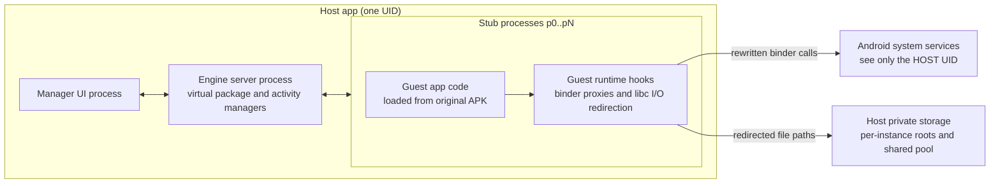

- The host app declares many placeholder ("stub") activities, services, providers and processes in its manifest.
- When a guest is launched, the engine starts a stub process, loads the guest APK's code and native libraries into it, and drives Android's normal app-startup path with the guest's components.
- The engine intercepts the guest's calls to system services, through proxies on Binder interfaces, and to the filesystem, through native libc hooks. It maps guest identities, components and file paths onto the host's.
- Every instance is just a separate "virtual user" with its own data root. Instance count is limited by storage and RAM, not by Android's user limits.

#### 4.7.2 Survey of existing engines (as of November 2026)

| Project | License | Android support claimed | Maintenance | Assessment |
|---|---|---|---|---|
| **VirtualApp** (asLody) [R31] | **No open-source license file.** The README says using the GitHub code requires buying a commercial authorization. | Open-source code frozen since **December 2017**. The commercial edition claims Android 5.0–17.0 and has changelog entries up to November 2026 [Verified R31]. | Commercial only | Proves the technique is still maintainable by a funded team. **The open-source code is not usable** (licensing, age). The commercial edition is a closed-source option that could be evaluated (cost and terms unknown). |
| **VirtualXposed** [R33] | GPL-3.0, with a README note that commercial use is not allowed | Android 5.0–10.0 [Verified R33] | Stale | Unusable for Android 14+. |
| **BlackBox** (original) | Apache-2.0 | Up to Android 12 | Repository deleted by the author; last push 2024-04 [Reported] | Ancestor of the forks below. |
| **NewBlackbox** (ALEX5402) [R32] | **Apache-2.0** [Verified R32] | "Android 5.0 to 14.0+", with a troubleshooting note for Android 15. **No Android 16 or 17 claim.** ARM64, ARMv7 and x86 [Verified R32] | Small community fork (58 commits, about 490 stars) | **Best open-source starting point**: permissive license, modern-ish baseline. Its claims are self-reported, and Android 16/17 support is unknown. Adopting it means **we become its maintainers**. |
| **Parallel Space** (LBE Tech) [R39] | Proprietary app | Targets API 35 and claims full Android 15 compatibility, last update July 2026. Says apps declaring a `REQUIRE_SECURE_ENV` flag are not supported [Verified R39] | Active, commercial | Existence proof that a commercial engine still runs on recent Android. Useful as a black-box reference in Phase 0. Not a component we can use. |
| **Plugin frameworks** (DroidPlugin, RePlugin, VirtualAPK, Shadow) | Various | Various | Mostly inactive | Designed for APKs built to cooperate with the host. **Not applicable** to arbitrary installed apps [Unverified]. |

#### 4.7.3 Platform pressure on virtualization engines

| Change | Effect on an engine |
|---|---|
| Non-SDK interface restrictions (Android 9+) [Verified R9] | Engines must use hidden APIs to proxy system services, which means relying on "bypass" techniques that Google does not support and can close at any time. |
| **Android 16: ART internal changes** [Verified R11] | Google warns that code relying on ART internal structures may break on Android 16 **and on earlier versions that receive ART updates through Google Play system updates**. Engines that hook ART methods are directly exposed, even without an OS upgrade. |
| **Android 17 (API 37)** [Verified R13] | Apps targeting 37 cannot change `static final` fields via reflection (`IllegalAccessException`) or JNI (crash). A lock-free `MessageQueue` breaks reflection on its private fields. Files loaded with `System.load()` must be read-only. Background-activity-launch rules extend to `IntentSender`. |
| Android 17 memory limits (all apps) [Verified R12] | Limits are based on device RAM. The page does not say per process or per app, but its test commands target a single process ID, which suggests per-process enforcement. A heavy guest game would then be limited like any app's process. |
| Android 14 safer dynamic code loading [Verified R10] | Dynamically loaded DEX files must be read-only (for apps targeting 34+). Loading guests directly from their installed (system-owned, read-only) APKs avoids most of this. |
| 16 KB memory pages [R20] | New devices may use 16 KB pages. Every engine native library must be 16 KB-aligned [Unverified for S25+]. |
| **Host targetSdk is applied to guests** | Guest code runs in host processes, so many behaviors follow the **host's** targetSdk rather than the guest's own [Unverified]. Raising the host's targetSdk can break guests. |

#### 4.7.4 Identity problems that cannot be solved honestly

To Android, every guest call comes from the **host UID** and the host's signing certificate:

- **Play Integrity:** the API has an explicit error, `APP_UID_MISMATCH` (-7): "The calling app UID (user id) does not match the one from Package Manager" [Verified R21]. Apps that enforce Play Integrity on their servers will fail in a virtual container. We will not spoof this.
- **Google Sign-In, Play Games login, FCM push, in-app billing:** GMS identifies callers by package and certificate. Inside a container these are expected to fail or behave as the host app [Unverified]. App Cloner's vendor documents the same failure class for re-signed clones [Verified R38].
- **Keystore key attestation** embeds the calling app's identity. Server-side checks will see the host [Unverified].
- **ANDROID_ID** is per signing key and user since Android 8, so all instances report the host's value, meaning instances look like the same device to servers [Unverified]. We will **not** randomize it (see 13.8).

#### 4.7.5 Verdict on virtualization

- Technically possible on Android 14–17 for a well-maintained engine, as commercial products show [Verified R31, R39].
- It is the **only no-root way** to get many instances **and** control over storage layout, which resource sharing requires.
- Costs: very high complexity, isolation enforced by software only, permanent maintenance against Android and ART changes, and compatibility that excludes Google-identity, Play-Integrity and anti-cheat-sensitive apps.

### 4.8 APK modification and repackaging

How it works: decompile the APK, rename the package (manifest, provider authorities, permissions), rebuild and re-sign it with a new key, then install it as a separate app.

| Property | Assessment |
|---|---|
| Isolation | Excellent. It becomes a genuinely separate app with its own UID. |
| Instances | Many (one package name each). |
| Resource sharing | **None.** A new package name means its own `Android/data`, so it downloads everything again. |
| Signature | Re-signing changes the certificate. App Cloner's own release notes say Google logins, Play Services, Play Games, Drive backup and in-app purchases **do not work** in clones, and that apps validating their certificate may break [Verified R38]. |
| Play Integrity | The app becomes "unrecognized" [Unverified]. |
| Games with anti-tamper (MLBB) | A modified client is exactly what anti-cheat systems look for. High ban risk, and it conflicts with our non-goals. |
| Updates | Every app update must be re-cloned. Split APKs must be merged. Play cannot update clones. |
| Legal and terms of service | Modifying and re-signing someone else's APK typically violates its terms, and it creates copyright exposure if shared. |

**Verdict:** not appropriate for MLBB or Instagram. At most acceptable for simple apps without Google or integrity dependencies. **Rejected as an architecture.**

### 4.9 Full-system containers and virtual machines

- **Twoyi** ran a whole Android 8.1 system as an app, without root, on Android 8.1–12. It is **archived (April 2023)**, discontinued for "complexity and lack of revenue" [Reported R36].
- **Android Virtualization Framework (AVF)** requires a privileged permission and offers no general GPU path for Android guests [Unverified].
- Closed products such as VMOS ship their own guest system images and are not composable or auditable.
- **Verdict:** only theoretically possible. Very poor game performance, no Google services, extreme complexity. **Rejected.**

### 4.10 ADB- or Shizuku-assisted native profiles

[Shizuku](https://github.com/RikkaApps/Shizuku) [R37] lets an app run commands with the ADB **shell** identity after the user enables wireless debugging. The shell can run `pm create-user` and `pm install-existing --user <id> <pkg>` [Reported]. This adds at most one more OS-isolated instance per allowed profile type (for example, a clone profile if One UI allows it), still with no resource sharing.

- **Privilege requirement:** elevated ADB (shell) access. This must be flagged explicitly. Shizuku has to be restarted after each reboot without root [Unverified]; the created profiles persist without it.
- **Samsung behavior is unknown** (user-type restrictions, launcher badging, Knox).
- **Verdict:** an optional power-user extension of the fallback, never the default. Not on the critical path.

### 4.11 Root-only approaches (for completeness)

With root, a single installation can be kept and only its **private** data swapped between accounts (`/data/user/0/<pkg>`), leaving `Android/data` untouched. This is the most storage-efficient design possible: one copy of resources, perfect compatibility, sequential use. It is **not available** on the S25+ because bootloader unlocking was removed [Reported R28], and rooting also triggers root detection in games and breaks Play Integrity. **Documented, not pursued.**

### 4.12 What an ordinary sideloaded app can and cannot do

| Capability | Ordinary app? | Notes |
|---|---|---|
| List launchable apps | **Yes** | Package visibility requires a `<queries>` declaration or `QUERY_ALL_PACKAGES` [R14]. A launcher-intent query is enough for our needs. |
| Read installed APK files (code) | **Yes** for visible packages | [Unverified] |
| Read other apps' internal data | **No** | Sandbox |
| Read other apps' `Android/data` / `obb` | **No**, even with All-files access | [Verified R16] |
| Create users, clone profiles or private profiles | **No** | System or shell only [Unverified] |
| Create a work profile | **Yes**, with user consent, one per device | [R4, Reported R34] |
| Install packages | **With user confirmation** (`REQUEST_INSTALL_PACKAGES`) | Silent install only as device/profile owner, with conditions [Unverified] |
| Create hard links | **No** | SELinux `neverallow` for untrusted apps [Verified R18] |
| Create symlinks inside own private storage | **Believed yes** | [Unverified] Must be tested in Phase 0 |
| Enable fs-verity (kernel-enforced immutable files) | **No** | `setupFsVerity` is not in the public API, and AOSP history shows it behind a signature/privileged permission [Verified R19, Reported] |
| Mount filesystems or use FUSE | **No** | [Unverified] |
| Use hidden APIs | Blocked by policy. Bypass libraries exist but are unsupported | [Verified R9] |
| Kill its own processes | **Yes** | Needed for sequential switching |
| Sideload-install our own app | **Yes, with conditions** | Google's developer verification for sideloaded apps is enforced in Brazil, Indonesia, Singapore and Thailand since 30 Sept 2026 and goes global in 2027. ADB installs are exempt, and an "advanced flow" exists [Verified R24, Reported R25, R26]. |

### 4.13 Target application research

#### Mobile Legends: Bang Bang (`com.mobile.legends`)

| Topic | Finding |
|---|---|
| Engine and data location | Unity build. Downloaded data under `Android/data/com.mobile.legends/…/dragon2017` [Reported R40]. Exact paths, file counts and sizes will be measured in Phase 0. |
| Size | Total footprint commonly cited at 2–6 GB depending on version and optional HD packs [Reported]. Not authoritative. |
| Login | Moonton account, plus third-party providers. Google-based login is expected to fail inside a container (4.7.4) [Unverified]. |
| Anti-cheat and terms | Secondary sources say Moonton prohibits third-party software and bans accounts [Reported]. Clone vendors advertise MLBB support [Reported R41], and one clone vendor itself warns about account bans [Reported]. **No official Moonton statement about virtualized environments was found.** |
| Built-in alternative | MLBB has in-game account switching. Switching does **not** re-download resources (they are device-level), but it requires logging in again each time [Unverified]. |
| Implication | Running MLBB inside our container may be detected, refused, or carry ban risk. **All MLBB experiments must use throwaway accounts.** |

#### Instagram (`com.instagram.android`)

| Topic | Finding |
|---|---|
| Built-in multi-account | Instagram supports adding several accounts and switching without logging out. Most sources say 5 per device, one recent source says 10 [Reported R42]. To verify in-app. |
| Push notifications | Delivered through FCM, which is bound to the real app identity [Unverified]. Expect **no push** inside a container. Works normally in a work profile. |
| Media permissions | In a container, the host holds camera, microphone and photo permissions on the guest's behalf (see 13.4). |
| Integrity and identity | Meta may flag unusual logins [Unverified]. All instances share the host's device identity (4.7.4). |
| Implication | For "two Instagram accounts", **built-in switching or the work-profile backend is better** than virtualization. The container adds risk without solving anything Instagram does not already solve. |

---

## 5. Technical Feasibility Assessment

### 5.1 Possible, privileged, or theoretical

| Capability | Possible for an ordinary app | Requires special privileges | Only theoretical or unavailable on target |
|---|---|---|---|
| 1 extra OS-isolated instance (work profile) | ✅ | | |
| 1 more manual instance (Secure Folder) | ✅ (user-managed, not controllable by us) | | |
| More OS-isolated instances (clone profile, extra users) | | ADB shell (Shizuku) or system | Samsung support unknown |
| Many instances (virtual container) | ✅ (software isolation, app-dependent compatibility) | | |
| Storage de-duplication between our instances | ✅ in principle (symlinks plus path redirection, must be proven) | | |
| Avoiding re-download for the 2nd instance | ⚠️ App-dependent (see 5.2) | | |
| Sharing resources with the original install | | Root | ❌ on S25+ (no root) |
| Sharing resources between OS profiles | | Root | ❌ (`Android/data` is per user; OBB possibly shared by the OS itself) |
| Kernel-enforced immutability of shared files | | Privileged (fs-verity) | ❌ for us; we use permission bits plus integrity checks instead |
| Google login, FCM push, Play Integrity inside container | | | ❌ (identity is the host's, and we will not spoof it) |
| Data swapping of a single install | | Root | ❌ on S25+ |

### 5.2 Two levels of "shared resources"

This distinction is central to being honest about the core requirement.

| Level | Meaning | Achievable? |
|---|---|---|
| **L1: Storage de-duplication** | Identical resource files from several instances are stored once on disk. | **Likely, for any app run in our container**, because our "harvester" can de-duplicate after the fact (see 9.7), even if the app re-downloaded. |
| **L2: Download avoidance** | A new instance does not download resources again. | **Only for apps whose "already downloaded" record lives in the shareable files themselves** (for example, a version index next to the assets). If the app records it in private internal storage (preferences or a database), a fresh instance believes nothing is downloaded and downloads again. We will **not** copy private state between instances to fake it. |

Phase 0 must determine which level MLBB reaches. Possible outcomes for MLBB: L1+L2, L1 only, or neither (if it does not run virtualized).

### 5.3 What would make the vision impossible

- **No engine runs reliably** on the device's Android version, even after reasonable effort (gate G1 fails). Then the product becomes the work-profile fallback, and shared resources are formally dropped.
- **Symlink-based CoW is blocked** by SELinux or misbehaves with real apps (gate G2 fails). Then de-duplication has to be done purely inside I/O hooks (mechanism M2 in 9.3), which is riskier.
- **MLBB detects and refuses virtualization**, or the user decides the ban risk is unacceptable (gate G3). Then MLBB is served by the fallback (one extra instance, no sharing) or by in-app account switching.

---

## 6. Architecture Comparison

### 6.1 Options considered

| ID | Option | Section |
|---|---|---|
| A | Use OEM and OS built-ins (Dual Messenger, Secure Folder, clone profile) | 4.3–4.5 |
| B | Native work profile with our app as profile owner | 4.6 |
| C | App virtualization inside our app (virtual container) | 4.7 |
| D | APK modification and repackaging | 4.8 |
| E | Full Android container or VM | 4.9 |
| F | ADB- or Shizuku-assisted native profiles | 4.10 |
| G | Root data swapping | 4.11 |
| H | No cloning: in-app account switching | 4.13 |

### 6.2 Comparison table

| Criterion | A: OEM built-ins | B: Work profile | C: Virtual container | D: Repackaging | E: Container/VM | F: ADB/Shizuku profiles | G: Root data swap |
|---|---|---|---|---|---|---|---|
| **Root requirement** | No | No | No | No | No (Twoyi) / privileged (AVF) | No root, but **elevated ADB** | **Yes** |
| **Android 14/15/16/17** | Built in. Samsung: Dual Messenger, Secure Folder | Official API, stable | Possible, **breaks with releases and ART updates** | Works, but rebuilt per app update | Twoyi archived at Android 12 | OEM-dependent | N/A on S25+ |
| **Application isolation** | Kernel (separate user) | Kernel (separate user) | **Software only** (same UID) | Kernel (separate UID) | Guest OS level | Kernel | Sequential, one active account |
| **Resource sharing** | None | None (OBB maybe) | **Yes** (L1 likely, L2 app-dependent) | None | Theoretical | None (OBB maybe) | **Perfect** (one copy) |
| **Multiple instances** | 1 per feature, user-managed | **1 per device** | **Many** | Many | Few (RAM) | +1 per profile type | Many (sequential) |
| **Performance** | Native | Native | Near-native CPU and GPU, small I/O hook overhead, host process memory limits | Native | Poor (no GPU path) | Native | Native |
| **Compatibility** | High (Dual Messenger: whitelist only) | **High** | Medium for ordinary apps. **Low** for GMS-, Integrity- and anti-cheat-dependent apps | Low for Google, Integrity and anti-tamper apps | Very low for games | High | High (root detection aside) |
| **Security** | High | High | **Weaker** (shared UID, hidden-API use) | OS-level, but runs re-signed code | Medium | High, but ADB enabled | **Weak** (rooted device) |
| **Complexity** | None for us | Low–medium | **Very high** | Medium | Extreme | Medium | Medium |
| **Reliability / production readiness** | High | High | **Low–medium**, needs permanent upkeep | Low | Very low | Medium | Medium |
| **Fit with our goals** | Advise the user only | **Fallback** | **Primary (gated)** | Rejected | Rejected | Optional extension | Not possible on target |

**Option H (in-app account switching)** needs no engineering, has perfect compatibility and zero duplicate storage, but requires re-login on each switch. It is the honest baseline every other option must beat. For Instagram it may already be the best answer.

### 6.3 Reasoning

1. The core requirement has two halves: **independent persistent state** and **shared resources**. Every option with kernel isolation (A, B, D, F) fails the second half. Only C (no root) and G (root) can share, and G is impossible on the device.
2. The requirement for **many instances** (Account A, B, C) also rules out A, B and F as complete solutions. Each tops out at one or two extra instances.
3. **C is therefore the only candidate that can meet the stated vision without root.** Its weaknesses (software isolation, compatibility, maintenance) are serious but disclosable and testable, which is why it is gated by Phase 0.
4. **B is the strongest fallback** because it is cheap, uses official APIs and has the best compatibility for exactly the apps where C is weakest (Instagram push, Google login). It also works as a per-app escape hatch.

---

## 7. Recommended Architecture

### 7.1 Decision [Design]

**Primary: a sequential virtual container with a Virtual Storage Layer and a shared resource pool.**

- DualApp is a single host app containing:
  - a manager UI;
  - an app-virtualization engine **forked from an Apache-2.0 code base** (candidate: NewBlackbox [R32]), kept behind a narrow **Engine Boundary** so the rest of the app never touches Android internals;
  - a **Virtual Storage Layer (VSL)** that gives each instance a private filesystem view;
  - a **Shared Resource Manager** that stores allow-listed resources once, in an immutable content-addressed pool, with copy-on-write per instance.
- **Sequential policy:** only one instance of a given app runs at a time. This removes concurrent-writer problems in the pool and keeps memory use predictable.
- **Guest code is loaded from the original installed APK** ("reference mode") by default, so app code is never duplicated and Play keeps it updated.
- **Transparency principle:** no anti-detection, no spoofing of integrity results, signatures or device identifiers, and no anti-cheat bypass. Apps that refuse are marked unsupported. Opt-out signals that apps declare (such as the `REQUIRE_SECURE_ENV` convention Parallel Space respects [R39]) are honored.

**Fallback: a native work-profile backend.** DualApp provisions a work profile, becomes its owner, makes apps available inside it, and launches them from the same dashboard. It provides one extra OS-isolated instance with full compatibility and no sharing. The dashboard also points the user to Secure Folder (a manual extra instance) and to in-app account switching where an app supports it.

Both backends implement the same **Instance Backend** contract (create, launch, stop, measure, remove). The UI and registry do not care which backend an instance uses. Fallback activation happens at two levels:

- **Global:** if gate G1 or G2 fails, the project continues as the fallback product.
- **Per app:** if an app is incompatible with the container (for example, MLBB at gate G3, or Instagram if push is required), its instances use the work profile.

### 7.2 Why this architecture

- **It is the only route to the core requirement without root.** Shared resources require us to control where an instance's files live. Only a container gives us that control, because only then do the files belong to our UID.
- **Sequential-only use (allowed by the brief) removes the hardest problems.** With no simultaneous instances of the same app, there are no concurrent writers to shared resources, and garbage collection and harvesting can run while the app is idle.
- **Forking, not writing, the engine.** Building an engine from scratch would take years. Licensing rules out the open-source VirtualApp code [R31], and VirtualXposed is GPL, frozen at Android 10 and carries a no-commercial-use note [R33]. An Apache-2.0 fork can be adopted, audited and owned.
- **The Engine Boundary contains the maintenance risk.** When Android or ART changes break the engine, the fix stays inside one module. The UI, registry, storage design and fallback are unaffected.
- **The fallback reuses everything.** If virtualization fails, the dashboard, registry, compatibility system and storage accounting still deliver a working, if smaller, product.

### 7.3 What the recommended architecture will not do

- Guarantee kernel-level isolation between virtual instances (13.1).
- Support Google Sign-In, Play Games login, FCM push, in-app billing or Play Integrity inside the container.
- Share resources with the original installation or with work-profile instances.
- Promise download avoidance (L2) for every app.
- Run MLBB if MLBB refuses the environment.

### 7.4 Decision gates

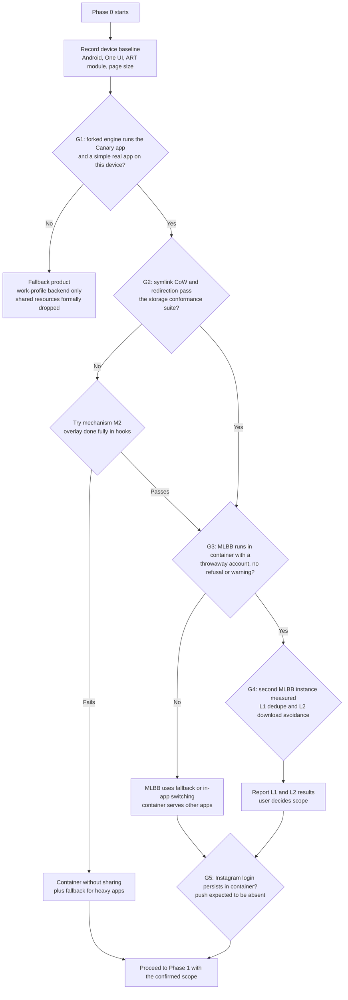

---

## 8. System Architecture

### 8.1 Layered view

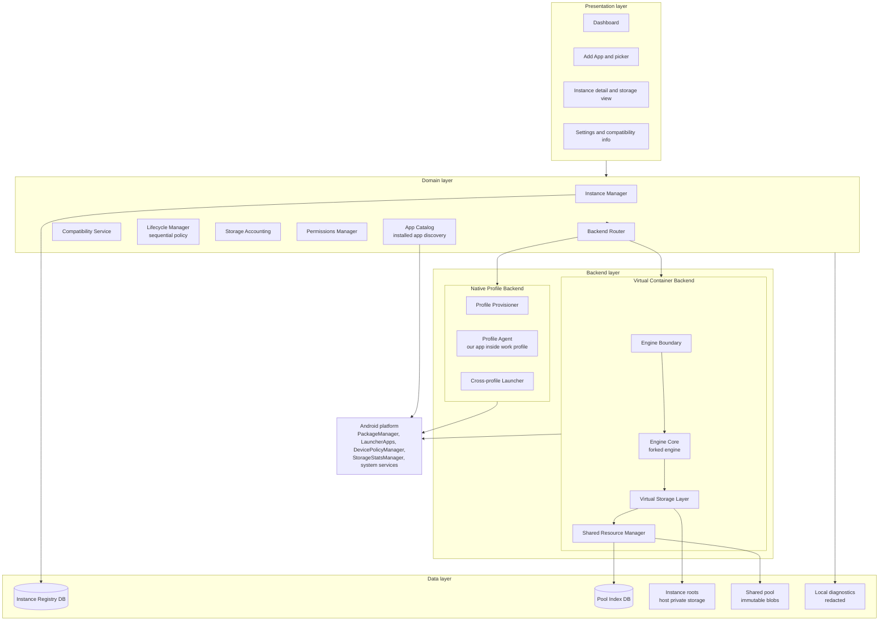

### 8.2 Process model (virtual backend) [Design]

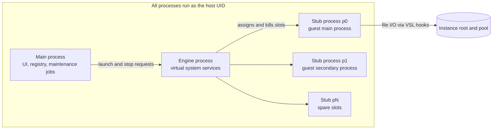

- The **main process** never loads guest code. It holds the registry and runs maintenance (harvest, garbage collection, scrub) only while no guest of the affected package is running.
- The **engine process** hosts the virtual package registry and the virtual activity, process and service managers. It is the only process that maps instances to stub slots.
- **Stub processes** each host one guest process. Guests that use several processes (common in social apps) take several slots. In sequential mode a small pool (around 10–20 slots) is enough; the real number is measured in Phase 0.

### 8.3 Component catalogue

Each component is described by its responsibility, why it exists, how it communicates, and its layer.

| # | Component | Responsibility | Why needed | Communicates with | Layer |
|---|---|---|---|---|---|
| 1 | **Dashboard and UI** | Shows apps, instances, status badges, storage. Launch, rename and remove actions. | User workflow (Section 12) | Instance Manager, Storage Accounting, Compatibility Service, through observable state | Presentation |
| 2 | **App Catalog (installed app discovery)** | Lists launchable apps with label, icon, version, ABI and split info. Watches install, update and removal broadcasts. | FR-1. Also detects guest updates and uninstalls that affect instances | PackageManager and LauncherApps (OS). Notifies Instance Manager and Lifecycle Manager of package changes | Domain |
| 3 | **Instance Manager** | Creates, renames and removes instances. Owns instance metadata and invariants (for example, a unique virtual user ID per instance). | Central authority over instances | Registry DB, Backend Router, Shared Resource Manager (seeding and removal), Compatibility Service | Domain |
| 4 | **Instance Registry** | Durable store for apps, instances, compatibility records and storage snapshots. | Persistence across reboots and updates | Read and written by domain components only | Data |
| 5 | **Compatibility Service** | Pre-checks an app before instance creation (Google dependencies, integrity APIs, opt-out flags, known-issue database) and records observed results. Chooses the recommended backend. | NFR-7 honest reporting. Routing to the fallback | App Catalog (APK metadata), Registry, UI | Domain |
| 6 | **Lifecycle Manager** | Launch, stop and switch with the sequential policy. Pre-migration backups when the guest app was updated. Blocks launches while maintenance runs. | Consistency of state and of the pool | Backend Router, Shared Resource Manager (locks), App Catalog (update events) | Domain |
| 7 | **Backend Router and Instance Backend contract** | Sends each operation to the virtual or native backend recorded for that instance. | Keeps the fallback a drop-in. Per-app routing | Instance Manager, Lifecycle Manager, both backends | Domain/Backend |
| 8 | **Engine Boundary** | The only surface through which the app talks to the engine: install a guest reference, create a virtual user, launch, stop, query running state, collect logs. | Contains the maintenance risk of the forked engine | Engine Core (inter-process calls to the engine process) | Backend |
| 9 | **Engine Core (forked)** | Virtual package registry, stub mapping, system-service proxies, identity mapping (guest package to host), notification bridge, runtime-permission proxy, **per-instance namespacing of Keystore aliases, AccountManager, notification channels and content-provider authorities**. | Running guests | Android system services (as host UID), VSL, Engine Boundary | Backend |
| 10 | **Guest Runtime** | Inside each stub process: loads guest code and native libraries from the original APK paths, installs Binder proxies and libc I/O hooks, applies the instance's path map. | Required for any guest execution | Engine Core, VSL | Backend |
| 11 | **Virtual Storage Layer (VSL)** | Maps guest paths (`/data/user/0/<pkg>`, `/data/user_de/0/<pkg>`, `/storage/emulated/0/Android/{data,obb}/<pkg>`) to the instance root. Intercepts writes to shared files and performs copy-up. Denies access to other instances' roots. | Private state per instance plus the hook point for CoW | Guest Runtime (in-process), Shared Resource Manager (path lookups, rare) | Backend |
| 12 | **Shared Resource Manager** | Content-addressed pool, Sharing Profiles, Harvester, Seeder, experimental Rebaser, garbage collector, Scrubber and journal (Section 9). | Core requirement B | Pool Index DB, instance roots, Lifecycle Manager (locks), Storage Accounting | Backend/Data |
| 13 | **Storage Accounting** | Computes private, shared-logical, amortized-shared and savings figures per instance and app. Uses OS storage stats for the host total. | FR-8, FR-9 and measurable evidence for the acceptance criteria | Pool Index, instance roots, StorageStatsManager, UI | Domain |
| 14 | **Permissions Manager** | Requests runtime permissions for the host when a guest needs them, with an instance-specific explanation. Stores per-instance allow and deny policy enforced by the engine. | Guests cannot hold permissions themselves | Engine Core, UI | Domain |
| 15 | **Profile Provisioner** (native backend) | Starts managed-profile provisioning, checks whether a profile already exists or is blocked. | Fallback B | DevicePolicyManager (OS), Profile Agent | Backend |
| 16 | **Profile Agent** (native backend) | Our app's copy inside the work profile, acting as profile owner. Makes apps available in the profile, reports storage, handles removal. | Only the profile owner can manage the profile | Personal-side app through `CrossProfileApps` | Backend |
| 17 | **Cross-profile Launcher** | Launches profile apps from the personal dashboard. | FR-5 for fallback instances | LauncherApps / CrossProfileApps (OS) | Backend |
| 18 | **Diagnostics** | Local, redacted logs and per-launch compatibility traces. Nothing leaves the device. | Debugging without leaking data | All components (write-only), UI (export on request) | Cross-cutting |
| 19 | **Maintenance Scheduler** | Runs harvest, garbage collection and scrub when idle or charging, only while no guest of that package runs. | Background storage work without corrupting running instances | Lifecycle Manager (locks), Shared Resource Manager | Domain |

### 8.4 Data model [Design]

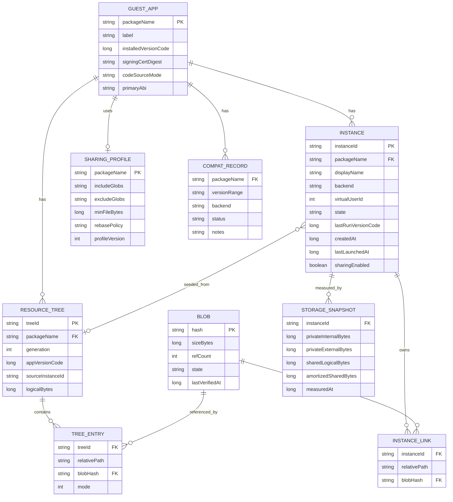

| Entity | Purpose |
|---|---|
| **GUEST_APP** | One row per installed app known to DualApp. `codeSourceMode` is `REFERENCE` (load from the original install) or `PINNED` (private APK copy, used if the original is uninstalled or the user freezes a version). |
| **INSTANCE** | One row per instance. `backend` is `VIRTUAL` or `WORK_PROFILE`. `state` follows the lifecycle in Section 10. `lastRunVersionCode` detects app updates. |
| **SHARING_PROFILE** | Curated per-app allow-list and exclusions (see 9.6). Versioned so that changing a profile triggers re-evaluation. |
| **RESOURCE_TREE / TREE_ENTRY** | An immutable snapshot ("generation") of an app's shareable resource directory: path to blob. New instances are seeded from the newest compatible generation. |
| **BLOB** | A content-addressed, read-only file in the pool. `refCount` counts tree entries plus instance links. `state` is `OK`, `QUARANTINED` or `PENDING_DELETE`. |
| **INSTANCE_LINK** | Which shared blobs each instance currently points to. Needed for exact reference counts and accounting. |
| **COMPAT_RECORD** | Observed and curated compatibility per app, version range and backend: `SUPPORTED`, `PARTIAL`, `UNSUPPORTED` or `UNTESTED`, with notes. |
| **STORAGE_SNAPSHOT** | Cached storage measurements for the UI and the acceptance evidence. |

### 8.5 On-disk layout (host private CE storage) [Design]

```text
/data/user/0/<host-package>/
├── databases/                      registry + pool index (SQLite)
├── engine/                         engine state: virtual package registry, virtual users
├── vroot/
│   ├── instances/
│   │   └── <instanceId>/
│   │       ├── data/               guest /data/user/0/<pkg>       (PRIVATE, never shared)
│   │       ├── de/                 guest /data/user_de/0/<pkg>    (PRIVATE, never shared)
│   │       ├── ext/data/           guest Android/data/<pkg>       (real dirs + private files + symlinks to blobs)
│   │       ├── ext/obb/            guest Android/obb/<pkg>        (same model)
│   │       └── meta/               instance journal, last-run version, pre-migration backups
│   ├── pools/
│   │   └── <packageName>/
│   │       ├── blobs/sha256/ab/<hash>   immutable files, mode 0444, dirs 0555
│   │       ├── staging/                 in-flight harvest work (journaled)
│   │       └── quarantine/              blobs that failed verification
│   └── pinned-apks/<pkg>/<versionCode>/ only in PINNED mode
└── no_backup/                       excluded from any backup
```

Everything lives in **internal** storage on purpose. Internal storage supports symlinks and atomic renames [Unverified]. Emulated external storage is served through FUSE, which does not support symlinks [Unverified]. Both sit on the same physical partition on modern devices, so there is no capacity penalty.

### 8.6 Key interactions

**Create an instance (virtual backend)**

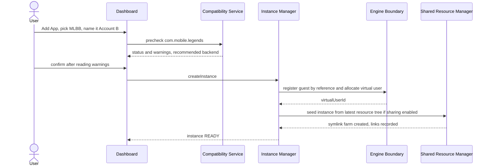

**Launch or switch (sequential policy)**

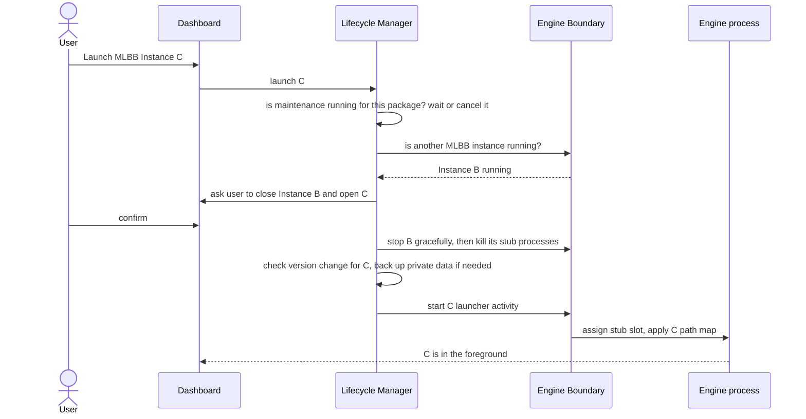

**Guest writes to a shared resource file (copy-up)**

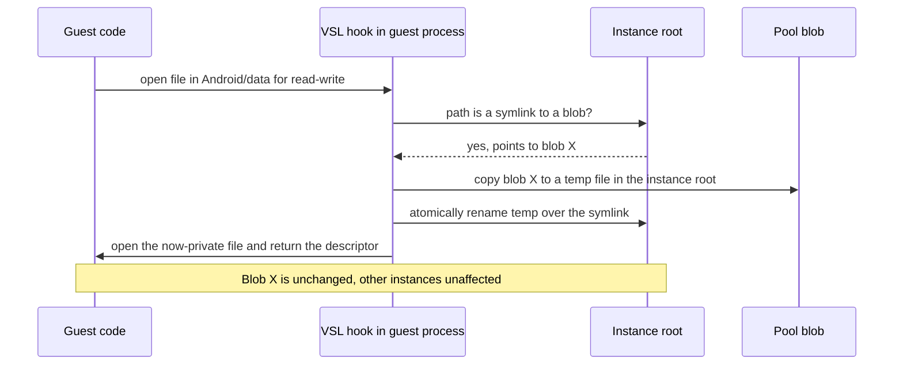

---

## 9. Shared Resource Storage Architecture

### 9.1 Goals and hard rules [Design]

**Goal:** store an app's large downloaded resources once and let every instance of that app read them, while each instance keeps its own private state and gets a private copy the moment it modifies a shared file.

**Hard rules:**

1. Only files under allow-listed **external app-specific** paths (`Android/data/<pkg>`, `Android/obb/<pkg>`) are ever shared. **Internal storage (`/data/user/0/<pkg>`, `/data/user_de/0/<pkg>`) is never shared.**
2. Shared files are **immutable** content-addressed blobs. No code path writes to a blob after it is published.
3. Every instance has its own writable layer. A write never reaches another instance.
4. Private state is never copied from one instance to another to "help" the second instance skip a download.
5. The filesystem is the source of truth for which instance uses which blob. The database is a rebuildable index.

### 9.2 Platform constraints that shape the design

| Constraint | Consequence |
|---|---|
| All virtual instances run as the **same UID** (the host's) | The kernel cannot separate instances from each other. Separation comes from path redirection, and immutability from permission bits. |
| Hard links are forbidden for untrusted apps by an SELinux `neverallow` [Verified R18] | Hard-link de-duplication, the classic cheap approach, is **unavailable**. |
| fs-verity setup is not public [Verified R19] | Kernel-enforced immutability is **unavailable**. |
| FUSE and mounting are unavailable to apps [Unverified] | No union filesystem at the kernel level. Overlay behavior has to come from our own hooks or from plain filesystem objects. |
| Emulated external storage does not support symlinks [Unverified] | Instance trees and the pool must live in **internal** storage, which is what the VSL redirects to anyway. |
| Permission bits apply to the owner too: a file with mode `0444` cannot be opened for writing by its owner without CAP_DAC_OVERRIDE [Unverified] | Blobs stay protected even against unhooked writes, unless code deliberately `chmod`s them. |

### 9.3 Mechanisms evaluated

| ID | Mechanism | Verdict |
|---|---|---|
| **M1** | **Symlink farm:** each instance's resource folder is a real directory tree in which shared files are **symlinks** to read-only blobs. Writes to a symlinked file are intercepted, and the file is copied up first. | **Preferred** [Design]. Reads, `mmap`, directory listings and even unhooked raw system calls work natively, because the kernel follows the symlink. Unhooked **writes** fail safely with `EACCES` instead of corrupting the blob. Only the copy-up step depends on hooks. |
| M2 | Pure in-hook overlay: the VSL fakes a merged view (lower = pool, upper = instance), including merged directory listings, whiteouts for deleted files, and `stat` synthesis | Fallback if M1 fails. Much larger hook surface (`getdents`, `stat` family, `rename`, `unlink`, `access`, `readlink`). Unhooked system calls see an inconsistent view. |
| M3 | Hard links to blobs | **Impossible** (SELinux) [Verified R18] |
| M4 | fs-verity-protected blobs | **Impossible** for third-party apps [Verified R19] |
| M5 | Reflinks or clone ioctls | Not available on typical f2fs/ext4 app data [Unverified]. Not pursued. |
| M6 | FUSE union filesystem | Not available to apps [Unverified] |
| M7 | `StorageManager.openProxyFileDescriptor` per-file proxies | Callback-based per-file proxy. Far too slow for gigabytes of game assets [Unverified]. Not pursued. |

### 9.4 Chosen design: symlink farm over a content-addressed pool

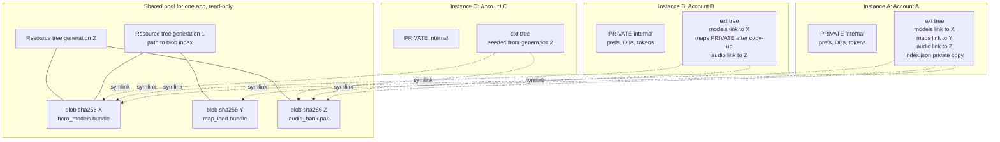

How an instance reads shared resources without seeing other instances' private data:

- The guest only sees **its own** instance root, because the VSL maps the guest's paths there.
- Symlinks inside that root point only into the **pool**, never into another instance's root.
- The pool contains only content that passed the Sharing Profile filter: allow-listed external resource files, never internal data.
- So the only things instances have in common are immutable, allow-listed resource files. Instance B can learn nothing from them about Account A except that A's instance downloaded the same public game assets.

### 9.5 File operation semantics

| Guest operation on a path inside `ext/` | Behavior |
|---|---|
| Open for reading, `stat`, `mmap`, list a directory | Native. The kernel follows the symlink to the blob. |
| Open for writing, append, truncate or `O_TRUNC` | **Copy-up**: take the per-instance copy-up lock, re-check that the path is still a symlink, copy the blob to a temporary file in the same directory, `fsync`, atomically rename it over the symlink, then open the private file. With `O_TRUNC`, create an empty private file instead of copying. |
| `truncate()` by path, `chmod`, `utimensat` | Copy-up first, then apply. |
| Delete (`unlink`) | Removes only the instance's symlink. The blob is untouched, and its reference is dropped at the next reconciliation. |
| Rename | Moves the symlink itself. Allowed. |
| Create a new file | A normal private file in the instance tree. It may be harvested later. |
| Unhooked raw write system call on a symlinked blob | Fails with `EACCES` because the blob is `0444` [Unverified]. Safe failure, no corruption. Logged as a compatibility signal. |
| `lstat` or `readlink` | Reveals that the path is a symlink. Rarely checked by apps. Tested in Phase 0 (P4). |

### 9.6 Sharing Profiles (per-app allow-lists) [Design]

A Sharing Profile is curated data, not code. It is versioned and shipped with DualApp, and users can switch sharing off per instance.

| Field | Meaning |
|---|---|
| `includeGlobs` | Paths eligible for sharing, relative to `Android/data/<pkg>` or `Android/obb/<pkg>` |
| `excludeGlobs` | Always-private paths: logs, replays, crash dumps, settings files, anything account-like |
| `minFileBytes` | Ignore small files (default 64 KB). Small files are where per-account state tends to live. |
| `stabilityRule` | A file must be unchanged since the end of the previous session before it can be harvested |
| `rebasePolicy` | `NEVER` (default) or `RESOURCE_ONLY` (see 9.7, step 6) |

**MLBB profile: hypothetical until Phase 0 measures the real layout.** Include `files/dragon2017/assets/**`. Exclude `**/*.log`, `**/replay*/**`, `**/*account*`, `**/*.db`, `**/*.xml`, `**/cache/**`. Set `minFileBytes` to 64 KB. The real globs must come from inspecting the actual directory of a test installation.

**Apps without a profile** get no sharing. This is the default, and it is safe.

### 9.7 Resource lifecycle: the 5 GB example

1. **Instance A (first instance) runs.** MLBB downloads 5 GB into A's `ext/` tree as ordinary private files.
2. **Harvest** runs while no MLBB instance is running, ideally when idle or charging. For each file that matches the profile, is stable and is large enough: hash it with SHA-256. If a blob with that hash already exists, delete A's file and replace it with a symlink. If not, **move** the file into the pool (same partition, so an atomic rename with no copy), make it `0444`, and leave a symlink in its place. Record a new **resource tree generation** (path to hash) tagged with MLBB's version code.
3. **Instance B is created.** The Seeder recreates the newest compatible generation as a symlink farm in B's `ext/` tree. B's internal storage starts **empty**, like a fresh install.
4. **B's first launch.** MLBB checks its resources:
   - **L2 success:** its download record lives in the shared tree (for example, a version index next to the assets), finds everything present, and downloads nothing.
   - **L1 only:** its download record lives in private internal storage, so it believes nothing is downloaded and downloads again. The new files land privately in B's tree, and the next harvest finds identical hashes and turns them back into symlinks. **Disk use is recovered after the fact; network use is not.**
5. **Resource update** (a game patch) in A: A's writes copy-up the changed files. The next harvest turns them into new blobs and records generation 2. B still points at generation 1 blobs and stays consistent.
6. **Experimental rebase.** Only for apps whose profile says `RESOURCE_ONLY`, and only while B is stopped: each symlink still pointing at generation 1 is repointed to the generation 2 blob. Paths B modified privately follow the profile's policy, and a snapshot of what changed is kept so it can be undone. Whether B then skips the patch download is app-dependent, for the same reason as L2. **Off by default. Promoted only after measurement.**
7. **Garbage collection.** A blob is deleted only when no instance links to it **and** no retained tree generation references it.

### 9.8 Specific concerns

| Concern | Design |
|---|---|
| **Resource versioning** | Trees are immutable generations tagged with the app's version code and the profile version. Instances record which generation they were seeded from. Old generations are kept while referenced. Seeding uses only a generation matching the installed app version (or an older one the app is expected to patch from). |
| **File integrity** | Blob name = SHA-256 of its content, computed at harvest. Files are `0444` and blob directories `0555`. A Scrubber re-hashes blobs when the phone is idle and charging (sampled, with a full pass periodically). A mismatch moves the blob to `quarantine/` and removes the symlinks pointing at it, so the app sees the file as missing and normally re-downloads it. The instance is flagged "repaired" in the UI. |
| **Resource modification** | Copy-up on any write intent (9.5). Unhooked writes fail safely. Shared content never changes in place. |
| **Concurrent access** | Sequential policy: only one instance per app runs at a time. Harvest, rebase and GC take a per-package maintenance lock, and the Lifecycle Manager will not launch that package while the lock is held. Within one instance, copy-up uses a per-instance file lock plus re-check, so two guest processes cannot race. Blobs are immutable, so concurrent reads are always safe (which keeps future simultaneous running possible). |
| **Resource deletion** | Deleting by the guest removes only its link. Blob deletion happens only in GC, using reference counts reconciled by scanning instance trees (`readlink`), not by trusting runtime counters. |
| **Cache invalidation** | The VSL does not cache link state across calls. It checks with a cheap `lstat` at open time, so copy-ups in one process are immediately visible to the guest's other processes. The pool index changes only during maintenance, when no guest of that package runs, so no runtime invalidation is needed. A Sharing Profile version change triggers a re-scan at the next harvest. |
| **Storage accounting** | Per instance: **private** = internal data + private external files. **Shared (logical)** = total size of blobs it links. **Shared (amortized)** = each linked blob's size divided by the number of instances linking it. Per app: **pool physical** = total size of blobs, **savings** = total shared-logical across instances minus pool physical, and **retained overhead** = blobs kept only by retained generations. The host's total from `StorageStatsManager` is shown next to it for cross-checking. |
| **Application updates** | Guest code in reference mode updates with Play. On the first launch after a version change, the Lifecycle Manager backs up the instance's **private internal data** (usually small), then lets the app migrate. Old resource generations remain until GC. Harvest tags new generations with the new version code. |
| **App uninstallation (the original)** | Reference mode: instances become `BROKEN` (no code), but their data and the pool are kept. The UI offers "reinstall the app" or "remove instances". Pinned mode avoids this at the cost of a private APK copy. |
| **Instance removal** | Delete the instance root (internal and external), its notification channels, its namespaced Keystore aliases and its accounts. Drop its links. GC removes blobs no longer referenced. The confirmation dialog shows what is deleted and what stays shared. |

### 9.9 Crash safety [Design]

- All maintenance operations are **journaled** in an intent log before they touch files. Each step is idempotent: hash, move into `staging/`, `fsync`, rename into `blobs/`, `chmod`, then replace the instance file with a symlink by creating a temporary link and renaming it over the file.
- On startup, the journal is replayed or rolled back before any instance may launch.
- Copy-up uses temporary file + `fsync` + atomic rename, so a crash leaves either the old symlink or the complete private copy, never a partial file.
- Reference counts are recomputed from the filesystem if the database and disk disagree.

### 9.10 Storage in the native fallback backend

There is no sharing. Each work-profile instance downloads its own resources into its own user's `Android/data`. The OS documentation says `Android/obb` "may be shared" across users [Verified R17]. Phase 0 tests this once, but it does not help apps that use `Android/data`, which appears to include MLBB [Reported R40].

### 9.11 What the early prototype must prove

None of Section 9 should be built until these are demonstrated on the S25+ (Phase 0, spikes S5–S7):

| ID | Must be proven | Pass condition |
|---|---|---|
| **P1** | Symlinks can be created in host internal storage and are followed. `0444` blocks owner writes. | Works under the device's real SELinux policy. Write attempts get `EACCES`. |
| **P2** | Engine path redirection covers Java file APIs, NIO, native `open`/`fopen`/`mmap`, SQLite in private dirs, and Unity/IL2CPP file access. | The Canary app's checks all pass. A Unity sample, or MLBB if G3 passes, loads assets. |
| **P3** | Copy-up is correct for every open mode, `truncate`, `rename`, `unlink`, attribute changes and multi-process guests. | Storage conformance suite passes. The blob checksum is unchanged after every test. |
| **P4** | Apps accept symlinked resource files. | Canary plus the real apps behave identically with and without the symlink farm. |
| **P5** | Harvest and seed with a 1–2 GB synthetic resource pack. | Second instance: L2 (zero resource download) in the "index in shared files" mode, and L1 (same disk use after harvest) in the "index in private storage" mode. |
| **P6** | The same with MLBB on throwaway accounts (only if G3 passes) | L1 and L2 outcomes measured and recorded |
| **P7** | Overhead is acceptable | Cold start and asset-load times within the targets set in Phase 0 (proposed: at most 10% slower than a native install). Frame pacing unchanged within measurement noise. |
| **P8** | Crash safety | Killing the process at random points during harvest or copy-up never corrupts a blob or loses private data. |
| **P9** | Integrity handling | A deliberately corrupted blob is detected, quarantined, and the instance recovers. |

---

## 10. Application Instance Lifecycle

### 10.1 States

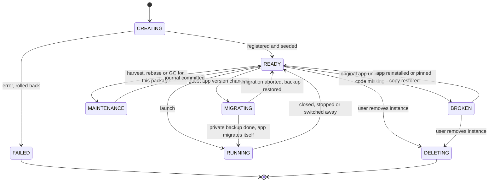

### 10.2 Lifecycle flows

| Flow | What happens |
|---|---|
| **Create** | Compatibility pre-check, then warnings, name and backend choice. Registry row (`CREATING`), virtual user allocated, guest registered by reference, seeded from the pool if sharing applies, then `READY`. Any failure rolls back fully. |
| **First launch** | Like a fresh install. The user logs in to the account intended for this instance. |
| **Normal launch** | Sequential check, version check, stub slot assigned, path map applied, guest's launcher activity started. |
| **Switch** | "Close Instance B and open Instance C?", then B is stopped gracefully (activities finished, with a timeout), its stub processes killed, and C launched. |
| **Close** | The guest backgrounds normally. The instance stays `RUNNING` until its processes die or are stopped. Background work is limited (13.4). |
| **Force-stop** | DualApp's "Stop instance" kills that instance's stub processes. Android's "Force stop" on DualApp stops all instances. Data is never affected. |
| **Reboot** | Nothing runs until the user launches an instance after unlocking. The journal is replayed first. |
| **Guest app update (Play)** | DualApp sees the package-replaced broadcast, stops running instances of that app, and marks the others for `MIGRATING` on their next launch. |
| **Host app update** | Same signing key: all data is kept. The journal is replayed. The engine's state format is versioned and migrated. |
| **Original app uninstalled** | Instances go to `BROKEN` with data kept (reference mode). |
| **Android OS or ART module update** | DualApp records the OS build and ART module version at each start. On change, it runs a quick self-test with the Canary checks before allowing launches, and warns if anything fails. |
| **Remove instance** | Confirmation listing what will be deleted, then `DELETING`: files, channels, Keystore aliases and accounts are removed, links dropped, GC run. |
| **Remove an app from DualApp** | Removes all of its instances, then optionally the pool. The default for keeping the pool is an open question (Section 18). |
| **Uninstall DualApp** | Android deletes everything: all instances and the pool. Stated clearly in onboarding and Settings. |
| **Backup or export** | Not in scope (FR-12). Exporting session tokens is a security risk (13.6). DualApp is excluded from Android backup on purpose. |

### 10.3 Native-backend lifecycle differences

- Create: provision the work profile once, then make the app available in it. Launch: through `LauncherApps` or `CrossProfileApps`. Removal: uninstall the app inside the profile, or delete the whole work profile.
- The OS handles migration, persistence and reboots natively. There is no pool, so no maintenance states.

### 10.4 Sequential policy [Design]

- MVP: at most **one running instance per app**. Instances of **different** apps may run at the same time if the engine supports it.
- Rationale: no concurrent writers to an app's shared resources, simpler process accounting, predictable memory use.
- Future simultaneous running (FR-11) is possible because blobs are immutable. Only maintenance locking would need to change.

---

## 11. Technology Stack

| Area | Choice | Reason |
|---|---|---|
| Host app language | **Kotlin** | Modern Android standard, null-safety, coroutines |
| Engine language | **Java and C/C++ as inherited from the fork** | Rewriting the engine buys nothing. The fork stays in its own module, with its Apache-2.0 notices. |
| VSL and hooks | **C/C++ with the NDK and CMake** | File-operation interception must happen in native code to cover native guest code such as Unity and IL2CPP. **This is the only place where native code is genuinely necessary.** |
| UI | **Jetpack Compose with Material 3** | Declarative UI, fits a small dashboard-style app, dynamic color and dark theme for free |
| UI architecture | Single activity, ViewModel, state flows, unidirectional data flow | Standard and testable. No extra framework needed. |
| Persistence | **Room (SQLite)** for registry and pool index. **DataStore** for small settings. | Relational data (apps, instances, trees, blobs) with transactions. Pool indexes can hold tens of thousands of rows. |
| Background maintenance | **WorkManager** with idle and charging constraints | Survives reboots and respects battery limits. Coordinated with the Lifecycle Manager's locks. |
| Concurrency | Kotlin coroutines and Flow | Built in |
| Hooking libraries | Whatever the fork already uses, re-evaluated in Phase 0. Candidates: ByteHook (PLT hooks) and ShadowHook (inline hooks) from ByteDance [R45, R46] | Maintained, permissively licensed, ARM64 and 16 KB-aware [Unverified]. Prefer PLT and Binder-proxy interception over ART method hooking, because ART internals are what Android 16 warns about [R11]. |
| Hidden-API access | Whatever the fork uses (for example AndroidHiddenApiBypass [R43]), **confined to the engine module** | Unsupported by Google. Must stay contained. |
| Dependency injection | **None at first** (constructor injection by hand). Hilt only if the object graph grows. | Avoid unnecessary frameworks |
| Testing | JUnit, AndroidX Test, Compose UI tests, UI Automator (cross-app flows), Macrobenchmark (startup), ADB-driven measurement scripts | See Section 15 |
| SDK levels | **minSdk 34 (Android 14).** targetSdk decided after Phase 0, likely 35 or 36. **Not 37 until the engine passes the Android 17 target changes** [R13]. | Guest behavior follows the host's targetSdk (4.7.3). Changing targetSdk is a compatibility event that requires a full test run. |
| ABIs | **arm64-v8a only** for the MVP | The S25+ is ARM64. Whether the S25+'s CPU still runs 32-bit apps is [Unverified]. All native code 16 KB-aligned [R20]. |
| Deliberately **not** used | Firebase, analytics or crash-reporting SDKs, networking libraries, Xposed frameworks, Play Core libraries | Offline, private by design (NFR-6). No cloud dependencies. |

**How the engine fits:** the project would have separate build modules for the app (Kotlin and Compose), the forked engine (Java and native), the VSL (native, our own), and the native-profile backend. Only the Engine Boundary is visible to the app module. Changes to the fork are kept as a documented patch series so that upstream fixes can still be pulled in.

---

## 12. User Experience and Application Flow

### 12.1 Screens

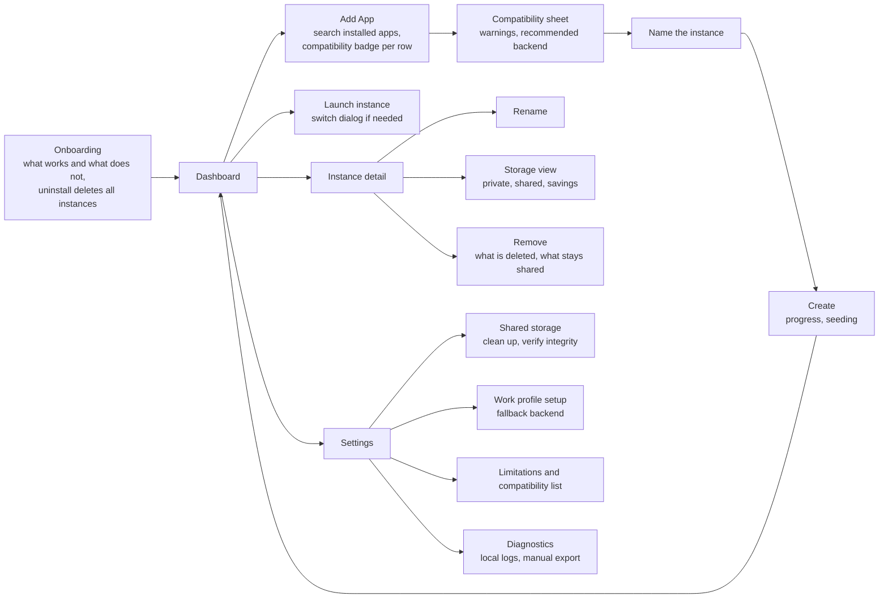

### 12.2 Dashboard layout (text wireframe)

```text
┌──────────────────────────────────────────────┐
│ DualApp                         [⚙ Settings] │
│ Shared storage saves 4.1 GB                  │
├──────────────────────────────────────────────┤
│ [icon] Mobile Legends            ⚠ Partial   │
│   ● Account B      2.1 GB private   [Launch] │
│   ● Account C      0.3 GB private   [Launch] │
│   Shared pool: 5.0 GB (used by 2)            │
├──────────────────────────────────────────────┤
│ [icon] Instagram          ⓘ Work profile     │
│   ● Secondary      Work profile     [Launch] │
├──────────────────────────────────────────────┤
│                                 [+ Add App]  │
└──────────────────────────────────────────────┘
```

- Instances are grouped by app. Each instance shows its name, backend, private size and running state.
- Long-press (or the detail screen) offers rename, storage, home-screen shortcut (Phase 6) and remove.
- The **original** app is not shown as an instance, because DualApp does not manage it. A hint ("Your original MLBB stays as Account A") avoids confusion.

### 12.3 Compatibility warnings (example wording)

- "Google sign-in and Google Play Games login will not work in this instance. Use the game's own account login instead."
- "Push notifications will not arrive while this instance is closed. For notifications, use a work-profile instance or the app's built-in account switching."
- "This game may detect that it is running inside another app. Using it this way may break the game's terms of service and put your account at risk. Test with an account you can afford to lose."
- "Instagram already supports switching between several accounts inside the app. You may not need an instance at all."
- "This app asked not to be run in virtual environments. DualApp respects that." (opt-out detected, creation blocked)

### 12.4 Storage view

It shows private data (internal and external), shared resources used (logical size), this instance's share of the pool (amortized), and pool totals and savings for the app. A short explainer covers what "shared" means and what is never shared.

---

## 13. Security and Privacy

### 13.1 Instance data isolation: an honest threat model

| Threat | Virtual backend | Native work-profile backend |
|---|---|---|
| A normal app instance accidentally reads or writes another instance's data | **Prevented** by VSL path mapping | Prevented by the kernel |
| A **malicious** guest deliberately escaping redirection (raw system calls, reading other roots) | **Not prevented.** All instances share one UID. **Only clone apps you trust.** | Prevented by the kernel |
| Other apps on the device reading instance data | Prevented by Android's sandbox: it is all host-private storage | Prevented |
| A guest reading DualApp's registry or pool index | Possible in principle (same UID). These hold no secrets: names, paths, hashes. | Not applicable |
| Data at rest on a lost or stolen phone | Protected by Android file-based encryption (CE storage) [Unverified] | Same |

The UI and documentation state plainly that virtual instances are **separated by software, not by Android's security boundary**.

### 13.2 Credential and session protection

- Internal storage is never shared or copied between instances (rule 9.1).
- The engine namespaces **Keystore aliases**, **AccountManager accounts**, **notification channels** and **content-provider authorities** per instance, so one instance cannot reuse another's keys or accounts through the normal APIs [Design].
- Android 17 caps Keystore keys per app (50,000 for apps targeting 37, otherwise 200,000) [Verified R12]. In a container, all instances share the host's quota. Monitor it.
- DualApp's own UI code never reads guest files except to measure their sizes.
- **Excluded from backup and device transfer** (backup disabled, data-extraction rules exclude everything), so guest tokens are never uploaded to cloud backups.
- Optional (Phase 6): require device authentication before launching a chosen instance.

### 13.3 Secure deletion

- Removal deletes files and directories and lets the filesystem discard the blocks.
- On flash storage with file-based encryption, **physical erasure cannot be guaranteed** by an app. Protection after deletion relies on Android's encryption [Unverified].
- Per-instance encryption with key destruction ("crypto-shredding") would mean encrypting all guest I/O in the VSL. It is rejected for performance and noted as possible future research for small internal data only.

### 13.4 Permission handling

- In the container, Android grants permissions to **DualApp**, not to the guest. The host manifest must declare the dangerous permissions guests may need (camera, microphone, location, media, notifications), and DualApp requests them **only when a guest asks**, with the instance named in the explanation.
- Per-instance allow/deny decisions are enforced by the engine. Android itself cannot tell instances apart.
- Not supported for guests: special accesses (overlay, accessibility, notification listener, device admin, VPN).
- DualApp does **not** request "All files access", since everything is in its private storage, and it avoids `QUERY_ALL_PACKAGES` by declaring a launcher-intent `<queries>` element [R14].
- Background behavior for guests is limited to what the host's foreground or background state allows. No long-running background services in the MVP.

### 13.5 Storage access

- All instance data and the pool live in DualApp's private internal storage.
- No world-readable files. Blobs are `0444`, which means readable by the owner UID only, since app home directories are private.
- Shared media such as photos goes through MediaStore and the photo picker under DualApp's media permissions. This is the user's own content and not per-instance.

### 13.6 Sensitive information logging

- Never log file contents, tokens, cookies, intent extras, account names, phone numbers, email addresses, or URLs with query strings.
- Paths are logged as instance ID plus a relative path category, not as user content.
- Verbose logging only in debug builds. Release logs are size-capped and stored in `no_backup`.
- Diagnostics export only through an explicit user action, with a preview of what will be shared.
- No crash-reporting or analytics SDKs (NFR-6).

### 13.7 Host application security

- **Signing key:** a dedicated release key, backed up offline. Losing it means an update requires uninstalling, which **destroys every instance**.
- **Supply chain:** the engine fork and native hook libraries are vendored at pinned versions and reviewed on update. No downloading or loading of remote code.
- **No network code** in DualApp itself. The INTERNET permission exists only because guests need it.
- **Exported components kept to a minimum.** Stub components are not exported unless the platform requires it. Provider authorities are namespaced.
- **Sideloading:** install through ADB (exempt from developer verification) or register for developer verification before enforcement reaches the user's country [Verified R24].

### 13.8 Integrity and compatibility ethics (transparency principle)

- No hiding of the engine from guests: no scrubbing of process memory maps, no anti-detection, no hiding of hooks.
- No spoofing of Play Integrity, signatures, Keystore attestation, `ANDROID_ID` or other device identifiers. Instances truthfully appear as the same device.
- Apps that opt out of virtualization, or that detect it and refuse, are marked **unsupported**. No workaround is attempted.
- Terms-of-service warnings are shown for games. All testing of MLBB uses throwaway accounts.

### 13.9 Native backend security

The work profile is OS-isolated. DualApp as profile owner applies only the policies it needs. The user can delete the work profile at any time from Android Settings, which deletes its apps and data.

---

## 14. Development Roadmap

The order follows the brief: prove feasibility first, build the interface late, and put nothing early that depends on unproven virtualization.

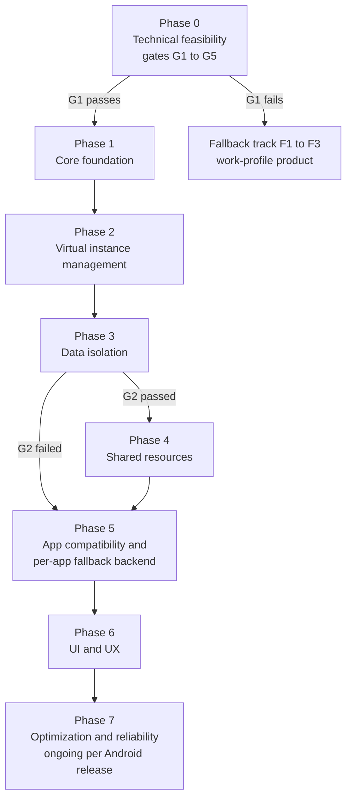

Effort sizes are relative (S < M < L < XL) for a single developer. They are not commitments.

### Phase 0: Technical Feasibility (L, time-boxed)

| Item | Detail |
|---|---|
| **Objective** | Decide, with measurements on the real S25+, whether the primary architecture is viable and how much of the core requirement it delivers. |
| **Required functionality** | None user-facing. Throwaway prototypes and a **Canary test app** (a test fixture that exercises storage, preferences, SQLite, Keystore, notifications, multiple processes and a synthetic resource download). |
| **Technical tasks** | **S0 Baseline:** record build, One UI, Android API level, security patch, ART module version, page size, ABIs, max users, free storage (Appendix A). **S1 Native profiles:** with an existing tool such as Shelter or Insular, create a work profile; install MLBB and Instagram in it; measure re-download size, OBB sharing, launching from the personal side, and coexistence with Secure Folder. **S2 Canary app:** build the fixture, including "index in shared files" and "index in private storage" resource modes and a local download server reached over ADB port forwarding. **S3 Engine spike:** build NewBlackbox unmodified, run the Canary app and one simple open-source app on the device. Fix Android 16/17 breakages within a fixed time box, keeping a log of every fix. **S4 Engine landscape:** desk check of the commercial VirtualApp edition's license terms and cost, as an alternative to maintaining the fork. **S5 Storage mechanics:** P1, P3, P4, P8 (symlinks, `0444`, copy-up, crash safety). **S6 Sharing proof:** P5 and P7 with the Canary app's 1–2 GB synthetic pack. **S7 Real apps:** Instagram in the container (login, persistence, media, notification behavior), then gate G5. MLBB in the container with a throwaway account (runs? warnings? performance?), then gate G3. If it passes, P6 (L1 and L2 for a second instance), then gate G4. **S8 Report:** feasibility report and gate decisions, and update this plan. |
| **Dependencies** | The S25+ with developer options and ADB. Throwaway MLBB and Instagram accounts. The user's decisions in Section 18. |
| **Expected outcome** | A go/no-go decision for each gate, backed by logs and numbers. A confirmed scope: full, container without sharing, or fallback product. |
| **Completion criteria** | All five gates decided with evidence. Measured MLBB footprint and layout. Measured overhead. The plan updated with confirmed facts in place of [Unverified] tags. |
| **Potential blockers** | The fork does not run on Android 17 at all. Samsung-specific hidden-API or SELinux differences. MLBB refuses or warns. Instagram flags logins. The time box runs out (that outcome is itself the answer for G1). |

### Phase 1: Core Foundation (M)

| Item | Detail |
|---|---|
| **Objective** | Build the backend-independent skeleton that every later phase depends on. |
| **Required functionality** | Installed-app discovery with search. Instance registry. Instance Backend contract with a stub implementation. Debug-grade dashboard. Local diagnostics. |
| **Technical tasks** | Project and module structure. App Catalog (launcher-intent query, labels, icons, version and ABI info, package-change watching). Room schema for the Section 8.4 model. Compatibility Service skeleton (static pre-checks: GMS usage, integrity API usage, opt-out flags). Diagnostics with redaction rules. Backup exclusion. |
| **Dependencies** | Phase 0 scope decision |
| **Expected outcome** | An installable app that lists apps and stores fake instances durably. |
| **Completion criteria** | AC-1 passes. The registry survives a reboot and a host update. Unit tests for the registry and catalog pass. |
| **Potential blockers** | Package visibility edge cases (apps without launcher activities). |

### Phase 2: Virtual Instance Management (XL)

| Item | Detail |
|---|---|
| **Objective** | Create, persist, launch, switch and remove virtual instances. |
| **Required functionality** | FR-2 to FR-7 on the virtual backend, with the sequential policy. |
| **Technical tasks** | Integrate the engine fork behind the Engine Boundary. Reference-mode code loading, including split APKs and native libraries. Virtual-user allocation per instance. Launch and stop with stub-slot management. Switch dialog and graceful stop. Lifecycle states from 10.1. Package-update handling (stop, then `MIGRATING`) with private-data backups. Basic notification bridge (per-instance channels). Startup self-test after OS or ART changes. |
| **Dependencies** | Phase 1, gate G1 |
| **Expected outcome** | Two or more Canary instances and a simple real app, each persistent and independently launchable. |
| **Completion criteria** | AC-1, AC-2, AC-5, AC-6 and AC-7 pass for the Canary app and one simple real app. |
| **Potential blockers** | Engine instability on the device's Android version. Multi-process guests. Native-library loading from APKs (linker namespaces). |

### Phase 3: Data Isolation (L)

| Item | Detail |
|---|---|
| **Objective** | Prove each instance keeps fully separate, persistent state, including login sessions. |
| **Required functionality** | Complete path mapping (CE, DE, external, OBB). Per-instance namespacing of Keystore, accounts, channels and providers. Permission broker. |
| **Technical tasks** | VSL path-map completeness audit. Namespacing in the engine. Permissions Manager UI and per-instance policy. Isolation test suite with per-instance canary tokens. Force-stop and reboot scripts. Instagram two-account test in the container (if G5 passed). |
| **Dependencies** | Phase 2 |
| **Expected outcome** | Evidence that instances are independent under normal behavior, and documented limits under malicious behavior. |
| **Completion criteria** | AC-3, AC-4, AC-5, AC-6 and AC-7 pass for the Canary app, a simple app, and Instagram (or Instagram's failure documented and routed to the fallback). |
| **Potential blockers** | Hidden shared state in the engine (for example, a global WebView data directory or a shared provider). Instagram security checkpoints. |

### Phase 4: Shared Resources (XL, only if G2 passed)

| Item | Detail |
|---|---|
| **Objective** | Implement the Section 9 design and show measured savings. |
| **Required functionality** | Pool, Sharing Profiles, Harvester, Seeder, copy-up, GC, Scrubber, journal, storage accounting. Experimental rebase behind a flag. |
| **Technical tasks** | Pool layout and index. Journaled harvest. Symlink-farm seeding. Copy-up hooks with locking. GC with filesystem reconciliation. Scrubber and quarantine. Accounting formulas and the storage view. MLBB Sharing Profile written from the Phase 0 measurements. Maintenance scheduling with locks. |
| **Dependencies** | Phase 3, gate G2, P1–P5 and P8 from Phase 0 |
| **Expected outcome** | A second Canary instance costs almost no extra storage. MLBB savings measured if G3 passed. |
| **Completion criteria** | AC-8, AC-9 and AC-SR1 to AC-SR7 pass for the Canary app. MLBB L1 and L2 results reported with evidence, whatever they are. |
| **Potential blockers** | Apps that `lstat` or reject symlinks. Apps that rewrite resources in place frequently. Harvest time on very large file sets. |

### Phase 5: Application Compatibility (L)

| Item | Detail |
|---|---|
| **Objective** | Run the full test matrix for MLBB, Instagram and simple apps. Make every outcome visible to the user. Build the per-app fallback. |
| **Required functionality** | Compatibility database and badges. Warnings. Recorded results. **The native work-profile backend** as the per-app fallback (provision, profile agent, make app available, cross-profile launch, storage stats). |
| **Technical tasks** | Run the Section 15.4 matrix. Turn observed failures into compatibility records. Implement the native backend and route incompatible apps to it. Secure Folder and in-app switching guidance screens. |
| **Dependencies** | Phase 3, plus Phase 4 for the sharing rows |
| **Expected outcome** | MLBB and Instagram each have a clearly labeled working path: container, work profile or built-in switching. |
| **Completion criteria** | AC-10 passes. The matrix is complete with evidence. No app is shown as "Supported" without a passing matrix row. |
| **Potential blockers** | Work profile blocked by an existing employer profile. Restrictions on `installExistingPackage` for a non-affiliated profile owner. Samsung Knox quirks. |

### Phase 6: User Interface and Experience (M)

| Item | Detail |
|---|---|
| **Objective** | Turn the debug-grade UI into the Section 12 experience. |
| **Required functionality** | Polished dashboard, add-app flow, instance detail, storage view, onboarding with limitations, settings. |
| **Technical tasks** | Compose screens. Instance colors and badges. Home-screen shortcuts per instance. Optional device authentication before launch. Accessibility (TalkBack labels, contrast, font scaling). Dark theme. |
| **Dependencies** | Phases 2–5 (the UI only exposes proven capabilities) |
| **Expected outcome** | A daily-usable app. |
| **Completion criteria** | Usability walkthrough of every Section 12 flow without help. Accessibility checks pass. |
| **Potential blockers** | Minimal. |

### Phase 7: Optimization and Reliability (L, ongoing)

| Item | Detail |
|---|---|
| **Objective** | Keep it fast, correct and alive across Android releases. |
| **Required functionality** | Performance tuning, crash recovery, maintenance scheduling, release-readiness process. |
| **Technical tasks** | Profile launch time, I/O hook overhead and memory. Tune the stub pool. Long-running soak tests. Scrub cadence. Storage clean-up tools. Watch Android QPR betas and ART Mainline updates. Run the conformance suite on every OS or ART change. Decide when to raise targetSdk. 16 KB alignment checks. |
| **Dependencies** | All previous phases |
| **Expected outcome** | Stable daily use. Breakages caught by the self-test before the user hits them. |
| **Completion criteria** | Two weeks of daily use without data loss. Self-test catches a simulated engine breakage. Performance within the targets set in Phase 0. |
| **Potential blockers** | Android 18 or later breaking the engine in ways that need major rework (risk RK-1 in Section 17). |

### Fallback track (only if gate G1 fails)

| Phase | Content | Size |
|---|---|---|
| F1 | Native work-profile backend: provisioning, profile agent, make apps available, cross-profile launch, storage stats | M |
| F2 | Dashboard for work-profile instances, plus Secure Folder and in-app switching guidance. Honest statement that shared resources are not possible. | S |
| F3 | Reliability: profile-state detection, recovery from a deleted profile, Samsung quirks | S |

---

## 15. Testing Strategy

### 15.1 Test levels

| Level | What | Tools |
|---|---|---|
| Unit | Registry logic, accounting formulas, Sharing Profile matching, journal replay, GC reachability | JUnit (JVM) |
| On-device storage conformance | Symlinks, permission bits, copy-up for every open mode, rename and unlink, multi-process races, crash injection | Instrumented tests in a debug build |
| Engine conformance | The Canary app's checks: preferences, SQLite, files (internal and external), Keystore, notifications, services, providers, multiple processes, native libraries, WebView | Canary app plus UI Automator |
| Compatibility matrix | Real apps, by hand plus scripted steps (15.4) | Manual protocol, ADB scripts |
| Persistence | Close, force-stop, reboot, host update, guest update | ADB scripts (`am force-stop`, `adb reboot`) and canary-token checks |
| Isolation | Per-instance canary tokens must never appear in another instance. Cross-read attempts through normal APIs must fail. | Canary app, automated checks |
| Storage and network | Section 15.3 measurements | Storage Accounting, `du` in debug builds, StorageStatsManager, TrafficStats |
| Performance | Cold start, asset-load time, frame pacing, memory, temperature | Macrobenchmark, `dumpsys gfxinfo` / SurfaceFlinger stats, `dumpsys meminfo`, in-game FPS display |
| Upgrade | Guest app updates, host updates, OS and ART module updates | Release checklist, self-test |
| Soak | Days of daily switching between instances | Manual log plus diagnostics |

### 15.2 The Canary test app (test fixture)

A small app we write for testing only. On first run it creates a unique token per instance and stores it in every storage location (preferences, SQLite, CE and DE files, external files, a Keystore key, an account). Its screen shows which tokens are present and whether they match. It can also download a deterministic synthetic resource pack (1–2 GB) from a local server reached over ADB port forwarding, so no internet is needed. It runs in two modes: "download index stored in shared files" (should reach L2) and "download index stored in private preferences" (should reach L1 only). This lets us tell an engine bug apart from an app's own behavior.

### 15.3 Measurement methods

| Metric | Method |
|---|---|
| Storage per instance | DualApp's accounting (8.4/9.8), cross-checked with `du` of instance roots in debug builds and DualApp's total in Android Settings |
| Pool physical size | Sum of blob sizes, cross-checked with `du` of the pool |
| First-instance download size | Bytes added to the shareable tree after the full download, plus network bytes (next row) |
| Network per instance | Instances run sequentially, so the host UID's traffic counters (TrafficStats / NetworkStatsManager) during one instance's session belong to that instance alone. For the Canary app, also checked against the local server's logs. |
| Download avoidance (L2) | Network bytes during the second instance's first run, compared with the first instance's |
| Savings | Shared-logical across instances minus pool physical, compared with N independent installs |
| Native work-profile baseline | Same metrics per Android user, from Android Settings and StorageStatsManager in the profile |
| Performance | Median of 10 cold starts, asset-scene load time, frame-time distribution for a fixed MLBB scenario (training mode), memory at steady state, compared against the native install |

### 15.4 Test matrix

Legend: **Must** = must pass. **Expect** = expected to pass, measure it. **Fail-OK** = expected failure, which must be documented and warned about in the UI. **Gate** = decided by a Phase 0 gate. **N/A** = not applicable.

| Scenario | Canary (virtual) | Simple app (virtual) | Instagram (virtual) | Instagram (work profile) | MLBB (virtual) | MLBB (work profile) |
|---|---|---|---|---|---|---|
| Discover and select app | Must | Must | Must | Must | Must | Must |
| Create 2+ instances | Must | Must | Gate G5 | 1 only (Fail-OK for 2+) | Gate G3 | 1 only (Fail-OK for 2+) |
| Log into a different account per instance | Must (tokens) | Expect | Gate G5 | Expect | Gate G3 | Expect |
| Login in one instance does not affect another | Must | Must | Gate G5 | Must | Gate G3 | Must |
| Close and reopen keeps state | Must | Must | Expect | Must | Expect | Must |
| Force-stop keeps state | Must | Must | Expect | Must | Expect | Must |
| Reboot keeps state | Must | Must | Expect | Must | Expect | Must |
| Remove one instance leaves others intact | Must | Must | Must | Must | Must | Must |
| Google sign-in / Play Games login | N/A | N/A | Fail-OK | Expect | Fail-OK | Expect |
| Push notifications while closed | Fail-OK | Fail-OK | Fail-OK | Expect | N/A | Expect |
| Camera, microphone, media picker | Expect | Expect | Expect | Expect | Expect (voice chat) | Expect |
| Native libraries and GPU rendering | Expect | Expect | Expect | Expect | Gate G3 | Expect |
| Second instance additional storage (L1) | Must | N/A | N/A | N/A (no sharing) | Gate G4 | N/A (measure the re-download) |
| Second instance download avoidance (L2) | Must (shared-index mode) | N/A | N/A | N/A | Gate G4 (report) | N/A |
| Guest app update keeps instances | Must | Expect | Expect | Expect (OS-managed) | Expect | Expect |
| Unsupported behavior reported, not hidden | Must | Must | Must | Must | Must | Must |
| Performance within targets | Must | Expect | Expect | Native | Gate G3 | Native |

### 15.5 Regression cadence

Run the conformance suite on every engine change, every monthly security patch, every ART Mainline update (the self-test records the module version), every update of MLBB or Instagram, and before any targetSdk change.

---

## 16. Acceptance Criteria

The criteria apply to the **Canary app and one simple real app on the virtual backend** (proving the architecture), and to **MLBB and Instagram on whichever backend the compatibility system routes them to** (proving the product). Results for the flagship apps are reported as they are, including failures.

| ID | Scenario | Pass condition | Evidence |
|---|---|---|---|
| AC-1 | Discover and select an installed app | The app appears in Add App, search finds it, and an instance can be created from it | Screen recording, registry entry |
| AC-2 | At least two independent instances of the same app | Two instances exist, each with its own virtual user and data root | Registry plus directory listing (debug build) |
| AC-3 | Different account per instance | Each instance shows its own account or canary token | Screenshots, token report |
| AC-4 | Login isolation | Logging into or out of one instance leaves every other instance's session unchanged | Before and after token reports |
| AC-5 | Close and reopen | State preserved after back, home, swipe from Recents, and DualApp's "Stop instance" | Script log |
| AC-6 | Reboot | State preserved for every instance after `adb reboot` and unlock | Script log |
| AC-7 | Safe removal | Removing one instance deletes only its private data. Other instances' tokens and shared blobs remain and their checksums match. | Before and after checksum report |
| AC-8 | Shared resources stay available | With sharing on, instance B reads every shared resource while A has been removed, updated or is running another session | Canary resource check, blob checksums |
| AC-9 | App update safety | After a guest update, every instance launches and keeps its state, and no blob checksum changes | Update test log |
| AC-10 | Honest unsupported reporting | Apps with known failures show the correct badge and warnings before creation. Observed failures are recorded and shown. | Compatibility database dump, screenshots |

**Shared-resource criteria.** These are measured, never assumed.

| ID | Metric | Pass condition (proposed, confirm in Phase 0) |
|---|---|---|
| AC-SR1 | First-instance resource footprint | Recorded (bytes in the shareable tree, and network bytes) |
| AC-SR2 | Second-instance additional storage after harvest (L1) | At most 5% of SR1, or 200 MB, whichever is larger |
| AC-SR3 | Duplicates avoided | Pool physical size at most 1.05 × SR1 with 2 and with 3 instances |
| AC-SR4 | Second-instance network use (L2) | L2 is claimed only if network use is at most 5% of the first instance's download. Reported either way. |
| AC-SR5 | Savings versus independent installs | Reported for N = 2 and N = 3 as N × SR1 minus pool physical |
| AC-SR6 | Isolation with sharing on | AC-3, AC-4 and AC-7 still pass. An automated check confirms the pool contains no file from internal storage and no excluded path. |
| AC-SR7 | Update divergence safety | After instance A applies a resource update, instance B still launches with intact resources (its own generation) |

**Claim policy.** "Shared resources achieved" may be claimed for an app only when AC-SR2, AC-SR3 and AC-SR6 pass with attached evidence. Download avoidance (L2) is a separate claim.

---

## 17. Technical Risks and Limitations

### 17.1 Risk register

| ID | Risk | Likelihood | Impact | Mitigation | Phase |
|---|---|---|---|---|---|
| RK-1 | Android or ART changes break the engine, including Mainline ART updates without an OS upgrade [R11, R13] | **High** | **High** | Engine Boundary. Prefer Binder-proxy and PLT hooks over ART hooking. Self-test on every OS or ART change. Conservative host targetSdk. Fallback backend always available. | 0, 7 |
| RK-2 | MLBB detects virtualization, or its terms make use risky (account bans) | Medium–High | High | Throwaway accounts. Gate G3. Transparency principle. Route MLBB to the fallback or in-app switching. | 0, 5 |
| RK-3 | Google identity, FCM and Integrity-dependent features fail in the container [R21, R38] | **High** (certain for some apps) | Medium | Document. Warn before creation. Fallback backend for apps that need them. | 5 |
| RK-4 | Software-only isolation is misunderstood as OS isolation | Medium | High | Clear UI copy (13.1). Recommend the work profile for sensitive apps. | 6 |
| RK-5 | Download avoidance (L2) is impossible for MLBB because its record lives in private storage | Medium–High | Medium | Separate L1 and L2 claims. L1 still recovers disk space. In-app switching as an alternative. | 0, 4 |
| RK-6 | Engine licensing or provenance problems | Medium | Medium | Use only the Apache-2.0 fork. Keep notices. Avoid the unlicensed VirtualApp code [R31]. Consider buying the commercial edition. | 0 |
| RK-7 | The fork is unmaintained upstream, so we inherit all upkeep | **High** | High | Budget for it. Keep changes small and documented. Re-evaluate the commercial option in Phase 0 (S4). | 0, 7 |
| RK-8 | Samsung-specific differences (Knox, SELinux, user types) | Medium | Medium | Test on the real device from day one (Phase 0 S0, S1, S5) | 0 |
| RK-9 | Pool corruption from a crash or bug | Low | High | Journal, atomic renames, immutable `0444` blobs, Scrubber, quarantine | 4 |
| RK-10 | Game performance or memory in the host process (Android 17 RAM-based memory limits [R12]) | Medium | Medium | Measure in Phase 0 (P7). Sequential policy. Only one heavy guest at a time. | 0, 7 |
| RK-11 | Original app uninstalled, breaking reference-mode instances | Medium | Medium | `BROKEN` state keeps data. Pinned mode as an option. | 2 |
| RK-12 | Sideloading restrictions (developer verification) reach the user's country [R24, R25] | Medium | Medium | ADB install (exempt) or register for verification. Decide in Section 18. | 1 |
| RK-13 | Work profile unavailable (existing employer profile, Samsung restriction) | Low–Medium | Medium | Detect and explain. Secure Folder and in-app switching guidance. | 5 |
| RK-14 | Signing-key loss destroys all instance data on the next update | Low | **High** | Offline key backup. Documented procedure. | 1 |
| RK-15 | Scope and effort overrun for a solo developer | **High** | Medium | Phase 0 time box. Strict gates. Fallback product as a guaranteed floor. | All |

### 17.2 Known limitations (definitive, independent of Phase 0 results)

1. DualApp **cannot** share resources with, or read data from, the original installation of any app [Verified R16].
2. Virtual instances are isolated **by software**, not by Android's kernel boundary.
3. Google Sign-In, Play Games, FCM push, in-app billing and Play Integrity **will not work** inside virtual instances, and DualApp will not fake them [R21].
4. Native (work-profile) instances are limited to **one**, with **no** resource sharing.
5. Secure Folder (private profile) apps cannot be listed or launched by DualApp [R44].
6. All instances look like the **same device** to app servers.
7. Uninstalling DualApp deletes all its instances.
8. Download avoidance for a second instance depends on each app's internal design.
9. Each new Android version or ART update may temporarily break virtual instances until the engine is fixed.

---

## 18. Unresolved Questions and Decisions

| # | Question | Why it matters | Default if unanswered |
|---|---|---|---|
| Q1 | ~~Android and One UI version~~ **Answered: Android 17, One UI 9.** Firmware build, patch, ART module and kernel still to be read over ADB. | Decides the engine work in Phase 0 | Recorded in Phase 0 S0 |
| Q2 | Which country is the phone used in? | Developer-verification enforcement for sideloading is live in Brazil, Indonesia, Singapore and Thailand, and global in 2027 [R24] | Plan for ADB installs |
| Q3 | Are you willing to accept terms-of-service and ban risk for MLBB in a virtual environment, and do you have throwaway accounts for testing? | Gate G3 and product scope | No real accounts in tests. MLBB container use only after explicit approval. |
| Q4 | For Instagram, are push notifications required? Is built-in account switching acceptable? | Decides whether Instagram needs DualApp at all, and on which backend | Recommend built-in switching, with the work profile second |
| Q5 | Budget for a commercial engine license, versus maintaining an open-source fork? | Risks RK-6 and RK-7 | Fork NewBlackbox |
| Q6 | How many instances per app do you realistically need (2–3, or more)? | If 2 is enough for most apps, the fallback covers more | Design for 3+ |
| Q7 | Will simultaneous instances ever be needed? | Locking design | Sequential only. Design kept compatible. |
| Q8 | Is there already a work profile (employer) or Secure Folder in use on the phone? | Availability of the fallback | Detect in Phase 0 S1 |
| Q9 | When the last instance of an app is removed, keep its shared pool for future instances, or delete it? | Storage versus convenience | Ask the user each time |
| Q10 | Personal use only, or shared with friends later? | Licensing obligations, verification, support burden | Personal use only |
| Q11 | Acceptable performance overhead (launch time, FPS) | P7 targets | At most 10% slower start, no visible FPS loss |
| Q12 | Reference mode (follow Play updates) versus pinned mode (frozen version) as the default for games | Update behavior versus storage | Reference mode |
| Q13 | Is in-app account switching (MLBB re-login, Instagram multi-account) an acceptable outcome for an app if the container fails? | Defines what counts as success | Yes, presented as an option in the UI |

### 18.1 Owner decisions recorded 2026-11-13

| Question | Decision |
|---|---|
| Q1 Android / One UI | Android 17, One UI 9 (confirmed). Do not ask again. |
| Q2 Country | **Indonesia.** Google's developer verification for sideloaded apps has been enforced there since 30 Sept 2026 [R24, R25]. Phase 0 prototypes are installed with `adb install`, which is exempt. A daily-use build will later need the ADB route, the "advanced flow", or developer registration. |
| Q3 MLBB risk | No real accounts. No MLBB login inside the container without explicit approval **and** a throwaway account. No anti-cheat or integrity bypass. |
| Q4 Instagram | No real accounts. Investigated separately from MLBB. |
| Q5 Budget | Free and open-source only. **No commercial licenses.** This rules out the commercial VirtualApp edition (S4 becomes desk research only). |
| Q6 Instance count | Design for **at least 3** instances of the same app. |
| Q7 Simultaneous | Not required. Sequential launching is enough. |
| Root | Not available, not part of the architecture. |
| Q8 Existing profiles | Inspect Secure Folder status **without modifying it**. No new users or work profiles without explicit approval. |
| Q10 Distribution | Personal use, sideloaded. |
| Q11 Performance | Native-like game performance is the priority. |
| Resource sharing | Prioritize both storage savings (L1) and avoiding repeated downloads (L2). |
| Original installs | Must remain untouched. No clearing, modifying or deleting existing app data on the phone. |

---

## 19. References and Sources

Official Android and AOSP documentation:

- **R1** AOSP, *Support multiple users* (user types, clone profile, OEM configuration): https://source.android.com/docs/devices/admin/multi-user
- **R2** Android reference, `UserManager`: https://developer.android.com/reference/android/os/UserManager
- **R3** Android 15 features (private space): https://developer.android.com/about/versions/15/features
- **R4** Android Enterprise, *Work profiles*: https://developer.android.com/work/managed-profiles
- **R5** Android reference, `DevicePolicyManager`: https://developer.android.com/reference/android/app/admin/DevicePolicyManager
- **R6** Android 9 enterprise features (`installExistingPackage`): https://developer.android.com/work/versions/android-9.0
- **R7** Android reference, `CrossProfileApps`: https://developer.android.com/reference/android/content/pm/CrossProfileApps
- **R8** Android reference, `LauncherApps`: https://developer.android.com/reference/android/content/pm/LauncherApps
- **R9** *Restrictions on non-SDK interfaces*: https://developer.android.com/guide/app-compatibility/restrictions-non-sdk-interfaces
- **R10** Android 14 features and changes (safer dynamic code loading): https://developer.android.com/about/versions/14/summary
- **R11** Android 16 behavior changes, all apps (ART internal changes): https://developer.android.com/about/versions/16/behavior-changes-all
- **R12** Android 17 behavior changes, all apps: https://developer.android.com/about/versions/17/behavior-changes-all
- **R13** Android 17 behavior changes, apps targeting API 37: https://developer.android.com/about/versions/17/behavior-changes-17
- **R14** *Package visibility filtering*: https://developer.android.com/training/package-visibility
- **R15** *Data and file storage overview*: https://developer.android.com/training/data-storage
- **R16** *Manage all files on a storage device* (restrictions on `Android/data` and `Android/obb`): https://developer.android.com/training/data-storage/manage-all-files
- **R17** AOSP, *Traditional storage* (OBB may be shared across users): https://source.android.com/docs/core/storage/traditional
- **R18** AOSP sepolicy, `app_neverallows.te` (no hard links for untrusted apps): https://android.googlesource.com/platform/system/sepolicy/+/refs/tags/android-16.0.0_r4/private/app_neverallows.te
- **R19** Android reference, `FileIntegrityManager` (no public fs-verity setup method): https://developer.android.com/reference/android/security/FileIntegrityManager
- **R20** *Support 16 KB page sizes*: https://developer.android.com/guide/practices/page-sizes
- **R21** Play Integrity API error codes (`APP_UID_MISMATCH`): https://developer.android.com/google/play/integrity/error-codes
- **R22** Play Integrity verdicts: https://developer.android.com/google/play/integrity/verdicts
- **R23** Play Asset Delivery: https://developer.android.com/guide/playcore/asset-delivery
- **R24** Android Developers Blog, *Android developer verification: rolling out to all developers* (March 2026): https://android-developers.googleblog.com/2026/03/android-developer-verification-rolling-out-to-all-developers.html
- **R44** AOSP, *Private space* (launcher needs `ACCESS_HIDDEN_PROFILES` and the home role): https://source.android.com/docs/security/features/private-space

Project repositories:

- **R31** VirtualApp (asLody), open-source code frozen 2017, commercial edition: https://github.com/asLody/VirtualApp
- **R32** NewBlackbox (Apache-2.0 BlackBox fork): https://github.com/ALEX5402/NewBlackbox
- **R33** VirtualXposed (GPL-3.0, Android 5–10): https://github.com/android-hacker/VirtualXposed
- **R34** Shelter (work-profile manager, maintenance mode): https://gitea.angry.im/PeterCxy/Shelter (GitHub mirror: https://github.com/PeterCxy/Shelter). The "only one work profile, cannot coexist with another manager" statement was seen in README copies on mirrors and forks.
- **R35** Insular (Island fork): https://gitlab.com/secure-system/Insular
- **R36** Twoyi (archived Android container): https://github.com/twoyi/twoyi
- **R37** Shizuku: https://github.com/RikkaApps/Shizuku
- **R43** AndroidHiddenApiBypass: https://github.com/LSPosed/AndroidHiddenApiBypass
- **R45** ByteHook (PLT hooking): https://github.com/bytedance/bhook
- **R46** ShadowHook (inline hooking): https://github.com/bytedance/android-inline-hook

Secondary sources (news, vendor and community; treated as [Reported]):

- **R25** Android Authority, Android sideloading changes timeline: https://www.androidauthority.com/android-sideloading-changes-timeline-3679204/
- **R26** 9to5Google, "advanced" sideloading flow rollout (August 2026): https://9to5google.com/2026/08/18/google-gradually-rolling-out-androids-advanced-sideloading-ahead-of-developer-verification/
- **R27** SammyFans, Galaxy S25 One UI 9 stable rollout (September 2026): https://www.sammyfans.com/2026/09/28/samsung-galaxy-s25-one-ui-9-stable-update/
- **R28** Android Authority, Samsung bootloader unlocking disabled in One UI 8: https://www.androidauthority.com/samsung-bootloader-unlocking-disabled-one-ui-8-3581366
- **R29** SamMobile, One UI 8 rebuilds Secure Folder on the private profile: https://www.sammobile.com/news/one-ui-8-fixes-samsung-secure-folder-major-security-flaw/
- **R30** Gadget Hacks, Dual Messenger app support (no official list): https://samsung.gadgethacks.com/how-to/clone-any-android-app-your-samsung-galaxy-phone-without-using-any-third-party-tools-0385004
- **R38** App Cloner 2.4 release notes (signature-dependent features do not work in clones): https://www.apkmirror.com/apk/applisto/app-cloner/app-cloner-2-4-2-release/app-cloner-2-4-2-android-apk-download/
- **R39** Parallel Space release notes (Android 15 target, `REQUIRE_SECURE_ENV` apps unsupported): https://www.apkmirror.com/apk/lbe-tech/parallel-space-multi-accounts/parallel-space-app-cloning-4-0-9594-release/
- **R40** Mobile Legends community forum (Unity build data in `dragon2017` under `Android/data`): https://forum.mobilelegends.com/forum.php?mod=viewthread&tid=72285
- **R41** Parallel Space vendor page claiming MLBB cloning: https://www.parallelspace-app.com/how-to-clone-mobile-legends-with-parallel-space/
- **R42** Instagram Help Center (adding and switching accounts; sources disagree on 5 versus 10 accounts, verify in-app): https://help.instagram.com/

---

## Appendix A: Phase 0 device baseline checklist

These are measurement commands for the developer's computer, not application code. Results go into the Phase 0 report.

| Item | How to obtain |
|---|---|
| Android version and API level | `adb shell getprop ro.build.version.release` and `adb shell getprop ro.build.version.sdk` |
| Build and security patch | `adb shell getprop ro.build.display.id` and `adb shell getprop ro.build.version.security_patch` |
| One UI version | Settings, About phone, Software information |
| CPU ABIs | `adb shell getprop ro.product.cpu.abilist` |
| Memory page size | `adb shell getconf PAGE_SIZE` |
| ART module version | `adb shell pm list packages --apex-only --show-versioncode` (look for the ART module) |
| Users and profile limits | `adb shell pm list users` and `adb shell pm get-max-users` |
| Free storage | `adb shell df -h /data` |
| MLBB resource layout and size (test install) | Settings, Apps, Mobile Legends, Storage, plus `adb shell du -sh /sdcard/Android/data/com.mobile.legends` and a directory listing for writing the Sharing Profile |
| Instagram storage | Settings, Apps, Instagram, Storage |
| Existing profiles | Settings: Secure Folder status, and any work profile present |

---

## 20. Phase 0 Findings

Live record of Phase 0. Every entry says what was tested, on which device, and whether it passed, failed, or is still unverified. Experimental files are in `phase0/`.

### 20.1 Status log

| Date | Step | Result |
|---|---|---|
| 2026-11-13 | Toolchain check on the development PC | **Blocked.** No Android SDK, platform-tools (ADB), NDK or Gradle install on the PC (Android Studio is installed but its SDK was never set up). JDK 17 and git are present. 273 GB free on C:. Nothing can be built or measured until the SDK is installed and the phone is connected over ADB. |
| 2026-11-13 | Device connection | **Not connected.** No device has ever been authorized for ADB from this PC. |
| 2026-11-13 | Toolchain installed (owner-approved) | **Done.** Official Google packages, checksum-verified command-line tools. See 20.3. |
| 2026-11-13 | NewBlackbox cloned and audited before building | **Done.** Commit `89b59836c66f173756a4ae258cf379a957649820`. Audit found **spoofing and anti-detection code that is active by default and cannot be switched off by configuration** (20.4). Full audit: `phase0/engine/NEWBLACKBOX_AUDIT.md`. |
| 2026-11-13 | Unmodified NewBlackbox debug build | **Compiles.** `BUILD SUCCESSFUL` in 3 m 56 s, 82 tasks, only deprecation warnings. Working tree unchanged (`git status` clean). The first attempt failed because of a setup mistake on our side (empty SDK path in `local.properties`), not an engine problem. Log: `phase0/results/newblackbox-build-unmodified.log`. **Not installed on the phone.** |
| 2026-11-13 | Device connection (second check) | **Still not connected.** Baseline not yet collected. |
| 2026-11-13 | Device connected, read-only baseline | **Done.** See 20.2. |
| 2026-11-13 | Install NewBlackbox (unmodified, arm64) via ADB, owner approved | **Blocked by Google Play Protect, twice.** Server verdict 3 (harmful), `INSTALL_FAILED_VERIFICATION_FAILURE`. Play Protect's verifier also checks ADB installs on this phone. Not worked around. The engine is **not installed**. |
| 2026-11-13 | Canary app built (`phase0/canary`, `dev.dualapp.canary`, targetSdk 35) and installed on the host | **Installed; passes Play Protect.** Host smoke test: run 1 then force-stop then run 2 kept the same instanceId; prefs, SQLite, internal and external file counts all agreed (`consistent=true`). This only checks the Canary itself; the two-instance isolation test needs a working engine. Log: `phase0/results/canary-host-smoke.txt`. |
| 2026-11-13 | Install NewBlackbox after the owner turned off Play Protect scanning themselves | **Installed** (`top.niunaijun.blackbox`). Play Protect was off for this install at the owner's choice; the build is our own compile of commit `89b5983`, not a downloaded binary. **First launch: opens without crashing** ("User 0" screen) and asks for **All Files Access**. **Owner granted All Files Access** (appops `MANAGE_EXTERNAL_STORAGE: allow`, verified over ADB). Screenshot: `phase0/results/newblackbox-first-launch.png`. Owner should turn Play Protect back on. |

### 20.3 Development toolchain (PC)

| Component | Version | Location |
|---|---|---|
| SDK command-line tools | 23.0 (`commandlinetools-win-16111833`, SHA-1 verified) | `%LOCALAPPDATA%\Android\Sdk\cmdline-tools\latest` |
| Platform-tools (ADB) | 37.0.1 (adb 1.0.41) | `%LOCALAPPDATA%\Android\Sdk\platform-tools` |
| SDK platforms | android-35, android-36, android-37.0 | SDK |
| Build-tools | 35.0.0, 36.0.0 | SDK |
| NDK | 29.0.13846066 (**a beta 3 release**, pinned by NewBlackbox) | SDK |
| CMake | 3.22.1 | SDK |
| JDK used for the build | Android Studio bundled JBR 21.0.6 (set per build only; no global change) | Android Studio |
| Gradle | 8.14.5 via NewBlackbox's wrapper. No global install. Downloads kept in `phase0/.gradle-home` (about 1.2 GB) | `phase0/` |

### 20.4 NewBlackbox engine assessment (pre-device)

| Topic | Finding |
|---|---|
| Version | Commit `89b5983`, 58 commits, history starts 2025-08-16, last change 2026-07-19 |
| Build | compileSdk 35, **targetSdk 28**, minSdk 21, NDK ndk-build, arm64 + armv7, 16 KB page alignment on the engine library |
| APK | `top.niunaijun.blackbox` 4.0.0, 159 activity entries (mostly stubs), 322 requested permissions, one engine library `libblackbox.so` (346 KB) |
| Opaque binaries | Dobby inline-hook library shipped only as prebuilt `libdobby.a`. Three prebuilt AARs in the demo app. JitPack used as a dependency repository. |
| **Spoofing and anti-detection (default-on)** | Native constructors hide root, virtualization apps and emulator traces from guests, and spoof the device as a **Pixel 6 on Android 12** with a fake serial. Java hooks replace device ID, ANDROID_ID and telephony identifiers, fake GPS location, and **block guest apps from exiting when they detect the sandbox**. |
| Consequence | Running the unmodified build applies all of the above to every guest app, which conflicts with the transparency principle (Section 13.8). |
| **Owner decision (2026-11-13)** | **Keep the engine as shipped.** No patch, no stripping. On-device tests will run with spoofing and anti-detection active. Every result from those tests is labelled "upstream engine, spoofing on" so it is never read as a transparent-container result. This weakens the evidence for G3 (MLBB) and Instagram: a pass shows the apps tolerate a disguised container, not an honest one. Phone install is still not authorized. |
| Early sustainability view | One maintainer, small history, an unauditable prebuilt hook library, an old target SDK, and anti-detection woven into the core. Removing it is feasible (it is concentrated in about 10 files), but every upstream update would need re-review. Final judgment waits for on-device results. |

### 20.2 Confirmed device specifications

| Item | Value | Source |
|---|---|---|
| Model | Samsung Galaxy S25+ | Owner |
| Android version | 17 | Owner |
| One UI version | 9 | Owner |
| Architecture | ARM64 | Owner |
| Model number / codename | SM-S936B, `pa2q` (pa2qxxx) | ADB |
| SoC | Snapdragon SM8750 (platform `sun`) | ADB |
| Android / API | 17 / API 37 (sdk_full 37.0); shipped with API 35 | ADB |
| One UI | 90000 (= 9.0) | ADB |
| Firmware build | `S936BXXUDDZJB` (`CP2A.260605.016`) | ADB |
| Security patch | 2026-10-05 | ADB |
| ART mainline module | `com.google.android.art` versionCode 372042720 | ADB |
| Kernel | 6.6.127-android15-8, aarch64, built 2026-10-19 (`-4k` variant) | ADB |
| ABIs | `arm64-v8a` only. **No 32-bit ABI**: NewBlackbox's armeabi-v7a side and any 32-bit guest are unusable. | ADB |
| Page size | **4096** (4 KB; the 16 KB linker flag is harmless) | ADB |
| RAM | 11.4 GB total, about 3.4 GB available at capture | ADB |
| Storage | 219 GB, **200 GB used, 19 GB free (92 %)**. Tight for test copies of MLBB; L1 dedupe matters more. | ADB |
| Users / profiles | User 0 (owner); user 150 = Secure Folder, type `profile.PRIVATE`, quiet mode (locked). Max switchable users: **1** (no extra full users). Shell cannot query user 150. | ADB |
| SELinux | Enforcing | ADB |
| MLBB | 2.2.23.12351, targetSdk 36, arm64, base + 13 splits (incl. Play Asset Pack) | ADB metadata only |
| Instagram | 455.0.0.51.72, targetSdk 37, arm64, base + 9 splits | ADB metadata only |

Raw output: `phase0/results/baseline-20261113-132942.txt`. The script's storage section first failed (Git Bash path rewriting); fixed with `MSYS_NO_PATHCONV=1` and re-read.
